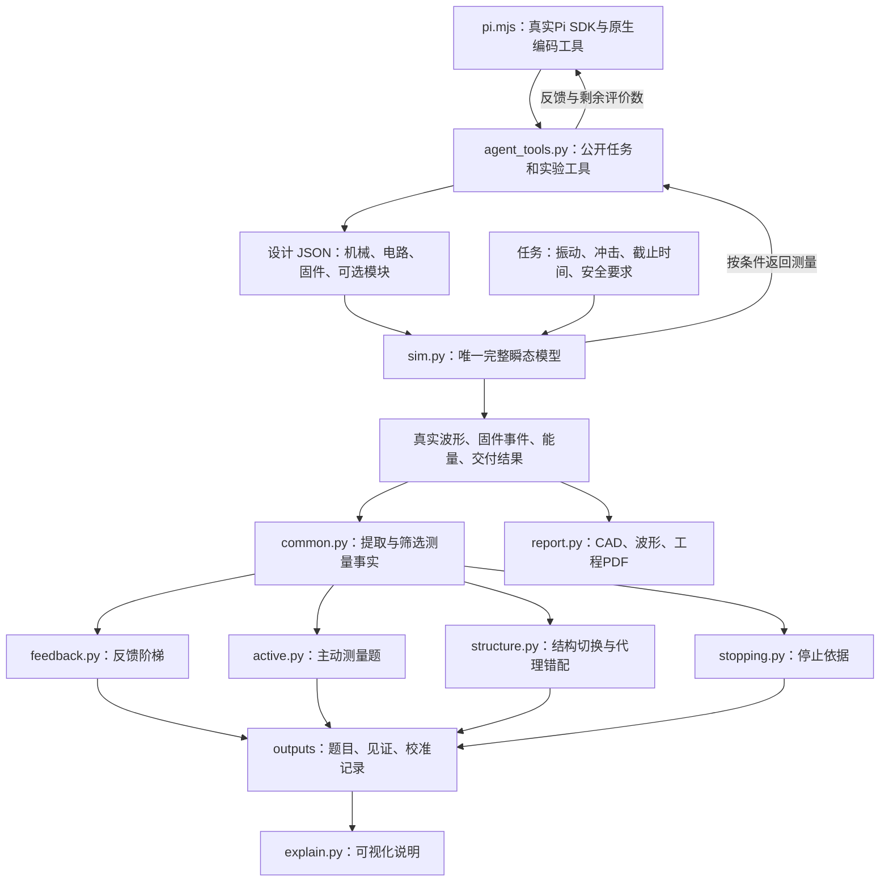
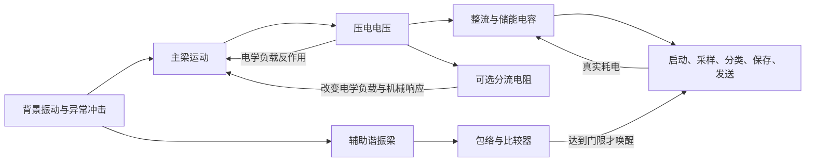

# 当前分支架构单

这份清单说明 `codex/formal-calibration-20261112` 现在实际运行什么、各文件为什么存在，以及本轮删掉了什么。

## 一眼看懂

**当前主线：真实Pi读取公开任务 → 修改设计 → 调用同一个物理内核 → 读取对应反馈 → 提交结果。**

四组题目已经完成物理校准，共164个实例；真实Pi已接入四组任务，新的 L/A/Pi 正式对比尚未启动。模型会话直接由Pi SDK运行，没有另写模型循环、数据库、哈希门禁或自动恢复平台。



这里的箭头表示数据关系。运行校准时，四个题目模块通过 `common.py` 调用同一个 `sim.py`，没有另外四套仿真器。

## 目录与文件清单

```text
README.md                        当前入口
ARCHITECTURE.md                   本清单
wakeup/
  sim.py                         唯一物理内核
  design.json                    基础双梁唤醒设计
  README.md                      节点入口
  formal/
    pi.mjs                       真实Pi入口，原生读写/编辑/Bash
    agent_tools.py               四实验共用的JSONL工具宿主
    package.json                 Pi SDK固定版本依赖
    calibrate.py                 选择运行哪一组本地校准
    common.py                    共同测量与反馈投影
    feedback.py                  E1：20题
    active.py                    E2：32对、64半题
    structure.py                 E3：32题
    stopping.py                  E4：48题
    report.py                    工程文档出口
    explain.py                   可视化说明出口
    case2.json                   冲击分流设计及任务
    experiment_plan.json         四实验的设置与判定标准
    requirements.txt             运行依赖
    outputs/                     已有校准数据、图纸和报告
```

### 每个源码文件只负责什么

| 文件 | 输入 | 输出 | 保留理由 |
|---|---|---|---|
| `pi.mjs` | 公开任务、模型/供应商、评价与费用参数 | Pi原生会话与最终结果 | 复用真实SDK，不重写Agent |
| `agent_tools.py` | Pi工具请求与当前实验条件 | 任务、评价、诊断、分支界、最终提交 | 仅连接现有任务与物理函数 |
| `sim.py` | 设计、环境、数值步长 | 30秒波形、事件、交付与安全结果 | 所有题目共用同一物理事实来源 |
| `common.py` | 完整仿真结果 | 电压、相位、事件窗口、F0–F3反馈 | 四实验共享测量口径，不重复写提取逻辑 |
| `feedback.py` | 固定种子、基础设计、Case 2设计 | 20道初态失败且同域有解的题 | 单独改变反馈粒度，保持物理题相同 |
| `active.py` | 成对任务参数、共同参考见证 | 同症状但修正方向相反的32对题 | 检查测量是否能区分下一步方向 |
| `structure.py` | 代理目标、合法域、结构参考输入 | 局部可解、结构需要、代理错配三类题 | 把“调参数”和“换结构”分开检验 |
| `stopping.py` | 指定平台、参数域、历史点 | 窄窗解、当前分支排除、全分支排除 | 停止判断需要覆盖指定域，不能只看几个失败点 |
| `calibrate.py` | `e1/e2/e3/e4/all` | 调用对应模块并刷新可视化说明 | 只有一个小命令入口，无运行框架 |
| `explain.py` | 已保存的总表、设置、数据路径 | `Architecture.html` | 让人查看题目和推导，不能修改物理结果 |
| `report.py` | 设计、任务、已有波形与演化记录 | STEP、工程图、波形、15页PDF | 把同一批事实变成人能读的工程交付 |

## 物理模型到底算了什么

### 机械、电路与程序如何相互影响



- **主梁**负责采能。梁长、宽度、厚度和末端质量共同决定谐振频率、应力、位移和压电电压。
- **辅助梁**负责触发。目标冲击激起它的电压，经包络电路超过门限后才能唤醒MCU。装了辅助梁不代表一定触发成功。
- **整流与电容**决定什么时候充够电，以及采样、发射时会不会掉电。增大电容既可能延长供电，也可能拖慢启动。
- **分流电阻**改变压电片外部负载，从而反过来影响梁的运动。不是在结果里直接扣掉一半应力。
- **固件**逐阶段消耗能量；采样后的ADC量化、FFT频带比例和RMS判据实际执行。分类拒绝、误报、掉电、超时都会影响交付。

单梁运动与压电电路同时积分：

```text
m × 位移加速度 + c × 速度 + k × 位移 − θ × 压电电压 = 外部振动作用力
Cp × 电压变化率 = −θ × 梁速度 − 外部取电电流
```

直接整流支路随储能电压改变取电电流；转换器支路有65%的功率转换效率。两者都计入模块功耗，不能把开路电压或稳态功率当成完整节点服务结果。

### 设计对象各块的含义

| JSON块 | 主要字段 | 实际改变 |
|---|---|---|
| `harvester` | 梁长、宽度、基底与压电层厚度、末端质量、阻尼 | 采能与结构响应 |
| `trigger_beam` | 同上 | 目标频段触发响应 |
| `circuit` | 电容、整流支路电阻、整流压降、启动/掉电门限、包络RC、分流参数 | 充电、触发、耗电与保护 |
| `firmware` | 采样率/点数、阶段时长与功率、分类阈值、轮询设置 | 什么时候采样、怎样判异常、怎样完成交付 |
| `modules` / `connections` | 可选模块与接线 | 是否启用辅助梁、有源前端、存储开销、分流；信号从哪里接入 |

A/B/C/D模块各自增加0.5/180/2/0.5微瓦静态开销。模块有代价，但不是因为开放了一个可调变量就收费。任务里的合法范围直接写在每道题的 `domain` 中。

### 服务结果怎么判

默认任务持续30秒，有4次目标事件和2次干扰事件；每个目标须在0.25秒内交付。采样为128点、2048Hz，即62.5毫秒。

最终检查按时交付4/4、误报0、掉电0、峰值应力不超过40MPa、梁尖位移不超过1.5mm。能量账另外报告输入、损耗、MCU消耗和储能变化，不拿一个固定残差数字伪装成所有设计的结果。

应力与位移峰值取求解器实际接受的内部节点；导出的1毫秒波形用于看图，不用于漏掉尖峰的安全判断。

## 四项实验的当前设置

| 实验 | 已校验题量 | 改什么 | 不改什么 | 校验依据 |
|---|---:|---|---|---|
| E1 反馈阶梯 | 20 | 给模型看F0/F1/F2/F3哪些测量 | 同一物理输入、可调域和完整服务 | 初态0/4、同域4/4见证、反馈逐级包含 |
| E2 主动测量 | 32对＝64半题 | 电容或质量的隐藏条件及诊断信息 | 每对公开初态反馈和单轴可调域 | 本方向见证通过、交换失败、数值通过区间不相交 |
| E3 结构与代理 | 32 | 单梁/双梁结构、开路代理/受载分析 | 各题公开域和服务要求 | 8局部控制、8结构题、16代理错配题的反事实 |
| E4 停止依据 | 48 | 历史点、当前分支界、全部分支界 | 各题制造平台、参数范围和服务 | 16窄窗有解、16需换分支、16全分支排除且有3/4历史 |

**E1的四档反馈：**

1. F0：按时交付数、误报数、安全是否合规。
2. F1：再加WAKE、CONFIRM、REJECT、BROWNOUT四个计数。
3. F2：再加首事件前储能电压、主/辅梁和包络峰值、首次就绪时刻。
4. F3：再加实际受载相位和逐事件电压/程序窗口。

**E3不是把“结构必需”写进答案。** 8道结构题有开模块通过见证，并对关模块的公开混合参数域做数值反例搜索；保存的结果是没有找到全服务反例。它与E4覆盖指定域的解析排除界是两种不同依据。旧“必须分流”的设想曾被无分流通过设计推翻，这份反例仍保留在 `e3_noD_load_bypass.jsonl`。

**E2的其他变量固定是题目定义的一部分。** 目前证明的是电容轴/质量轴的方向歧义，不把它说成全部14变量域的无公共解。

### 从哪里查原始设置与结果

| 内容 | 当前唯一主要入口 |
|---|---|
| 四实验总设置 | [experiment_plan.json](wakeup/formal/experiment_plan.json) |
| 总验收表与说明 | [CALIBRATION.md](wakeup/formal/outputs/CALIBRATION.md) |
| E1完整题目 | [e1_formal_tasks.json](wakeup/formal/outputs/e1_formal_tasks.json) |
| E2成对题目 | [e2_tasks.json](wakeup/formal/outputs/e2_tasks.json) |
| E3题目与校准结果 | [e3_summary.json](wakeup/formal/outputs/e3_summary.json) |
| E4题目与校准结果 | [e4_summary.json](wakeup/formal/outputs/e4_summary.json) |
| 可视化物理与逐题索引 | [Architecture.html](wakeup/formal/outputs/Architecture.html) |
| 工程设计报告 | [Engineering_Design_Report.pdf](wakeup/formal/outputs/report/Engineering_Design_Report.pdf) |

`*_public_tasks.json`是未来模型可见的任务；完整任务JSON中含校准用隐藏参数和通过见证，两者不能混用。它们是不同数据用途，不是重复备份。

## 本轮实际删掉的冗余

精简阶段逐份审阅了9个物理/校准/文档源码文件，代码从1,790行减到1,704行，净减86行。物理内核317行未改。随后补上Pi入口和实验工具宿主两个文件；当前共11个源码文件、2,047行，详见 [implementation.json](wakeup/formal/outputs/implementation.json)。

| 位置 | 原来多余的东西 | 现在 |
|---|---|---|
| `common.py` | 对只读输入做两次深拷贝再转调仿真 | 直接引用同一仿真函数，104→99行 |
| `feedback.py` | 先各自产出中间任务文件，再读回来拼正式20题；多个旧入口 | 一次在内存构造20题，直接保存4个正式产物，166→129行 |
| `active.py` | 已完成的一次性历史文件改名逻辑、重复构造梁 | 直接读写当前文件，242→235行 |
| `structure.py` | 目标函数转接层、每轮重读整份历史日志、缺种子时悄悄用空列表 | 直接调用搜索函数，只读本轮新增记录，286→281行 |
| `stopping.py` | 先写临时冻结/进度文件，结束立即删除 | 直接用内存列表组装结果，233→229行 |
| `report.py` | 另写一套方块3D几何、自调用Python子进程、两份CAD准备逻辑、死变量 | 直接复用真实CAD，同进程执行，355→328行 |
| `explain.py` | 在HTML里再次复制大份任务JSON | 只展示验收总表并链接原数据，71→70行 |
| 原 `CONTRACT.md` | 已结束批次的旧预算/派工便条，重复且与完成后的累计数不符 | 移除；实验定义保留在 `experiment_plan.json` |

可视化HTML从1,856,396字节减到16,276字节，减少99.1%。工程PDF仍为15页，从1,030,963字节减到765,968字节；删掉不再使用的255,162字节方块CAD PNG。过时的HTML截图和PDF预览截图也移除，避免截图与实际页面不一致。

基础9个源码文件的行数：317＋99＋129＋235＋281＋229＋16＋70＋328＝1,704。Pi接入在其上增加两个小文件，模型执行仍使用外部SDK。

**修改后的核对：** 固定种子的题目、设计换算、参数域、能量界与E4的48题反馈投影前后一致；E1用已保存结果重放，20题验收状态一致。共同仿真入口用一个已有固定输入对照，完整波形和科学字段逐项相同，输入也未被改写。报告全程从保存的波形重建，两Case结果仍为PASS，未再求解物理。没有跑新Agent或重新扫题目矩阵。

没有为了减少行数合并四项不同实验，也没有把易读函数压成一行。保留题目生成代码、必要的参考输入，以及重建报告所需的原始波形。

### 哪些“检查”应当保留

- 求解器失败时明确报错：失败的积分不能成为设计结果。
- 二极管单向电流、启动/掉电门限和ADC截断：它们是物理和器件模型。
- 截止时间、误报、掉电、应力与位移判定：它们定义任务，不是外加审批。
- 判断题目是否真的有见证、两半题是否同反馈：它们是此次题目构造本身。
- 报告复用已有结果：避免仅因重排PDF而再跑一次30秒仿真。

当前代码中没有SHA256审核链、供应商账本、角色权限、审批门禁、断点续跑平台。本轮也没有增加这些东西。

## 当前仍有的历史材料与数据依赖

清理前整个Git分支有7,943份跟踪文件，但当前活动源码只有上述11份。大量文件来自旧实验、论文资料和历史结果；**文件多不等于现在运行了一个大框架**。

本轮不删除过去实验数据来美化文件数量。`battery-world/`、`docs/`、`integrations/`、`pi-bf-aiot/`、`release/`、`review/`等旧目录不在当前校准调用链。旧源码已在上一轮从此分支移除，仍可由历史提交恢复；当前保留的历史数据不参与控制决策。

有几份 `outputs` 文件确实参与当前重建，不能当临时文件清掉：E2共同参考见证、E3结构参考设计和搜索种子，以及E4已经校验的S1窄窗结果。它们是输入数据；读取已有结果并不等于重新独立校验。源码仍保留相应生成/搜索函数，具体依赖见各模块。`implementation.json`记录当前代码数；原`report_receipt.json`保留当时工程校准记录，不冒充本次重建的新科学实验。

若以后要把运行代码单独打包，所需内容就是 `wakeup/sim.py`、`wakeup/design.json` 和 `wakeup/formal/`；无需拷贝旧平台或整个历史仓库。

## 怎样使用

在仓库根目录执行：

```sh
# 只查看已有题目与说明；不做新物理仿真
python3 -B wakeup/formal/explain.py

# 需要重新构造/校准某组题目时才运行，e1可换为e2/e3/e4
PYTHONDONTWRITEBYTECODE=1 OPENBLAS_NUM_THREADS=1 python3 -B wakeup/formal/calibrate.py --experiment e1 --workers 4

# 使用已有工程输入重建报告；已有完全相同输入的波形会直接复用
python3 -B wakeup/formal/report.py wakeup/formal/outputs/report/input.json
```

物理计算只需NumPy和SciPy。可视化/报告另外用Matplotlib、CadQuery、ReportLab和svglib，具体版本在 `requirements.txt`。生成已有校准数据的说明页不需要另装框架。

## 真实Pi如何接入

只增加两个源码文件：`pi.mjs`启动真正的 `@earendil-works/pi-coding-agent@0.85.1`，`agent_tools.py`处理实验工具请求。Pi原生的read/write/edit/bash保留；每次Bash限30秒。物理与评价没有挪进JavaScript。

| 实验 | Pi条件参数 | 实际工具行为 |
|---|---|---|
| E1 | F0 / F1 / F2 / F3 | 同题同域，评价后仅返回该档反馈 |
| E2 | Blind / Active / Oracle | 两半题独立；Active可付0.2单位诊断，Oracle开场免费给，Blind无诊断工具 |
| E3 | baseline / diagnostic | 同开路代理；diagnostic另给真实受载相位、阶段和事件窗口；结构题先算实际面积 |
| E4 | L0 / L1 / L2 | 已有历史；L1仅当前分支界，L2全部声明分支界 |

共同工具：`task`、`evaluate`、`finish`；条件允许时再有`diagnose`、`bounds`。每个evaluate接收基于**原始初态**的平面字段修改，例如 `{"harvester.length_mm":30}`；不是自动接着上次候选累加。只能改公开域内的字段，评价数和诊断费用随结果返回。

E1的隐藏长度换算与E2的实际电容/质量换算仍由Python宿主处理，回复不包含隐藏因子、见证或真值标签。E4允许启用模块但初态未写参数的情况，用共同公开默认配置补齐：分流47kΩ/1V、转换器输入10kΩ；原设计已有数值不覆盖，原校准数据不回写。

`finish`分别保存模型判断和`verified_pass`。模型自称FEASIBLE不会被当成实际PASS；不可行判断也原样记录，留待按原题覆盖界评价。

Pi临时工作目录只放公开任务和名义梁公式，私有数据由宿主读取；退出时删除临时目录，输出只保留公开任务、原生会话和最终结果。这里是本机开发运行器，原生Bash/Read没有操作系统级文件隔离；正式盲测部署需让这些原生工具无法直接读取校准见证，临时目录本身不构成硬隔离。

### 安装与单题命令

```sh
npm install --prefix wakeup/formal
node wakeup/formal/pi.mjs --list

# 真SDK和原生工具检查，不请求模型
node wakeup/formal/pi.mjs --task E1-01 --condition F0 --check --out /tmp/pi-check

# 显式选择Pi已配置的provider/model后运行一题
node wakeup/formal/pi.mjs --task E1-01 --condition F3 \
  --provider PROVIDER --model MODEL --max-cost 1 --out runs/e1-f3
```

默认6次设计评价、12次模型回复、900秒。`--max-cost`是按SDK费用估算在回复之间停止，不是供应商账单或单请求预留。认证沿用Pi原生配置；已有SDK可设`PI_SDK=/path/to/index.js`复用，Python可用`PYTHON`选择。没有新增代理服务、费用数据库或恢复框架。

接入检查使用真实Pi会话和原生读写/编辑/Bash，并经JSONL执行已有设计；检查本身不调用模型，不计为Agent成绩。完整检查记录见 [pi_check.json](wakeup/formal/outputs/pi_check.json)。本次没有启动640条正式模型比较。
