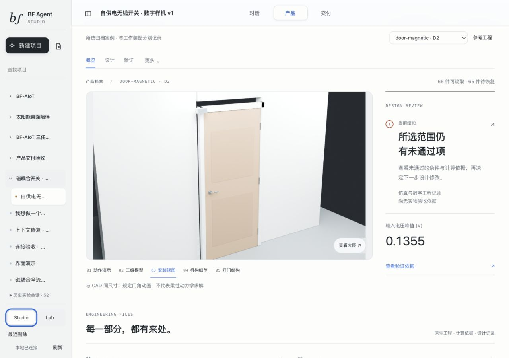

# BF-AIoT Agent

## 2026-10-20 五阶段研究与工程交付

当前 V2 实现、Power/Firmware 协作与联合执行、五阶段实验、两篇完整论文及工程接手资料已集中到本分支。

- [完整交付入口](deliveries/BF_FINAL_20261020/START-HERE.md) · [完整封存工程包下载](https://github.com/littleandbrother/agent/releases/tag/bf-five-phase-20261020)
- [8页工程简报](release/evidence/five-phase-20261020/brief.pdf) · [11页工程详报](release/evidence/five-phase-20261020/detailed.pdf)
- [方法与 RSI 论文](battery-world/papers/method-reexecution-20261019/final/main.pdf) · [BF 接口充分性论文](battery-world/papers/interface-sufficiency-20261019/final/interface-sufficiency.pdf)
- [五阶段结果与审查](docs/research/phase-plan-20261019/HOURLY-REVIEW.md) · [发布说明与复现命令](release/BF-FIVE-PHASE-20261020.md)

默认继续采用 H0，本批尚未确立稳定 RSI 收益。A/R 保留 NO_GO、暗区与 FIFO 失败结论；压电节点已完成数字验证和目标构建，实物测试尚未完成，12项 DFM 警告保留。原 P01 Demo、原会话、失败和费用历史保留。

下方为早期检查点的历史说明。

当前 BF-AIoT Agent 与设计工作台的源码快照（2026-10-10）。工作台围绕同一产品任务组织设计、工具执行、交付物和验证证据；Pi 负责 Agent 执行，Harness 与科学环境分别保留身份和版本。

## 2026-10-10 开发检查点

本次更新包含 Three.js 运行动画、工程工作区与产品/交付展示、版本化技能与严格加载、十篇 2025–2026 论文的独立 Pi 任务、原生工程适配器、功能验收、恢复与上下文管理，以及无累计费用/token/请求数上限策略。时间授权仍独立生效；模型凭据和原账本不随源码发布。

截至 2026-10-10 00:14 北京时间，十篇所选阶段交付的 588 条文件摘要一致，最新阶段回执 9/10 通过，68 项功能门为 21 PASS、39 NOT_CHECKED、7 UNEVALUABLE、1 FAIL。**完整数字产品验收为 0；物理验证未开展；Pi 方法改进尚未证明稳定迁移或 RSI。** 这些维度不能合并成一个完成率。

[本次发布说明](release/BF-AGENT-CHECKPOINT-20261010.md) · [十篇项目与系统能力评估](battery-world/docs/agentlab/CURRENT-ASSESSMENT-20261010.md) · [封存验收快照](release/evidence/checkpoint-20261010/literature/acceptance.json) · [发布检查](release/evidence/checkpoint-20261010/verification.json)

公开证据是去除机器路径的阶段/复查回执，保留原始文件与公开副本各自的 SHA-256。作者论文全文、完整模型请求、运行数据库、安装依赖和完整参与者工程目录不随这次源码检查点上传。原生完整工程包仍保存在原 Pi 运行目录；回执中的文件门 PASS 不表示这些工程包已经成为完整产品。

## 2026-10-08 开发检查点

本次更新补入 D5 自供能联合仿真与资格检查、六组证据及学术制图、原理图/PCB/BOM 成果展示、本地运行与审计恢复，以及真实 Pi 的立创工程操作、固件构建、责任清单和中断续接。详见 [本次修改与验证](release/SELFPOWER-PI-CHECKPOINT-20261008.md) 和 [Pi 全流程当前检查点](battery-world/docs/agentlab/PI-FULLFLOW-20261008.md)。

Pi 的一个候选已通过声明模型内的联合仿真检查并完成一次发送；目标固件也已构建、核对向量和执行主机回归。**完整自主产品交付尚未验收：新板最终原生 DRC、机械包络适配和便携固件工程包仍有未完成项，实物与制造未验证。** 本次提交是可追溯的开发进度，不是完成全部产品验收的声明。后文 D2 与早期先导数据作为历史基线保留。

## 目录

| 目录 | 内容 |
| --- | --- |
| `battery-world/apps/agent-studio/` | Studio（设计对话、产品成果、交付）与 Lab（控制台、全景）；流式对话、Trace、工具/Memory/Harness、架构地图、产品节点交付物 |
| `battery-world/packages/python/bfworld/src/bfworld/agentlab/` | 本地服务、会话与预算、Agent 调度、工程适配器、交付物绑定、参考案例与验证 |
| `battery-world/scripts/` | 可执行设计、构建、仿真、固件、校验和案例发布脚本 |
| `battery-world/configs/`、`contracts/`、`fixtures/` | 配置、契约和确定性测试输入（后两个目录也在 battery-world 内） |
| `battery-world/tests/`、`docs/`、`project/` | 测试、研究记录、当前工程状态（均在 battery-world 内） |
| `pi-bf-aiot/packages/bf-agent/` | 定制 Pi Agent 与 BF-AIoT 工具接入 |
| `pi-bf-aiot/packages/bf-harness/` | 求解程序、提示词和 Harness |
| `pi-bf-aiot/` 其余目录 | 固定版本的上游 Pi 源码及构建依赖锁定文件 |
| `integrations/` | 本机在用的立创社区 MCP 与三个 EDA 技能源码快照 |
| `release/` | 源码清单、来源、校验脚本和此次发布验证记录 |

产品页可按节点查看图片、仿真、原生工程、代码、报告和数据；交付状态与文件数量分开。原作者参考电路不会被计为当前设计的原理图或 PCB。

## 当前可查看的工程案例

[门磁耦合 D2 报告（36页）](cases/door-magnetic-D2/report/door-case.pdf) · [报告源码与编译说明](cases/door-magnetic-D2/README.md) · [原生工程附件](https://github.com/littleandbrother/agent/releases/tag/door-magnetic-d2-20260930)

D2 包含门动画、22件 CAD/图纸、COMSOL 场图、LTspice 电源仿真、PCB 布线和目标固件。**单次开门冷启动和磁网格验收未通过；原生 EDA ERC/DRC、实物与制造未验收。** 源码包含 BFA-026/027 的全会话成果目录、BFA-028 的不可变工程案例发布、BFA-029/032/033 Studio/Lab 与交付体验、BFA-030 受限全仿真链路和 BFA-031 任务级实验约束，不包含用户会话数据库。

2026-10-02 发布加入真实 Pi 先导、精确工具反馈记录、来源/单位计算检查和机械加载—释放审查，其验证范围见 [历史发布说明](release/MECHANICAL-RELEASE-20261002.md)；之前的 Studio 验证保留在 [上一轮记录](release/STUDIO-PILOT-VERIFICATION.md)。

BFA-031 已固定可修改设计变量、任务条件、候选配额和提交复核。早期无 Agent 空间摸底记录见 [原轻量研究记录](release/evidence/door-design-pilot-v1.zip)。随后四条真实 Pi 轨迹完成提交：12 个候选中 5 个可求解但未满足任务、7 个越界，尚无自供能正例。不能把二者合并为同一批试验，详见 [真实先导收尾](battery-world/docs/agentlab/PAID-PILOT-CLOSURE-20261002.md)。

新独立文献会话实际搜索并读取三篇参考，完成 50 次模型请求；人工选择的磁体翻转探针重建 STEP 并执行原生联合计算，PMIC 端口能量约从 3.99 增至 16.25 µJ，仍未启动。Pi 的错误位移推论已拒绝，未扩大模型域。见 [机械释放完整报告](battery-world/docs/agentlab/MECHANICAL-RELEASE-REVIEW-20261002.md) 与 [可下载的精简证据](release/evidence/mechanical-release-20261002/README.md)。

前版机械—电路—程序闭环的基线仍为**储能峰值约0.146 V、0次完整发送**；磁场两档网格差11.3%，仍高于5%门槛。[原闭环验证与边界](release/CLOSED-SIMULATION-VERIFICATION.md)。

## 本次上传范围

这是**源码与指定数字工程案例发布，不是本机工作区或实物产品交付备份**。包含当前源码、锁文件、文档、测试、必要浏览器依赖和小型基准数据。不包含密钥、认证令牌、会话数据库、参与者工作区、完整私有运行轨迹、模型账单状态、已安装工具链；指定 D2 原生工程二进制仅作为版本绑定的 Release 附件提供。COMSOL、Blender、立创 EDA、编译器与各自许可需要单独安装；工具接入代码不等于这些软件或硬件已可用。

其余原机参考案例及 BFA-030 的 COMSOL/STEP/RAW/固件等原生产物仍保存在本地 `bf-agent-workbench`。新克隆没有这些本地资料时，产品页应显示缺失，不能把源代码存在解释为该交付项已验收。BFA-030 的可复算入口、版本化参数、Result 契约和测试包含在源码中，原生重算需另备软件、许可证和本地路径。

D2 已提供原理图及实际布线，但原生立创验收及可制造图纸仍未完成；仿真结果不代表实测、制造或烧录验收；源码上传也不构成自主 Agent 或 Harness RSI 有效性的科学结论。工程状态见 [产品交付物说明](battery-world/docs/agentlab/PRODUCT-DELIVERABLES.md) 与 [原生仿真说明](battery-world/docs/agentlab/PLUCK-NATIVE-SIMULATION.md)。

## 构建与本机启动

当前执行隔离依赖 **macOS `sandbox-exec`**，尚未完成通用跨平台安装。需要 Python **3.11**、Node **22.19+** 和 Corepack/pnpm **11.7.0**。上游可选 Gondolin 扩展示例要求 Node 23.6+；当前 BF Agent 构建在 Node 22.22.0 验证。

```bash
git clone https://github.com/littleandbrother/agent.git
cd agent
python3 release/verify_source.py --manifest release/source-manifest-20261010.json

cd pi-bf-aiot
npm ci --ignore-scripts --no-audit --no-fund
npm run bf:build

cd ../battery-world
export BF_PI_ROOT="$(cd ../pi-bf-aiot && pwd)"
BFWORLD_BOOTSTRAP_PYTHON="$(command -v python3.11)" ./bootstrap.sh
./init.sh
```

`--ignore-scripts` 避免上游仓库级 hook 安装；可选原生后端可能仍需对应平台的独立构建。这里的 Pi 构建使用随源码保存的模型目录数据，不执行在线模型生成步骤。

**运行路径已集中配置**：当前应用通过环境变量绑定源码、数据和工具链；不需要修改 launcher.py 或 provider.py。先配置相邻 Pi 与独立运行数据：

```bash
export BF_PI_ROOT="$(cd ../pi-bf-aiot && pwd)"
export BF_HOME="$HOME/.local/share/bf-agent-runtime/workbench"
# 按本机实际安装位置设置 BF_CAD_PYTHON / BF_BLENDER / BF_COMSOL /
# BF_NGSPICE / BF_ARM_GCC / BF_CMSIS；BF_NODE 可覆盖 Node 路径。
# BF_PROVIDER_KEY_FILE 只指定受保护的本地文件，不将密钥写入仓库。
PYTHONPATH=packages/python/bfworld/src .venv/bin/python \
  -m bfworld.agentlab.server --port 8768
```

使用新 state 目录生成的 `launch-url.txt` 打开本机认证入口，不提交它或 `operator.token`。模型调用仍需要本地凭据和有效费用/时间额度。发布检查没有新增付费调用；已完成的真实实验及其费用在报告中单独记录。部分历史案例脚本和专有软件依赖仍需单独配置；当前作者工程沙箱仅验证 macOS，不等于全平台安装器。macOS 云盘目录中的源码及工具链应保持本地下载；云端占位依赖可能阻塞编译或沙箱导入，全景会将不可读取的历史文件明确标为暂不可用。

本轮新增：稳定的项目导航与搜索、按版本/来源组织的产品成果、结果概要/技术报告/工程资料包三类交付、报告依赖与缺失文件检查。界面统一排版、留白、材质、短动效和键盘/手机交互；产品结论与文件数量保持分别记录。详见 [Studio 使用与交付](battery-world/docs/agentlab/STUDIO-PRODUCT-EXPERIENCE.md)、[八项设计自检](battery-world/docs/agentlab/STUDIO-CRAFT-REVIEW.md)、[受限设计先导](battery-world/docs/agentlab/AGENT-DESIGN-PILOT.md)。



既有全仿真入口继续把参数化 CAD、COMSOL 梁参数、有限磁力表、LTspice 原厂 PMIC、共享 C 程序和虚拟接收器连接起来。详见 [全仿真链路](battery-world/docs/agentlab/CLOSED-SIMULATION.md) 和 [产品执行链](battery-world/docs/agentlab/PRODUCT-EXECUTION-AUTHORITY.md)。阶段完成、局部计算通过、完整工程验收和实物验证分别记录。

立创适配器默认从 `~/.codex/tools/bf-jlceda/easyeda-pro-mcp` 和 `~/.codex/skills/{easyeda-api,easyeda-schematic-net-fanout,easyeda-pcb-routing}` 读取组件。`integrations/` 保存这些目录当前实际安装的源码；迁移时可配置适配器路径，或在确认目标目录未被其他项目使用后安装到这些位置。官方 API Skill 的本机版本没有全部上游格式指南，发布清单忠实保留已安装内容。它仍需要立创原生应用、API Gateway 插件和正确的工程绑定，不能只靠复制文件宣称电路环境可用。来源与验收边界见 [JLCEDA-INTEGRATION.md](battery-world/docs/agentlab/JLCEDA-INTEGRATION.md)。

`battery-world/README.md` 中的 8766 是较早的科学 World Studio；当前 Studio/Lab Agent 工作台是上述 8768 服务。两者不是同一个前端。

## 校验与来源

`release/source-manifest.json`、`release/integration-source-manifest-20261002.json` 和 `release/source-manifest-20261008.json` 保留历史发布基线；当前文件由 `release/source-manifest-20261010.json` 记录 SHA-256。使用上面的 `--manifest` 命令验证当前版本；旧清单不会因本次更新被重写。源码校验不是运行或物理验收。

Pi 来源：<https://github.com/earendil-works/pi>，基线 `7140838fdd5ee1ff21dbe50955a8801617b065ef`，包含本项目的 `bf-agent`/`bf-harness` 定制。保留 [Pi MIT LICENSE](pi-bf-aiot/LICENSE)、[Three.js LICENSE](battery-world/apps/agent-studio/vendor/three/LICENSE) 及各上游文件原有声明。本仓库是源码快照，不继承或声称拥有上游完整 Git 历史。

本次验证范围见 [本次修改与验证](release/SELFPOWER-PI-CHECKPOINT-20261008.md)。前版界面验证见 [Studio 验证](release/STUDIO-PILOT-VERIFICATION.md)，前版闭环验证见 [全仿真验证](release/CLOSED-SIMULATION-VERIFICATION.md)，较早记录仍见 [原始验证](release/VERIFICATION.md)。
