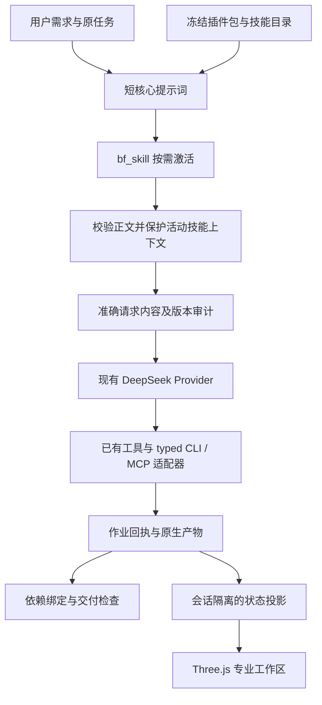

# BF Agent Design：提示词、技能、工具与运行动画的实际接入

日期：2026-10-08。应用基线：`96a84b7`，工作分支 `codex/integrate-dot-20261002`。

本轮完成产品运行架构与 Three.js 展示的实现、专项验证和本机部署。它没有完成磁耦合产品的最终工程验收，也没有增加硬件验证或证明 Pi 自主能力提升。以下分别记录软件实现、真实产品状态及外部介入。

## 1. 先核对事实，再确定改动

开发前核对旧主会话已停止，保留现有未提交修改；部署前再次只读核对所有会话、普通作业、工程作业和 EDA 作业没有 RUNNING/QUEUED/STARTING 项。没有重建参与者工作目录、修改原生工程、清空费用记录或恢复付费会话。

当前任务仍为 `pi-chat-8ae12ef0354d33bb`。数据库真实状态为 **PAUSED / CHAT_TURN_WALL_BUDGET**，早先的 HTTP 402 已不是最近一次暂停原因。服务重启和架构升级不会续期原任务授权，也不会自动重发消息。旧运行继续绑定旧 harness；下一次合法恢复会生成并绑定新版。

诊断确认了四处结构问题：

1. 技能入口分散，Pi 原生技能目录为空；工具参数写错可能收到另一份默认文档。
2. 核心提示词积累了专业命令和历史补丁，方法正文与任务事实混在一起，压缩上下文后无法保证方法仍存在。
3. 作业进程成功、原生检查通过、产品验收和物理验证容易被混称为完成。
4. 展示层缺少统一的真实状态投影；PCB 原生变更没有进入同版本交付的依赖绑定。

实施沿用现有 Pi、DeepSeek 代理、SQLite、作业恢复、预算和产品交付模块，在这些接缝上补全契约。

## 2. 各层现在分别负责什么

| 层 | 实际职责 | 本轮实现入口 |
| --- | --- | --- |
| 核心提示词 | 产品身份、恢复原则、合理假设、失败诊断、用户沟通、完成边界 | `pi-bf-aiot/packages/bf-harness/src/product.ts` |
| 技能资源 | 可复用专业方法、触发条件、输入、步骤、检查边界；按需激活与释放 | `bf-harness/resources/skills/`、`agentlab/skill_resources.py` |
| 插件包目录 | 声明版本、技能、适配器与工具依赖；形成可哈希的发布单元 | `bf-harness/resources/plugins.json` |
| 工具 / MCP / CLI 适配器 | 执行有结构的操作，返回执行事实、作业编号、来源与原生检查结果 | 原有 `bf_eda`、`bf_engineering`、`bf_reference`、`bf_product` |
| 可信运行时 | owner、任务与授权、冻结版本、预算、恢复、上下文投影、依赖失效和验收 | `launcher.py`、`provider.py`、`context.py`、`deliverables.py` |
| 显示层 | 将会话、工具与作业事实转成专业工作区动画；不发布验收结论 | `runtime_view.py`、`runtime-studio-model.js`、`runtime-studio.js` |



插件是方法与能力声明的发布单元。执行权限继续由后端控制，插件中的文字不会扩大文件、网络或原生工程权限。本轮实现的是项目自带插件包注册与冻结加载；没有启用任意远程插件安装、可执行 hook 或通用 MCP 服务自动发现。EasyEDA 使用当前 typed CLI 适配器；现有其他 MCP 连接沿用原有实现。目录中的能力声明不能充当外部软件可用性证明，执行前仍须使用对应工具的状态检查。

## 3. 技能与版本已经统一

新增或适配了 7 份产品方法：

| 技能 ID | 解决的问题 |
| --- | --- |
| `bf-task-recovery` | 恢复同一任务，核对最新数据库与实际产物，避免盲信过期 TASK/CHECKPOINT |
| `bf-reference-reuse` | 记录参考来源、适用条件、参数依据与本产品差异 |
| `easyeda-agent` | 原理图、器件身份、引脚网络、BOM、封装的 typed CLI 工作流 |
| `easyeda-pcb-routing` | 实际板框、布局、布线、保存回读后的原生 DRC |
| `bf-mcu-firmware` | 实际目标构建、独立中断定义、时序、错误路径和功耗边界 |
| `bf-coupled-mechanical` | 从实际 PCB 更新结构输入，检查装配和有适用范围的联合仿真 |
| `bf-product-delivery` | 跨专业一致性、同版本文件、检查失效、介入记录和统一交付 |

现有工程工具中的 14 份方法一并加入统一目录，总计 **21 项技能、4 个插件包**：`bf-product`、`bf-easyeda`、`bf-multiphysics`、`bf-engineering`。旧 `jlceda` 路由方法从新目录排除。每项记录稳定 ID、版本、插件、适配器、路径与内容 SHA-256。

EasyEDA 的 4 份必要 typed 参考文件、许可和逐文件来源记录已随项目固定。运行中的 Pi 读取冻结副本，不扫描不断变化的全局技能目录。原有工程方法在冻结时由唯一实现源生成副本，避免手工维护两份正文。

新的工具契约：

```json
{"action":"catalog"}
{"action":"activate","skill_id":"easyeda-pcb-routing"}
{"action":"resource","path":"vendor/easyeda-typed/references/pcb-routing.md","offset":0,"limit":120}
{"action":"deactivate","skill_id":"easyeda-pcb-routing"}
```

`bf_skill` 使用严格参数 schema。未知名称、错误字段、未冻结运行、不存在的资源、越界路径和被篡改的内容明确报错；不会回退到默认技能。兼容的 `bf_eda action=skill,path=...` 只做明确映射，返回实际 ID/版本/适配器/哈希。旧参考分页保留字符单位，新资源默认按行分页，并返回下一页位置。

Pi 的原生 ResourceLoader 现在返回真实技能目录。产品启动自动激活恢复技能；专业工作由 Pi 按目录激活对应方法。活动正文按 owner 和本次 manifest 隔离；变更 manifest 后旧激活记录不会冒充新版本。正文总量限制为 60 KB，完成某阶段后可释放对应方法。

## 4. 上下文压缩与“确实送入请求”

活动方法来自服务端校验后的冻结资源，进入受保护的系统方法消息，经过上下文压缩仍然保留。任意工具返回或参与者文件中自称“技能”的文字不能自行进入这个区域。

`request_evidence.py` 分别记录 manifest、技能版本、正文哈希、是否存在于投影请求、是否准确存在于最终待发送的请求内容。`present_in_wire` 只证明准备发送的请求包含该正文，不证明供应商收到、模型理解、因果使用或正确完成任务。

验证实际启动了 Pi 进程并使用隔离的桩模型：错误 `name` 字段被拒，正确 `skill_id` 激活成功，随后正常停止。没有借此调用生产 DeepSeek 或原生工程工具。冻结研究任务保留原有方法入口和限制，不借产品技能改变科学条件。

## 5. 原生检查与依赖失效

新增 `bf-native-outcome-v1`，独立保留：执行状态、明确原生检查状态、检查范围、违规计数、作业/工程绑定、工程整体是否通过与物理验证边界。退出码 0 且 DRC `passed:false` 会显示检查受阻。

历史 EDA 行内 stdout 被截断时，只读取服务端保存的完整回执，并核对 owner、作业 ID、大小限制与回执哈希。JSON 截断或证据不足返回 unavailable，不推测通过。

交付绑定新增原生输入版本：PCB 几何、PCB 电气、原理图电路。分类依据现行 typed 命令，并排除读取、帮助与 dry-run。未知编辑保守处理。

| 变更 | 直接失效范围 | 保留条件 |
| --- | --- | --- |
| PCB 板框或相关放置 | PCB 检查/制造、机械装配等使用几何的交付项 | 不因板框变化直接使供能 SPICE 或固件过期 |
| PCB 布线 | PCB 电气检查及相关制造/交付项 | 不因纯布线变化直接使机械几何过期 |
| 原理图编辑 | 电路、相关固件/联合检查与交付项 | 需要重新核对实际受影响接口 |
| 查询、报告/展示操作 | 不增加原生设计输入版本 | 不自动重算产品 |

专项回归发现旧依赖链会将 PCB 板框变化经 CAD 传播到磁学与供能，因此将“直接原生输入变化”与“真正的语义输入/产物变化”分别传播。后一种仍按原有依赖图保守失效。这里实现的是版本失效检测，不是完整的电气语义影响求解器，也不会自动派发仿真。

## 6. Three.js 已接入当前应用

采用用户更新后的 `workbench/agent-studio-3d` 已构建组件及高清资源，保留原始项目与移植包，新增逐文件来源哈希和第三方许可。所有运行资源从本机应用提供，无 CDN 依赖。

动画位于现有会话页，支持收起、放大与恢复对话布局。五个工作区表示同一个 Pi 的五类专业工作，没有宣称五个独立 Agent 正在运行。中央模型和屏幕内容明确标记为视觉示意。

状态来源为 `/api/runtime-view` 快照和现有会话事件：

- 快照在同一数据库事务读取 owner、状态、游标和作业；保留较早但仍在运行/未知的作业，以及最近的原生检查。
- 刷新时恢复本轮尚未结束的工具调用，不加载全部历史 Trace；事件按 owner、游标去重并接续快照。
- 实际工具/作业开始驱动专业工作区；`delivery_inspect` 开始/结束驱动讨论与返回；暂停、失败、连接中断分别显示。
- 原生检查失败保留在显示中，后续只读查询不会把它清成完成。
- 收起和隐藏页面暂停动画；遵循 reduced-motion；销毁时释放实例。
- 技能信息显示可用数量、活动版本和哈希。旧运行显示“下一次运行冻结并加载”，不伪称已使用新技能。

真实浏览器验收观察到：Pi 因时长预算暂停、PCB DRC 24/36/1 项错误、最新固件作业已执行。收起后刷新仍收起，展开及恢复对话正常；390 px 和当前 795 px 宽度均无横向溢出，控制台无错误。源组件有一条 Three.js 阴影类型弃用警告，不影响渲染。未实测 GPU 上下文丢失或系统级 reduced-motion 切换；实际讨论状态由隔离的事件测试验证，未为演示动画派发付费生产任务。

## 7. 验证、部署与重现

专项验证全部通过：**128 项 Python 回归**、Node 状态投影检查、`bf-agent` 与 `bf-harness` 两个 TypeScript 编译、7 份新技能格式检查。覆盖错误技能调用、版本篡改、路径与 owner 隔离、上下文压力、精确请求证据、DRC 假成功、事件重复与恢复、原生输入失效，以及原有预算/恢复/HTTP/交付行为。

重现命令（输出目录必须是新的）：

```sh
rtk proxy .venv/bin/python scripts/verify_runtime_architecture.py --output /absolute/new-verification-directory
```

最终专项结果：`~/.local/share/bf-agent-runtime/architecture-rollouts/20261008-200750/verification-final/report.json`。首次暴露板框依赖过度失效的失败日志保留在同目录上一级 `verification/`，修复后通过的结果另存。

`npm run check` 已执行：格式、固定依赖、运行依赖声明、导入、入口依赖图、shrinkwrap、安装锁检查通过；全仓 TypeScript 检查在通用包的 Fetch/Headers/Request/WebSocket 类型处失败。排除本轮 BF 两个包后仍复现 340 个错误。本轮两个目标包可编译、真实 Pi 桩模型流程通过，但不把这等同于 Pi 全仓检查通过。该类型环境问题仍需单独处理。完整应用及根仓库 `init.sh` 本轮未运行，不声明全仓库健康。

已同步实际运行位置 `~/.local/share/bf-agent-runtime/pi-bf-aiot`，复制前逐文件核对已知版本，保存旧文件与哈希收据；更新了本机 8768 服务。最新准备的 harness：

- 路径：`workbench/harnesses/PRODUCT-fb02c43e9f4b`
- identity：`fdcfed1b6c718621a48ec71cbd7c9c9decd0a63a4d83568b5bbe54b0a3e2a481`
- 技能资源 manifest：`adf55a95485cd059363bc25c2f900a2aec1c4ccaf7f168a9d47b47980b09313e`

这里只准备新版运行配置，没有替换暂停任务的历史绑定。部署及 HTTP/页面验收收据：`~/.local/share/bf-agent-runtime/architecture-rollouts/20261008-203121/`，包含 `install.json`、`prepared-harness.json`、`live-acceptance.json`、`runtime-view.json`、`assets-http.json` 和 `runtime-studio.jpg`。更新前后 model_requests 总数、charged 和 reserved 聚合值完全相同；本轮新增生产模型调用 0、原生仿真/EDA 作业 0。保留既有 UNKNOWN 用量，聚合 reserved 不是可用余额。

## 8. 产品接手点与三条独立结论

| 维度 | 当前事实 |
| --- | --- |
| 工程结果 | 名义联合仿真 `eng-28deaae4839d843d` 可复用；PCB `eda-c9ea821d5d400dbc94c9` 原生 DRC 未通过（24 Clearance、36 Connection、1 Netlist）；BOM/身份/接口、实际 80×30 mm 板与机械一致性、同版本统一交付仍待验收 |
| Pi 与 Codex 分工 | Pi 已完成既有设计、仿真、目标固件、便携包修复及原生布局/布线尝试；此前存在 Codex 布线执行器修复与独立复验。本轮提示词/技能/检查与动画架构由 Codex 修改，桩模型测试不计为 Pi 自主工程成果 |
| 物理验证 | 尚无本轮实物装配、烧录启动、中断实测、射频或真实功耗验证；数字通过不能提升为硬件通过 |

最新目标固件为 `eng-e0516772a5a40e54`，不是早期的 `eng-2a02583017cf031c`。已有 nRF52832 ELF/HEX/BIN、90 项主机检查、独立向量与便携包检查；当前架构验收没有重新构建该产品固件或完成物理验证。

下一项产品工作：在现有任务有效授权恢复后，先加载恢复和 PCB 技能，核对原生 DRC 的具体未连接项及净表/封装/BOM 对应，修复后保存并回读；再以实际板框更新机械并做同版本交付检查。只重验受变化影响的项目。没有电源拓扑、负载或相关模型输入变化时，不重复 `eng-28deaae4839d843d` 整机计算。

本轮没有提交或推送 Git。BFA-035 整体仍 in-progress；本架构子项的软件实现与专项验证完成。后续真实 Pi 收益验证应沿用固定技能 manifest，分别记录有效产物、错误调用、重复读取、时间与 Codex 必须介入的次数，再得出是否改善的结论。
