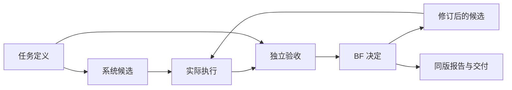

# BF 任务与设计标准定义 v1

2026-10-17 · `bf-design-task-definition-v2` · `bf-task-semantics-v1`

**这组定义已经进入 V2 的提交、执行、检查、恢复和交付入口。任务定义控制目标与范围，候选记录实际设计，执行结果支撑验收与下一次设计选择。**

完整机器定义：[定义目录](definitions/definition-catalogue.json) · [实际候选示例](definitions/task-definition-example.json) · [Pi 实际可见合同](definitions/model-visible-contract.json)。

## 1. 稳定核心的六个对象

| 对象 | 回答的问题 | 必须保存的内容 | 当前实现 |
|---|---|---|---|
| 任务定义 | 做什么、允许改什么、何时结束 | 意图、阶段、服务、场景、参数、设计范围、判据、报告范围 | `repository_profiles.definition()` |
| 系统候选 | 本轮实际执行哪个设计 | 父候选、完整文件树、任务定义、专业提交及接口 | 现有 `System Commit` |
| 接口 | 这个输出由谁消费 | 生产者、消费者、执行器、检查器、单位、初态、适用范围、影响的检查 | `compile_standard()` / `interface_consumers()` |
| 执行 | 哪组输入产生这些原始结果 | 输入摘要、模型与环境、操作身份、运行状态、原始产物 | `repository_task_execution` |
| 验收 | 在哪些要求下得到什么结论 | 执行引用、要求、检查器版本、分项结果、当前资格 | `repository_task_checks` / `repository_validation` |
| 决策与交付 | 保留、修订、拒绝，还是交付 | BF 决定及理由、采用记录、报告、同版工程包 | 现有 `decide` / `release` |



任务要求由用户确认后通过 operator 入口封存。BF 在设计范围内选择器件、参数、程序与实验。要求改变时产生新定义和子候选，旧定义、旧结论与费用留在原记录中。

## 2. 任务定义：一个项目可以连续经历多个任务

| 字段 | 含义与执行规则 |
|---|---|
| `profile` | 选择已注册的执行器、工程门与报告模板 |
| `intent` | `audit / reproduce / reconstruct / complete / optimize / new_design` |
| `phase` | 本阶段名称；阶段变化记录原因和父定义 |
| `goal` | 用户要完成的工作 |
| `service` | 接收端可观察结果、截止时间、最低结果数、启动方式；必须与当前执行器能力一致 |
| `scenario` | 输入工况、初态、电流模型、外部条件与检查阈值，按字段类型解释 |
| `parameters` | 参数值、单位、来源、角色、来源位置及实际绑定 |
| `design_space` | 可改字段及范围、可写文件；可以收窄当前适配器支持的范围 |
| `acceptance` | 必需工程门与条件；实际数值判据同时公开在 `acceptance_predicates` |
| `report` | 与任务范围匹配的章节及输出格式 |

意图和执行范围分别选择。例如，曲线审查消费曲线数据；节点设计消费结构参数和程序。PCB 审查入口目前开放读取、检查和报告。模型实际看到的 `qualified_operations` 只列出该入口已经实现的操作。

同一项目可依次进行“审查 → 重建 → 机理验证 → 产品设计”。切换时检查新阶段所需的输入是否齐全，并保留完整父文件树。旧专业工作区必须先重基，才能继续写入。

## 3. 参数来源与参数角色分开

| 维度 | 可用值 | 用途 |
|---|---|---|
| 来源 `source` | user、literature、measurement、agent、reference | 说明数值从哪里来；文献和测量需要 `locator` |
| 角色 `role` | constraint、design_choice、assumption | 分别表示固定约束、设计选择、待验证假设 |
| 绑定 `binding` | scenario、design、artifact | 指向实际场景字段、设计字段或工程文件 |

同一个“用户提供的梁长 50 mm”有两种合法表达：

```json
{
  "name": "length_m", "value": 0.05, "unit": "m",
  "source": "user", "role": "constraint",
  "binding": {"target": "design", "path": "length_m"}
}
```

如果用户给的是参考尺寸，将 `role` 改为 `design_choice`，并在 `design_space` 中声明可变范围。来源仍是 `user`。

当前程序会拒绝：无实际绑定的硬约束、单位冲突、固定变量同时被声明为可修改、超出范围的设计、固定文件摘要改变，以及未定义的输入字段。说明性假设可以保留描述；进入计算的数值必须在绑定对象中出现。

## 4. 功能、物理对象与工作分配

功能词汇采用 H 采能、P 电源、S 感知、C 计算、R 无线、G 接收，加 M 机械、B 板级实现。

| 关系 | 保存方式 | 例子 |
|---|---|---|
| 功能关系 | `functions[].components` | C 和 R 都引用 `soc` |
| 物理实现 | `components`，可附 `physical_instance` | 一个无线 MCU 对应一个 `U1` |
| 工作关系 | `assignments` 引用功能、组件与已注册角色 | 启动问题由相应工作任务处理 |

物理实例只登记一次；功能可以共享它。工作区写入权限单独检查。当前 P01 适配器支持 Power/Firmware 专业任务；名义压电参考由 Lead 直接修改设计和主机程序。后续新增专业必须同时接通对应执行路径。

## 5. 七组接口：记录实际消费者

| 接口 | 核心内容 | 当前名义压电参考链的消费路径 |
|---|---|---|
| 机械—换能 | 输入运动、边界、电端口、适用域 | `design.json + material → modal → source.cir → ngspice` |
| 换能—电源 | 端口特性、极性、负载域、初态 | `source.dat + conversion_efficiency → available_power → storage.cir` |
| 电源—程序 | 电源轨、启动、欠压、负载事件、电流来源 | `编译后的 events.csv + state_currents_a → load.json → storage.cir → 服务窗口检查` |
| 感知—数据 | 被测量、采样、标定、误差 | 注册定义；传感器与标定执行器待接入 |
| 板级—固件 | 器件、引脚、电压、总线、复位 | 注册定义；目标 MCU 与原生板级执行器待接入 |
| 无线—接收服务 | 帧、序号、接收端、截止时间、成功条件 | `sample/tx events.csv → 独立数字接收检查` |
| PCB—装配 | 轮廓、坐标、单位、孔位、高度、禁布区 | 注册定义；原生板与装配执行器待接入 |

每组已实现接口公开三个检查层次：`format`、`source_consistency`、`engineering_compatibility`。负载描述与程序一致后，供电检查仍直接使用实际求解结果。

负载的三种来源分开保存：程序确定调度；实际执行生成事件；器件模型或测量提供电流。本参考配置的电流是固定名义值，列在任务场景中。

当前联合执行语义已经固定：源计算 120 周期、每周期 160 个时间步，最后 20 周期求平均；储能最大步长 0.01 秒，事件边沿 1e-7 秒；事件按时间排序且互不重叠；从声明的初始储能开始。当前采用平均源功率与程序事件驱动负载，供电结果随后参与服务判定。自动启动和电压驱动的程序反馈是下一执行器增量。

## 6. 变化怎样传播

**执行身份 = 设计输入 + 执行场景 + 模型实现 + 工具环境。验收身份 = 执行结果 + 当前要求 + 判据 + 检查器版本。**

| 变化 | 执行处理 | 验收与交付处理 |
|---|---|---|
| 梁尺寸、材料、输入频率 | 重算受影响的源与下游结果 | 检查新候选 |
| 储能容量、真实程序调度 | 重算受影响的储能与服务；源输入相同则复用 | 检查新负载与服务 |
| 最低服务电压、最低帧数、采样/发送时长要求 | 复用原始事件和波形 | 按新要求重新评价 |
| 检查器实现或判据版本 | 保留原始结果 | 重新取得检查结果及参考资格 |
| 报告文字 | 复用执行与有效检查 | 生成新报告及同版审查包 |
| 任务从复现切换为新设计 | 核对新任务需要的输入；按实际输入变化执行 | 封存新任务定义和当前资格 |
| 专业任务仍引用旧定义 | 先处理重基 | 写入与提交入口返回基线冲突 |
| 操作结果未知 | 查询已有操作、对账 | 恢复前禁止重复派发 |
| 执行完成但登记中断 | 从完成回执补登记 | 继续检查 |

历史 v1 成功回执可按等价实际输入复用。历史 UNKNOWN 操作同样参与恢复检查，升级定义不会绕开它。

## 7. 每轮设计的固定出口

`task_state` 从现有候选、执行回执、检查、报告与交付记录计算状态，不新增另一套控制器。

| 状态 | 意义与下一类动作 |
|---|---|
| INPUT_BLOCKED | 输入不符合定义；修正任务输入 |
| READY_TO_EXECUTE | 输入完整；执行当前候选 |
| RECOVERY_REQUIRED | 先核对未知操作或补登记已完成结果 |
| READY_TO_VALIDATE | 原始结果已有；执行受影响检查 |
| EXECUTION_BLOCKED | 执行失败；根据回执处理执行问题 |
| EVALUATION_BLOCKED | 当前检查无法评价；处理缺失的评价条件 |
| DECISION_REQUIRED | BF 根据分项结果保留、修订、拒绝或采用 |
| READY_TO_DELIVER | 同版报告已生成；打包 |
| DELIVERED | 同版工程、执行、验收与报告已归档 |

任务是否通过由 `qualification.task_passed` 给出。交付允许包含失败候选；采用为通过版需要对应工程门全部通过。

BF 每轮需要回答五件事：当前工程问题、选择的修改、实际执行对象、结果支持的判断、下一次决定。报告章节来自任务配置，数值来自当前执行与检查；候选、任务定义、原始产物和报告进入同一份清单。

## 8. 本轮用哪些情况检验稳定性

| 情况 | 实际结果 |
|---|---|
| 用户尺寸为硬约束 / 参考值 | 固定尺寸禁止改动；参考尺寸在允许范围内可改 |
| 无绑定约束、错误单位、NaN、未知字段 | 提交被拒绝 |
| 同一芯片承担计算与无线 | 共享同一个物理对象；重复实例被拒绝 |
| 只读审查、未接通专业 | 不开放修改入口；后端拒绝越权动作 |
| 阶段变化、旧工作区、缺新阶段输入 | 记录原因，保留父树，要求重基或补输入 |
| 连续部分提交 | 前一提交的源码保留并进入后续执行 |
| 只改验收要求 | 原始执行复用，验收身份改变 |
| 真实输入变化 | 新执行身份；受影响结果重算 |
| 旧版本 UNKNOWN、完成后登记中断 | 不重复派发；已有完成结果可恢复登记 |
| 失败候选交付 | 保存真实失败、报告和同版包 |

**真实消费回放：**读取 Pi R7 的同一份波形，2.2 V 条件通过；提高到 3.2 V 后供电检查失败。来源一致性检查保持通过，工程兼容性检查变为失败。该回放检查了 59 个实际内容对象，执行记录始终为 9 条，新增模型调用和原生求解均为 0，失败候选完成报告与打包。

32 项标准化专项包含在 260 项 Repository 回归中，全部通过。Pi 工程检查通过；原 Web/Lab 的 19 项回归、7 项真实预览和 6,388 件 Baseline 文件核对通过。

证据：[实际消费回放](verification/standards-consumer-002/result.json) · [回归日志](verification/repository-standards-final.log) · [在线发布](verification/standards-publication-v1/result.json) · [Demo 核对](verification/live-lab-standards-002/result.json)。

## 9. 已运行的设计与当前版本

BF 在独立的常规压电参考任务中完成两轮设计。第一轮选择 47 µF；第二轮根据两帧突发探针选择 68 µF，正式调度保持 2/6/10/14 秒。第二轮标准发送窗口最低 3.1531 V，4 帧有效接收。两轮设计和报告更正共 53 次请求，本地登记 $1.1036。

采用版 R7 保留。其后追加了同工程的标准定义接入版 R8，原始执行和 Pi 报告文字复用，当前五项名义检查通过，审查包已生成。R8 由 Codex 通过 operator 入口完成定义迁移；设备设计由 Pi 完成。

本次更新的 `bf-task-design` Skill 和任务合同已部署，当前版本通过确定性消费测试。下一次 Pi 设计从这份合同恢复；方法效率比较在固定环境下另行进行。

完整结果：[RESULTS.md](RESULTS.md)。源码基点 `9bcdbad`；当前增量位于 V2 工作树，源码摘要见 [发布回执](verification/standards-publication-v1/result.json)。

## 10. 后续怎样演化

每项新能力采用同一条入口：**定义输入与适用域 → 接通真实消费者 → 建立独立检查和反例 → 固定参考通过 → BF 做一次真实修订 → 同版交付 → 从新候选继续第二次修订。**

下一批按依赖顺序接入目标 MCU、具体电源器件、原生 CAD/原理图/PCB 和装配。每批沿用这六个对象，增加对应适配器和检查；旧任务与原始结果保留。研究方法的变化固定为独立实验条件，避免与模型、环境、评价器同时变化。

结束条件也由任务决定：必要服务检查通过并交付后结束该阶段；失败候选根据实际结果进入设计修订；环境缺口生成有输入与回执的修复任务。通过、失败、受阻和交付都有明确记录。
