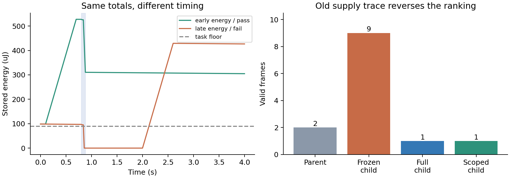
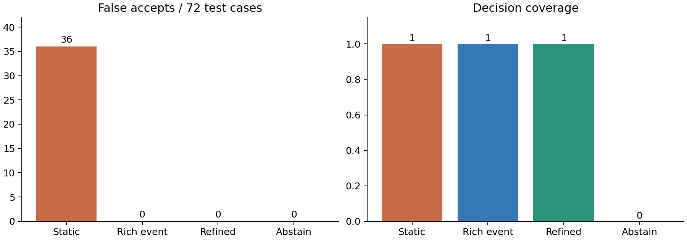

# 契约充分性与因果范围重放：先导实验

## 实验回答了什么

两个最小反例均已运行：相同静态接口可以对应相反服务结果；固定旧供电轨迹可以把更差的程序策略判成更好。加入事件、信息窗口和反馈后，本实验消除了这些错误。

最重要的负结果：反例驱动精化选择了全部三个预定义特征，结果与固定丰富事件契约完全相同。真实模型提案也收敛到同一固定配置。本轮没有得到超越强基线的算法收益，也没有得到改进器自身变强的证据。

## 冻结的对象与实验单位

| 项目 | 设置 |
| --- | --- |
| 环境 | 分段恒功率能量缓冲模型，供能-负载-信息窗口-接收判断 |
| 独立变量 | 接口暴露特征、重放范围、模型提出的方法配置 |
| 固定内容 | 每个实例的任务、初态、源条件、程序活动、评价规则 |
| 三种机制 | 能量到达时序；事件信息有效窗口；活动负载影响源响应 |
| 主要样本 | 30 个参数种子 × 3 种机制 × 2 个相反结果实例 = 180 个场景，90 对 |
| 分割 | 开发 72、验证 36、测试 72；成对实例不跨分割 |
| 重放样本 | 30 个场景；开发 12、验证 6、测试 12 |
| 模型 | 既有 V2 provider 的 deepseek-flash；身份及费用进入原账本 |
| 方法提案 | 3 条链，每条 2 代；temperature=0，非独立随机种子实验 |
| 输入特征成本 | prefix=1、information=2、feedback=3；基础成本 1，均为设定权重 |

参数种子改变幅值，机制族保持相同。一次运行或一对缩放实例不能算成一个全新的工程任务。

契约与重放表由确定性判断器计算；真实模型参与任务评估和方法配置提案。研究者已查看机制先导结果，模型没有读取测试标签；本轮属于开发先导，正式论文仍需冻结新机制测试集。

## 最小反例一：总量相同，先后不同

选取 energy_timing-00：初始储能 98.598 µJ、任务下限 89.634 µJ、输入功率 717.076 µW，供能持续 0.6 s。采样发生于 0.80 s，发送发生于 0.84 s。

- 情况 A：在 0.10-0.70 s 收集能量，随后执行任务，结果成功。
- 情况 B：在 2.00-2.60 s 才收集能量，任务发生得过早，结果失败。

两者的总能量、初态、名义电压、峰值电流、帧长度和任务能量完全相同。静态接口对两者给出相同判断。

相同接口信息对应相反二元结论时，仅消费该接口的确定性判断者至少判错一个；等概率二元对的最小错误率为 1/2。允许补充读取或实验时，需要把新信息纳入接口。本轮把这一经典不可区分性事实作为问题定义。

另外两个反例分别交换事件有效窗口，以及加入负载作用于源端的反馈。90/90 对实例均出现静态别名与相反结果。

## 论文一：结果与算法增量

精化器在开发对上按“区分未覆盖反例数 / 特征成本”贪心选择。候选特征由开发者预先实现：任务前缀能量余量、采样相对信息窗口的余量、活动期反馈损失。

| 方法，测试集 72 | 正确放行 | 正确拒绝 | 错误放行 | 错误拒绝 | 未判定 | 覆盖率 | 特征权重 |
| --- | --- | --- | --- | --- | --- | --- | --- |
| 静态总预算 | 36 | 0 | 36 | 0 | 0 | 100% | 1 |
| 丰富静态量 | 36 | 0 | 36 | 0 | 0 | 100% | 1 |
| 固定丰富事件契约 | 36 | 36 | 0 | 0 | 0 | 100% | 7 |
| 反例驱动精化 | 36 | 36 | 0 | 0 | 0 | 100% | 7 |
| 全部回答未知 | 0 | 0 | 0 | 0 | 72 | 0% | 1 |

“丰富静态量”使用相同静态字段与总量判据，是字段增广控制；“固定丰富事件契约”才是本轮的有效强基线。精化器最终选择全部特征，没有节约特征成本。

200 个后续压力场景改变源幅值、起止时刻、初态、容量、活动时间与反馈系数。静态方法错误放行 98 个；事件方法正确放行 84、正确拒绝 116。该压力集在先导结果后生成，用于检查代码与适用范围，单独记录。

保守性结果目前很弱：测试没有产生错误拒绝，所选机制又刻意突出静态误放行。下一阶段要加入“固定预算拒绝，但动态可调度”的可行方案，测量有效设计被排除的比例。

## 最小反例二：旧供电轨迹奖励更差的策略

父程序每 2 s 尝试一次服务；子程序每 0.4 s 尝试一次。源和初态不变，能量由实际活动持续消耗。

| 评价方式 | 父程序有效帧 | 子程序有效帧 | 对子程序的判断 |
| --- | --- | --- | --- |
| 完整响应环境 | 2 | 1 | 变差 |
| 把父供电轨迹固定给子程序 | 2 | 9 | 被误判为改善 |
| 重新执行受影响的反馈范围 | 2 | 1 | 与完整环境一致 |

30/30 个构造场景发生错误排序。无源反馈时复用独立源输入并重算电源、程序、接收；有源反馈时把源端也纳入执行范围。30 个范围重放均与完整计算一致。半数场景的工作计数由 4000 降到 2000，另半数保持 4000，合计减少 25%。这里统计的是模型运算单元，不是实际求解器时间。

## 论文二：真实方法提案结果

模型只能选择三个特征以及 frozen/power_only/causal/full 四种重放方式。它读取开发结果；验证集用于选择配置；选择后固定测试集评分。没有提供测试反馈来生成后代。

初次 2200 输出 token 限额下，6 次中 5 次把额度消耗在推理，最终答案为空。保存这些失败后，把上限改为 8192，其余条件不变，6/6 得到合法配置。

| 配置，固定测试集 | 契约判断正确 | 重放错误排序 | 工作计数 |
| --- | --- | --- | --- |
| 固定静态 + 旧轨迹 | 36/72 | 12/12 | 24000 |
| 固定丰富 + 全量执行 | 72/72 | 0/12 | 48000 |
| 固定丰富 + 因果范围 | 72/72 | 0/12 | 36000 |
| 模型选择的配置 | 72/72 | 0/12 | 36000 |

两条链两代选择不变；第三条链从 full 改为 causal。按验证排序选中的是第一条链的第一代配置。三个特征和合法重放边界已经由开发者写好，因此这里只验证方法配置选择。改进器代码、提示和特征生成能力没有发生递归演化。

本轮没有实施普通反思优化、GEPA、DGM 或 Pacti 的可比较实测；也没有实现未知边界的误差估计器。论文不能把本轮固定配置选择包装成对这些方法的超越。

## 校准、反例和重复执行

零能量控制失败、充足能量控制成功、错误信息窗口失败；相同策略重放相符；时间步从 2 ms 减到 1 ms 后判断不变。

六个代表场景另用 ngspice 积分相同能量状态方程，6/6 判断一致，最大终态偏差 0.829 µJ。它核对数值实现；器件级物理核对来自另外的 LTC3588-1 探测。

信息窗口对的电气输入相同，第一次校准执行时误重复了一次。现已按电气网表摘要缓存；更换信息判据直接复用同一波形，新增检查验证零派发。原 P01/P08 的已通过原生作业没有重跑。

## 当前科学结论与下一次最小实验

| 命题 | 本轮结果 | 下一步最有区分力的实验 |
| --- | --- | --- |
| 静态接口会隐藏服务成败差异 | 已有成对反例和原生数值校准 | 新器件/新反馈机制中的信息遗漏 |
| 反例精化优于固定丰富契约 | 本轮打平 | 高成本特征池，测最小观察成本与错误拒绝 |
| 固定旧轨迹会错误评价新策略 | 30 个构造场景均出现 | 在实际 PMIC + 电压驱动程序上复现 |
| 范围重放能节省完整计算 | 本模型减少 25% 工作计数 | 真实求解器耗时，范围扩展与边界误差检查 |
| 方法经历能产生可迁移改进 | 尚无跨新机制收益 | 固定反馈/验证/最终测试三集，未知机制迁移 |
| 改进器本身能递归提高 | 本轮未测试 | 固定起始求解器，让父/子改进器各自产生后代 |

当前研究入口应保留这两个反例，继续追问：怎样发现尚未实现的关键特征，以及怎样识别局部重放已经越过适用边界。下一阶段用真实设备模型回答这两个问题，比继续堆叠 Agent 数量更有价值。

## 相关工作定位

- Pacti：契约组合与不相容分析，https://www.pacti.org/ 。后续仅在兼容表达域内比较。
- GEPA：https://arxiv.org/abs/2507.19457 。后续加入普通反思优化和等预算比较。
- DGM：https://arxiv.org/abs/2505.22954 。区分配置选择、求解器改进和改进器改进。
- HarnessDev：https://arxiv.org/abs/2609.01437 。后续固定执行模型并检查迁移稳定性。

代码和完整数据：scripts/task_evaluation/、data/mechanisms/、data/mechanisms-controls/、data/method-pilot-v2/。可下载包包含逐场景轨迹。
