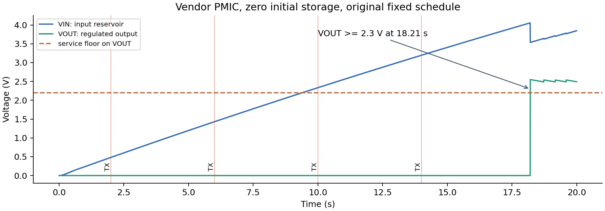
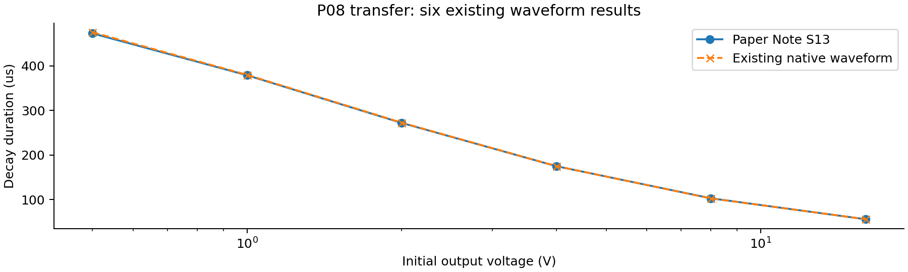

# 默认压电案例与 P08 迁移

## 默认参考设计

机械：压电悬臂梁长 50 mm、宽 10 mm，基底与压电层各 0.2 mm，端部质量 2 g。名义输入 30 Hz、加速度峰值 4.905 m/s²。模型一阶频率 31.087 Hz。

电源：Pi 选择 LTC3588-1。压电接器件内置桥的 PZ1/PZ2；输入储能在 VIN；10 µH 外部电感连接 SW 与 VOUT；D0 接 VIN2、D1 接地选 2.5 V 输出。VIN 启动典型阈值 4.04 V，范围 3.77-4.30 V；VIN 停止稳压范围 2.66-3.08 V。输入阈值与输出供电门限分别检查。

来源：ADI《Energy Harvester Produces Power from Local Environment》，https://www.analog.com/en/resources/technical-articles/energy-harvester-produces-power-from-local-environment.html ；LTC3588-1 Rev C，https://www.analog.com/media/en/technical-documentation/data-sheets/35881fc.pdf 。

程序：主机 C 编译产生 4 组采样/发送事件，采样 10 ms、发送 4 ms。电流包络暂用 1 mA / 8 mA / 8 µA；数字接收器核对序号、值和校验。该负载还需由实际 MCU、传感器和无线器件进一步落实。

| 项目 | 既有名义参考 | 本轮器件级探测 |
| --- | --- | --- |
| 源 | 压电机电模态，100 kΩ 负载 | 同一模态，厂商桥与 buck 直接加载 |
| 电源模型 | 固定 0.5 变换效率，单储能状态 | LTC3588-1 厂商模型，VIN/VOUT 双节点 |
| 储能初态 | 抽象节点 2.5 V | VIN=0、VOUT=0 |
| 储能电容 | 抽象 68 µF | 输入 150 µF、输出 68 µF |
| 活动计划 | 2/6/10/14 s 采样，11 ms 后发送 | 复用同一编译事件表 |
| 20 s 接收结果 | 4 个有效帧 | 0 个有效帧 |
| 决定 | 保留已有名义参考 | Pi 保留审查候选，修订冷启动调度 |

名义源功率 ngspice 305.514 µW，解析 304.295 µW，偏差 0.4003%。固定效率后平均可用 152.757 µW，负载平均 40.944 µW。这些平均值没有预测器件探测中的启动等待。

器件探测得到 293282 个原生采样点。VIN 峰值 4.0575 V；VOUT 峰值 2.5534 V；VOUT 到 2.3 V 的时间为 18.2096 s。四次任务都在启动之前，故全部失败。该对照同时改变了初态与模型，后续应逐项比较以归因。

Pi 的下一工程问题：零初态、20 s 条件下，按 PGOOD/电压启动任务能否完成至少 3 帧？当前执行器缺电压驱动的固件反馈入口。该入口接通后，再由 Pi 选择调度与电容方案。本次交付为名义参考及器件失败审查包；冷启动产品方案仍在进行。

Codex 介入记录：提供 ADI 原文参数，纠正外部电感、最坏返回门限和电压域混用；实现并运行器件探测。Pi 负责选型、说明修订、结果判断与 release。探测点的 150 µF 输入 / 68 µF 输出由 Codex 在已提议范围内选择，已记录，未计作 Pi 自主优化。

Pi 报告还保留一个需要语义校验的问题：历史 G2 段把 VIN 阈值与输出任务下限排列比较。实际独立判据分别检查节点，主报告不采用这项跨电压域差值。原始输出保留以供任务标准化测试。

## 从原十例选 P08

P08 选取一级降压模型六个初始输出电压的电流衰减复核。它和压电节点使用不同任务类型，适合检验系统能否按任务缩小工程范围。

原始来源 owner 为 pi-chat-e0028698d50802cb，作业 eng-19eb09030ae354a8。复用 55305 点原生波形；按 |电感电流| 最后超过 1 mA 的时刻提取，与论文补充 Note S13 第 27-28 页比较。

| 初始输出 V | 论文 µs | 原波形 µs | 偏差 % |
| --- | --- | --- | --- |
| 0.5 | 473 | 475.4902 | +0.5265 |
| 1 | 379 | 379.9524 | +0.2513 |
| 2 | 272 | 272.6873 | +0.2527 |
| 4 | 175 | 175.2596 | +0.1484 |
| 8 | 103 | 102.5669 | -0.4205 |
| 16 | 56 | 56.1420 | +0.2535 |

最大绝对偏差 0.5265%，低于本轮 1% 的复核条件。Pi 完成读取来源、表格检查、决定、报告和同版 release。新增原生仿真为 0。

此流程证明曲线复核任务的迁移；P08 原论文中的其他电路、通信和整机功能仍按原记录保存。复核使用独立 V2 owner，原 owner 保持原样。

## 交付身份

### 默认案例

- 当前候选：`SC-f922e8e8b0b9da6909a8268623bedfa5ecbb51a46b218fd8412fd984aef14f4d`
- 已采用：`SC-88d963b80011ebe47dc1f99a2ff88e7fbb65b0464587f118c57314a09734aeb6`
- Release：`REL-8992233d7155be2a518c3b214dd97d91c21ffe23b9f32d28e8719d2f1cfd710f`

### P08 复核

- 当前候选：`SC-7d474cd25fed8ac3056195d36458749facea261ed665ff3baf64310991b2737f`
- 已采用：`SC-7d474cd25fed8ac3056195d36458749facea261ed665ff3baf64310991b2737f`
- Release：`REL-ece97f4c4257b540434ab9fa6b54a82acf28fb06a3faa9e16ca8c9efe24528fd`

原始 RAW、提取数据、代码、任务定义和封存包均有 SHA-256。完整身份见 data/deliveries.json；原工程及费用保护结果见 data/preservation.json。
