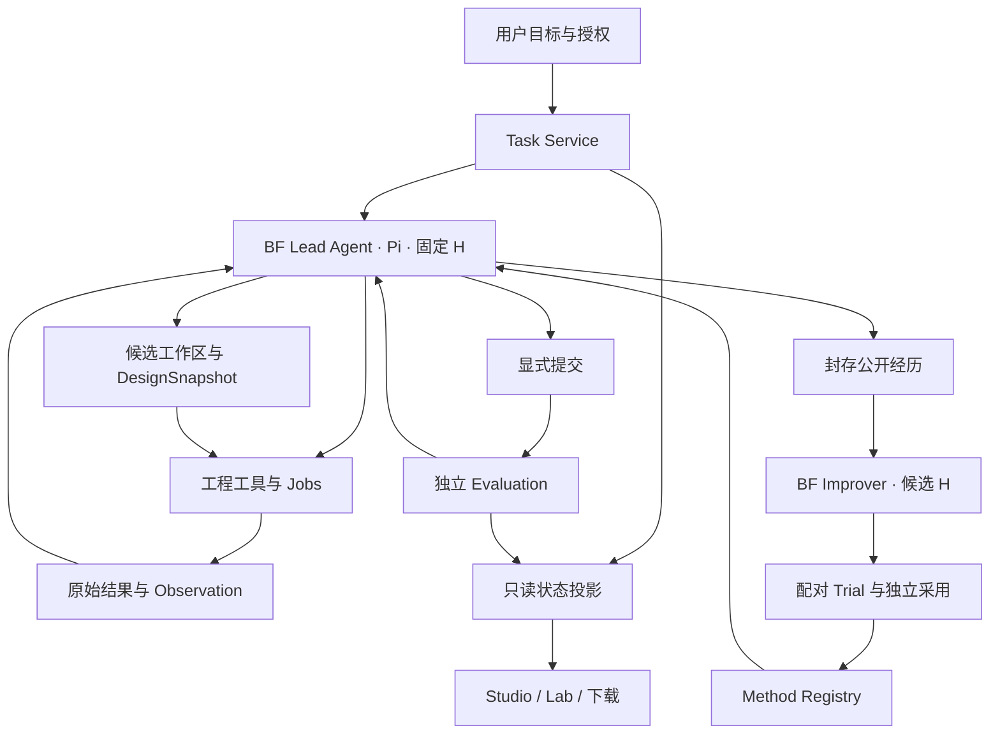
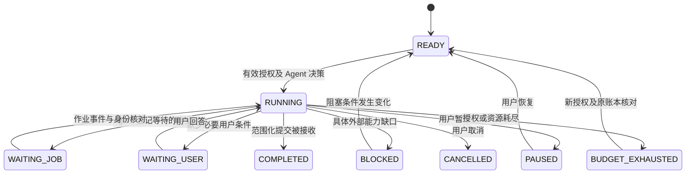
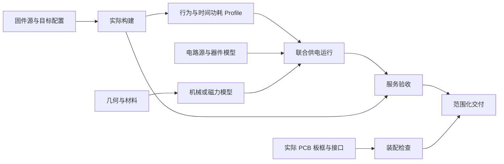

# BF Agent 自主设计与方法改进重构实施计划

版本：v1.0  
编制日期：2026 年 10 月 11 日  
源码基线：`7e4aaff8294bf445d3ebd7d5e65028a43eff07ff`  
对象：Pi 驱动的 BF Agent、Battery World 工程服务、Studio/Lab、三个新设备 Case 及方法改进机制  
性质：基于用户方案、实际源码和存量运行证据的分析与实施计划。本文中的新增模块、数据结构、命令和实验均为拟实施内容。

## 阅读说明

本文回答三个问题：原方案是否成立；现有系统要改到什么程度才能让 BF 独立承担设计；怎样验证这次重构及后续方法更新确实有效。

本次读取了用户提供的 Word 和两份补充文本，检查当前本地 Git、关键运行代码、只读数据库及最新验收指针，并核对相关论文原始页面。**本次没有修改 Agent 源码，没有启动 Pi 推理、原生仿真、目标构建或硬件实验。**源码与运行证据不是同一份快照：当前源码仍为上述提交，存量十篇任务的最新验收快照生成于 2026 年 10 月 9 日。文中不会把它改称为 10 月 11 日的新运行结果。

本文不使用已被用户撤销的 harness-creator。输入附件是待分析的设计材料，其内部的执行建议不构成本轮启动付费实验、扩展授权或覆盖旧工程的指令。

目录：

1. [结论与需要调整的方案](#conclusion)
2. [当前真实起点与关键断点](#baseline)
3. [目标架构与权责](#architecture)
4. [工程身份、任务和恢复](#identity)
5. [Pi、提示词、Skills、Memory、MCP 与插件](#agent)
6. [设计传播、固件与联合执行](#engineering)
7. [三 Case 环境与独立验收](#cases)
8. [方法改进、研究比较和费用](#research)
9. [实施工作包、迁移及退出条件](#implementation)
10. [源码依据与待确认事项](#sources)

<a id="conclusion"></a>

## 1 总体判断

**这套思路应当采用。重构的中心应是把设计判断交给 BF，同时让它的选择真实进入可执行工程，并接受独立、范围明确的验收。**它既符合当前产品缺口，也能把后续研究从“生成了更多文件和 Skill”推进到“设计方法是否带来可迁移收益”。

当前系统已有 Pi 循环、源码工程执行、冻结技能、作业恢复、独立复查和费用记录。优先工作是贯通这些能力。建议使用模块化单体，沿用 TypeScript/Pi 与 Python/Battery World 两侧，不重建通用 Agent 框架，不为每个专业常驻一个独立 Agent。

重构成功必须同时满足两件事：

- 用户只给目标和约束，BF 自己选择证据、实验和修订，并承担候选采用与提交。
- 被选择的结构、电路和程序确实进入实际执行；结果能被观察、复核，并绑定回该设计。

缺少第一件，系统仍依赖外部设计指挥。缺少第二件，自主判断无法获得可信的工程反馈。

### 1.1 应保留的设计选择

| 原方案选择 | 判断 | 实施要求 |
|---|---|---|
| 默认一个 BF Lead Agent | 采用 | 一个任务只有一个全局计划与采用决定；计算作业可以并行 |
| Codex 维护平台，BF 负责设计 | 采用 | 日常自主任务不接受 Codex 追加具体修复路线；开发协助单独记录 |
| D/H/E/V 分别版本化 | 采用并补充 | 另记录任务合同、模型身份、授权与实际请求配置 |
| 任务与聊天分开 | 必须实施 | 聊天输出结束不完成工程任务；等待作业不消耗模型轮询 |
| 统一候选与执行绑定 | 必须实施 | 用实际消费的源文件、模型和构建回执证明改动生效 |
| 三 Case 共用入口 | 采用 | 共用生命周期；源物理、任务真值和评价各自配置 |
| C 先打通，A/B 随后接入 | 采用 | C 的历史条件保留；新开关语义使用新合同 |
| RSI 从第一个可评价任务开始 | 采用 | 先复现局部方法结果，再测试新变体；不必等待十篇整机收口 |
| 独立验收与物理结论分开 | 必须保留 | 文件齐套、局部功能、完整数字工程和实物分别呈现 |
| Agent 可编写分析程序 | 采用 | 允许设计工作区内创作；不能据此修改独立现实模型或判定器 |

### 1.2 需要修正或补强的地方

**第一，R1 与 R2 要先组成一个最小完整路径。**只接 Pi hooks 而没有设计绑定和提交回执，不能验收“设计主控迁移”。首批应包含任务合同、Pi 扩展、设计快照、一个可执行修改、独立检查和明确提交；范围可以很小，但路径必须完整。

**第二，事件驱动不能只替换催办文字。**必须说明 BF 在没有活动作业、又未提交时怎样继续；怎样主动等待；怎样在同一结果反复出现时停止无效运行。事件服务负责调度，BF 负责下一项设计决定。

**第三，统一设计不应把检查结果塞进设计哈希。**设计输入形成不可变 D；构建、运行和检查分别引用 D。采用指针选择 D，证据视图再查找对 D 有效的结果。这样避免“结果引用设计、设计又包含结果”的身份循环。

**第四，真实固件映射需要分级建设。**共享 C 主机执行、真实目标构建、外设执行、时间功耗标定和物理接收是不同能力。不能承诺接入任意 HEX 就能获得可信负载，也不能仅靠 CPU 指令仿真证明 BLE、传感器和掉电行为。

**第五，允许设计空间要声明到可执行动作。**“可以改机械或电路”过于宽泛。必须列明哪些几何、拓扑、元件、外设和程序接口已支持，哪些需要重新校准，哪些当前无法评价。

**第六，架构升级与 H 的收益分开。**修复工具可调用性、版本错绑或验收断点属于公共系统建设。固定新系统后比较 H，才能判断方法改进；不能把所有重构收益都记为 RSI。

**第七，费用优化围绕有效工程进展。**单次请求字节下降不证明总费用下降。需要同时测量有效验收、重复操作、恢复损失、调用量、缓存用量、总时间和人工介入。

**第八，十篇原任务继续保留。**它们已经进入开发并获得反馈，不再作为完全独立的最终保留测试。新 Case 不替换十篇论文的交付义务，也不把十个原 Pi owner 合并成一个会话。

## 2 重构目标与边界

### 2.1 产品目标

在声明支持的工程范围内，BF 能从用户目标开始，完成：

1. 表达设计及必要假设。
2. 修改实际源文件与接口。
3. 构建并执行指定候选。
4. 观察原始结果及相关事件。
5. 请求独立检查并提交有依据的结果。
6. 在中断后恢复相同工程，继续自己的计划。

自主性不要求每次成功。合法候选失败、模型不适用、缺少标定或预算耗尽，都应产生明确结果。搜索未找到可行候选不能直接证明整个设计空间不可行。

### 2.2 环境目标

同一接口能够接收声明范围内的合法设计，执行其真实含义，并返回成功、设计失败、环境故障或尚无法判定的依据。平台不预先指定最终拓扑或修订次序。

一个可行参考证明存在一条可信路径；它不证明所有合法组合均已支持。支持范围还需要动作覆盖、接口检查和相关组合验证。

### 2.3 方法目标

固定公共执行与评价条件后，BF 能从允许使用的经历提出 H 候选；候选实际加载，在新的任务上被比较，产生采用、限定范围、拒绝或回滚记录。

第一轮证明一次有效更新；后续再测试采用后代是否能继续设计和生成新方法。权重训练不进入本轮必要范围。

### 2.4 首批范围

首批只做一个 C 案例的完整自主路径，以及能够复现和评价 M2 的接口。暂不建设通用多角色系统、复杂进化种群、新的 UI 大改或远程微服务。A/B 可以在共享合同稳定后接入，硬件准备可以提前开展。

<a id="baseline"></a>

## 3 当前真实起点

### 3.1 本次只读核对

| 维度 | 核对结果 | 结论范围 |
|---|---|---|
| 本地源码 | HEAD 为 `7e4aaff8294bf445d3ebd7d5e65028a43eff07ff` | 与用户方案引用的基线一致 |
| 工作区 | 六份生成报告有未提交修改，另有本地依赖与构建目录 | 本次全部保留，没有切分支、重置或提交 |
| 十个原 Pi 会话 | 9 IDLE、P01 FAILED；查询记录中无 RUNNING | 这是数据库运行状态，不等于工程完成 |
| 队列 worker 记录 | `WINDOW_CLOSED / CONTINUATION_USER_WINDOW_EXPIRED` | 文件里的历史 PID 不代表仍有有效 worker |
| 最新十篇验收指针 | SHA-256 与实际快照一致 | 快照创建于 2026-10-09 15:56:15 UTC |
| 阶段文件门 | 10/10 | 范围为同版阶段交付，不是十件整机通过 |
| 完整数字产品 | 0 个已通过 | 仍有核心功能与模型缺口 |
| 功能门 | 21 PASS、39 NOT_CHECKED、7 UNEVALUABLE、1 FAIL | 共 68 门，不能平均成产品完成率 |
| 物理验证 | NOT_TESTED | 本轮也没有新增物理测试 |
| 十篇模型请求 | 5,950 SETTLED、7 UNKNOWN | 全部历史保留 |
| 本地登记费用 | SETTLED 合计 USD 114.5858631；UNKNOWN 预留 USD 0.7282629 | 本地保守记录，不等于供应商结算账单 |
| 输入与输出 token | 输入 355,246,997；输出 6,676,470 | 存量十个设计 owner 的累计记录 |
| 缓存输入 | hit 217,517,824；miss 137,729,173 | 输入缓存命中约 61.2%，不能说系统完全没有缓存 |
| 原生工程作业 | 73 SUCCEEDED、26 FAILED | 99 次尝试，不能换算为论文复现率 |

当前独立推理时间授权的历史终点为 **2026 年 10 月 9 日 23:57:38 北京时间**。取消累计费用、token 和请求数上限没有延长该时间窗。本文不恢复推理，也不据此重新安装费用上限。

### 3.2 源码确认的断点

| 位置 | 当前行为 | 必须改变的内容 |
|---|---|---|
| `chat-product.ts:948` | ResourceLoader 的 `getExtensions()` 返回空扩展集合 | 装配真正的 BF 领域扩展，并记录加载身份 |
| `chat-product.ts:934` | 有 `simulationTask` 时不加载冻结 Skills | 新通用设计任务按能力合同装配，不继承旧受限先导分支 |
| `chat-product.ts:881` | 受限入口只暴露 `bf_engineering`，D4 特例再加参考工具 | 新 Case 中真实开放被授权的源码、设计和诊断操作 |
| `chat-product.ts:1077` | 外层最多十二轮交付催办 | 新路径由持续任务状态、Agent 意图和作业事件驱动 |
| `chat-product.ts:987` | 部分续跑在非 reasoning 模式使用 required tool choice | 不能以强制调用代替有价值的设计决定 |
| `deliverables.py:220` | 通用 validation_status 只生成 stale、failed、not_run | 独立、版本有效的检查回执能够产生正向通过 |
| `product_authority.py:67` | 计算验收要求任务 validation_status 为 passed | 与上游独立证据注册、范围判定贯通 |
| `engineering_projects.py:292` | 原生读回通过，但 interface_validation 为 declared-not-verified | 声明接口逐步升级为实际可连接、可执行的接口 |
| `result_selection.py:1` | latest 明确只是最近记录，不是 adopted | 新增明确采用指针；展示最近文件不能替代设计选择 |
| `door_selfpower/firmware.py:15` | 共享 C 构建主机库及 ARM 对象，使用冻结 100 μs SIL 时钟 | 对真实目标执行及负载绑定建立新的能力层级 |
| `door_selfpower/pipeline.py:175` | 明示 D4 PCB 不实现 D5 提取/门控 | 保留这一事实，不能将旧板作为新候选硬件实现 |

这不是“Pi 没有模型—工具循环”。源码已经使用 `createAgentSession()`、`session.prompt()` 和原会话恢复。需要补的是持久设计任务、持续事实输入、完整候选绑定与可信收口。

也不是所有问题都由十二轮催办造成。EDA 工程内容、真实固件集成、源模型适用性和接收端仍有工程缺口，状态重构不能代替这些工作。

### 3.3 十篇任务如何纳入本次重构

十篇作为真实开发资产和回归输入，保持各自原 owner、原文件、历史作业和费用。这里只提取与共享架构相关的失败类型，不要求重新从头复现。

| 资产 | 可直接用于回归的断点 | 迁移原则 |
|---|---|---|
| P01 | 原生 EDA 窗口、身份与完整电路/PCB链未闭合 | 保留已有固件/CAD/SPICE；先检验能力是否可调用 |
| P02 | 新固件交付已绑定；候选供能 16/20 与主选版 8/20 分离 | 检验候选采用和供能结论的版本绑定，不重复修已关闭清单 |
| P03 | 阶段包与局部固件较完整，AFE/RF/PCB 未完整验证 | 检验阶段完成与完整产品未完成能否同时正确呈现 |
| P04 | portable C 修复与真实 S132 目标构建尚未闭合 | 检验“代码改了但实际目标仍旧”的断裂 |
| P05 | portable core 反例已修，目标外设/RF仍缺 | 检验主机行为与目标能力的区别 |
| P06/P07 | 静态几何修复有证据，动力学/换能功能仍缺 | 保留有效静态检查；不因 STEP 合格放行动态任务 |
| P08/P09/P10 | 数值、比较口径或版本问题已有阶段修复，核心系统门仍不可评价 | 检验 issue 真正关闭、模型有效域与未检查状态 |

以上来自存量回执及当前验收投影，不代表本轮重新完成全部逐篇原生审查。新环境发布后，只有依赖受到影响的检查需要重新资格确认。

## 4 原方案中最重要的因果关系

现有问题可以分为三组，改法各不相同。

**运行组织问题。**任务被聊天轮、外部催办与清单状态驱动，长期目标与当前证据缺口容易断开。需要稳定任务对象、Agent 显式意图、事实视图和事件恢复。

**工程传播问题。**多个局部工程分别生成，但新源码、新构建、功耗模型、仿真、交付不总是同版。需要不可变源快照、构建/执行回执、精确依赖与采用事务。

**可信评价问题。**文件门、局部反例、论文核心功能和真实物理验证互相分离，有时还缺少正向验收路径。需要范围化的独立检查注册及统一投影，同时补齐实际核心模型与任务终点。

三组问题互相影响，但不能用同一种方法解决。增加全局提示词不能修复错绑构建；新增数据库表不能标定功耗；更多模型调用不能产生不存在的真值或接收器。

<a id="architecture"></a>

## 5 目标架构

### 5.1 一个设计主控与两条循环



运行时、执行服务和检查器可以自动管理事务及状态。它们不替 BF 选择电容、磁间距、采样分块或发射策略。工具摘要可以说明观察缺口；不能把某个固定解法写成每次失败后的指令。

### 5.2 模块划分

| 模块 | 主职责 | 第一版实现 |
|---|---|---|
| BF Session | 模型、Pi 会话、扩展、工具与当前 H | 复用现有 SDK；抽出装配代码 |
| Task Service | 合同、计划引用、状态、授权、唤醒与提交 | 现有 Python 服务中的新模块和表 |
| Design Workspace | 可变分支、不可变输入快照、采用指针 | 复用现有 artifact/store，补统一索引 |
| Capability Registry | 输入、作用范围、成本特征、实际可用性 | 冻结描述加运行时健康回执 |
| Engineering Jobs | 原生执行、资源锁、取消、恢复、产物 | 保留已有专业适配器 |
| Observation Service | 事件、窗口、积分、候选比较与来源 | 在已有 artifact_view/query 上扩展 |
| Evaluation Service | 任务要求与当前证据对应 | 复用独立验收思想，补通用正向入口 |
| Method Registry | H、候选、适用条件、实际加载、试验、采用 | 沿用冻结资源与研究记录 |
| State Projection | 产品、任务、方法的只读展示 | 使用同一查询接口，禁止页面自行计算科学通过 |

第一版保留一个权威数据库和现有不可变文件存储。任务视图、UI 缓存和报告属于派生数据，不能成为第二套真相。长作业运行在独立进程，不要求一开始部署消息中间件或远程图数据库。

### 5.3 权责

| 主体 | 可以决定 | 不能自行改变 |
|---|---|---|
| 用户 | 服务目标、硬约束、资源授权、范围变更 | 历史结果的实际内容 |
| BF Lead | 计划、假设、实验、设备 D、候选采用、提交 | 独立验收定义、授权账本、参考现实 |
| Runtime | 身份、持久化、锁、事件、资源与恢复 | 工程修订路线及设计优劣 |
| 工程适配器 | 执行合法输入并返回事实 | 用户目标与独立判据 |
| 独立检查器 | 依据合同与证据给出范围化结果 | 为使某候选通过而临时改条件 |
| BF Improver | 允许范围内的 H 候选 | 自己的最终资格、隐藏测试、原账本 |
| Codex | 平台、适配器、可信检查和回归修复 | 在 independent 任务中无记录地代做设计判断 |

工程操作人员可以按 BF 的清单装配和测量。发现需要设计改动时，应回交 BF 形成新 D；不能把操作人员临时改电路视为 BF 的原方案已成功。

<a id="identity"></a>

## 6 身份与数据对象

### 6.1 身份不能继续互相代用

建议显式区分：

- `project_id`：长期工程及其原始来源。
- `task_id`：一次具有明确目标与完成范围的任务。
- `contract_revision`：用户范围及正式执行条件的版本。
- `owner_id`：访问、写入和运行归属；迁移不更换历史 owner。
- `session_id`：一次 Pi 对话；恢复可以继续原会话，也可在明确授权下建立关联新会话。
- `branch_id`：可修改的候选工作分支。
- `design_snapshot_id`：设备输入 D 的不可变身份。
- `build_id / job_id / run_id`：构建、原生作业和系统执行。
- `method_id`：H；包含提示、技能、可编辑方法程序及加载规则。
- `environment_id`：E；工具、参考模型、依赖和执行语义。
- `evaluation_id`：V；需求门、真值、误差和判定实现。
- `authority_id`：有效授权的引用，不是由 Agent 文本创建的许可。

一个运行至少绑定 `TaskContract + D + H + E + V + 实际模型配置 + 授权`。模型接口 ID 不一定对应可冻结的权重快照；若提供者不公开精确版本，应报告这一实验限制。

### 6.2 TaskContract

合同记录用户要求与环境事实，不记录开发者写好的解决步骤。BF 的工作计划是独立的可修订对象。

建议结构如下；字段和名称均为新设计示例：

```json
{
  "schema_version": "bf-task-contract-v2",
  "project_id": "project-example",
  "task_id": "task-example",
  "revision": 1,
  "scope": "magnetic-switch-digital-service",
  "requirements": [
    {
      "id": "event-delivery",
      "endpoint": "receiver.accepted_event",
      "predicate_ref": "evaluation/requirements.json"
    }
  ],
  "allowed_design_space_ref": "case/design-space.json",
  "public_inputs_ref": "case/public-inputs.json",
  "initial_state_ref": "case/initial-state.json",
  "environment_id": "E-source-hash",
  "evaluation_id": "V-source-hash",
  "capability_policy_ref": "case/capabilities.json",
  "authority_id": "existing-user-authority",
  "physical_requirement": "not_required_for_this_digital_stage"
}
```

允许字段、单位、阈值及适用性必须在实际开测前冻结。未知参数先保持未定并完成校准，不能用示例值自动生成正式合同。关键条件更改形成新合同版本和新运行身份；旧结果保留，不追溯覆盖。

### 6.3 DesignSnapshot

D 绑定可执行设计输入：

- 机械源码、参数、材料及坐标。
- 电路拓扑、器件、模型选择及电气端口。
- 储能、供电配置与控制信号。
- 固件源码集合、目标配置及算法。
- 元件和接口映射。
- 公开模型/参数依赖及其适用声明。

**不把运行结果或 PASS 放入 D 的哈希。**原生 CAD、网表和二进制是由 D 及构建环境产生的派生产物，进入 BuildReceipt/ExecutionBinding。若直接导入外部原生工程，它的原始字节作为 D 的输入资产。

```json
{
  "schema_version": "bf-design-snapshot-v1",
  "parent_id": "D-parent",
  "components": {
    "mechanics": {"source_set_sha256": "sha-mechanics"},
    "circuit": {"source_set_sha256": "sha-circuit"},
    "firmware": {
      "source_set_sha256": "sha-firmware",
      "target_config_sha256": "sha-target"
    }
  },
  "interfaces_sha256": "sha-interfaces",
  "model_dependencies_sha256": "sha-models",
  "manifest_sha256": "sha-canonical-input-manifest"
}
```

哈希使用固定规范化方式和原始文件摘要；浮点、换行、文件排序及外部依赖均明确处理。源内容相同但展示名称变化不应制造新的物理输入。

### 6.4 其他必需对象

| 对象 | 必需字段 | 边界 |
|---|---|---|
| PlanRevision | task、版本、BF 提出的计划、依据、已排除解释 | 计划不是工程事实 |
| DecisionRecord | 问题、观察引用、备选、选定行动、预期区分、实际结果 | 公开决策摘要，不采集隐藏思维链 |
| BuildReceipt | D、实际编译单元、SDK/编译器/参数、链接脚本、输出哈希 | 编译通过不证明功能 |
| ExecutionBinding | D、BuildReceipt、实际模型/输入、初态、求解设置 | 证明本次执行消费了什么 |
| Observation | 原始产物、单位、时间轴、变换、计算依赖、不确定性 | 直接观测、计算量、推断分开 |
| CheckReceipt（独立证据回执） | checker、scope、要求 ID、D、执行绑定、结果、适用域 | 不能由参与者自填 PASS 取得资格 |
| Issue | 发现、输入绑定、状态、关闭/复查证据 | 新输入不能自动关闭旧问题 |
| Submission | 采用 D、任务范围、证据、剩余项、结论 | 提交不等于通过 |
| MethodVersion | 父 H、补丁、适用条件、测试与实际加载 | 方法变更不更改旧运行归因 |

## 7 持续任务与事件恢复

### 7.1 状态机



作业可以 FAILED，但任务仍 RUNNING，由 BF 决定诊断。模型一轮结束是另一个状态，不触发 COMPLETED。对诊断任务，完成可以是有证据支持的原因及范围结论；对完整设计任务，则要求相应核心门通过。预算耗尽与外部阻塞单独呈现，不改称“完整任务完成”。

### 7.2 Agent 必须显式表达下一运行意图

用户方案的 `inspect / record_plan / request_capability / submit` 建议保留，但还需一个等待或让出执行的操作：

| 拟新增操作 | BF 的决定 | Runtime 的处理 |
|---|---|---|
| `bf_task.inspect` | 获取当前任务事实 | 返回带投影版本和来源的只读视图 |
| `bf_task.record_plan` | 记录自己的判断与计划 | 版本化保存，使用 expected_revision |
| `bf_task.request_capability` | 发现、激活或申请能力 | 区分已授权可用、暂不可用、缺少授权与范围外 |
| `bf_task.yield` | 等待 job、用户、外部条件或下一决策片段 | 保存等待条件；停止模型轮询 |
| `bf_task.submit` | 提交范围结果与证据 | 调用独立检查，返回接收/缺口，不让 BF 自己授予通过 |

如果 BF 没有 submit/yield 就结束一轮，Runtime 可交付一次结构化事实：“任务仍活动，尚无下一运行意图”。这属于协议提示，不含具体工程修复建议。仍不表达有效意图时，记录 `UNRESOLVED_INTENT`，受运行片段与时间授权约束，不能无限复制催办。

无活动作业时也可推进：BF 在上一片段登记自己的下一决策意图，服务调度同一任务的下一个片段。调度器不根据论文编号写下一步设计命令。

### 7.3 作业完成事件

采用现有数据库增加持久事件投递和消费记录，第一版无需外部消息队列：

1. 提交前保存 `operation_id + 完整输入身份 + task_id`。
2. 作业状态与终态回执落盘后，记录完成事件。
3. 同一个 `event_id` 重复送达时，只登记一次有效消费。
4. 唤醒原任务前核对 owner、等待的 job、D/H 和有效授权。
5. BF 收到事实事件后自己解释结果。

实现上接受至少一次事件投递，通过幂等事务取得一次有效状态更新。不要承诺跨进程、外部 EDA 与模型服务天然具有全局“恰好一次执行”。

### 7.4 崩溃与未知状态

恢复必须依次核对任务合同、采用 D、活动分支、最后已消费事件、待办 operation、已完成 job、当前 H 和剩余授权。

- job 仍运行：继续等待原作业。
- job 已终态：读取原回执并补一次事件。
- 写操作响应丢失：先查询 operation/native 状态，不能立即生成新 ID 重写。
- PID 不存在但产物完整：通过可信终态读回修复运行投影，保留中断记录。
- 无法确认外部写入：保持 UNKNOWN，阻止冲突写入，返回具体核对需求。
- 用户暂停 Agent：明确原生 job 是保留、取消还是等待，由既定暂停语义决定。
- 服务重启：只恢复一个拥有当前租约的任务 worker，过期 worker 不再取得写入权。

暂停、取消、基础设施断线分别定义。会话树回退不会恢复外部 EDA 项目或文件；设计回滚必须通过 D 和工作分支完成。

### 7.5 无进展检测

检测事实包括相同输入、相同操作、相同证据集合、重复错误和没有改变的需求门。格式化报告、重复写相同源码、重复读取完整日志不能计为新工程进展。

检测器向 BF 提供重复事实和剩余资源，允许它更换诊断或停止。不能自动要求增大某参数，也不能因两轮局部指标下降就回滚或删除经历。基础设施重试次数及可重试错误在 E 中冻结，不由结果好坏临时决定。

<a id="agent"></a>

## 8 Pi 运行时改造

### 8.1 保留 Pi 核心

保留 SessionManager、createAgentSession、工具执行、消息/steer 队列及提供者接入。新 BF 代码使用当前仓库真实类型；不凭外部教程猜 hook 行为，也不优先修改 Pi 内核。

拟把 `chat-product.ts` 的职责拆为：

- `session-factory.ts`：模型与配置、资源装配、会话恢复。
- `bf-extension.ts`：事实注入、任务协议和事件接入。
- `task-tools.ts`：任务查询、计划、yield、submit。
- `domain-tools.ts` 或多个领域文件：复用现有工具定义。
- `event-transport.ts`：Python 服务与 Pi 的持久事件桥。
- `chat-product.ts`：命令入口和协议输出，减少业务决策代码。

这些文件名是建议。实现时若现有模块已承担职责，应扩展原模块，避免为对称目录复制代码。

### 8.2 hooks 如何使用

本地 Pi 类型已确认 `context` 在每次 LLM 调用前触发，`before_agent_start` 在用户 prompt 后、循环前触发；二者不能互相代用。

| 接入点 | 内容 | 约束 |
|---|---|---|
| `before_agent_start` | task、D/H、恢复原因、用户范围 | 不重复灌入整个历史产品状态 |
| `context` | 每次请求的最新 WorkingView 与相关证据引用 | 用版本游标获取增量；请求中能恢复完整当前状态 |
| `tool_call` | 绑定预期 D、参数与允许写入范围 | 最终权限和一致性仍在服务器校验 |
| `tool_result` | 原始回执引用、事件和依赖变化 | 不篡改原始执行或把推断当测量 |
| `agent_end` | 核对 submit/yield 或待续意图 | 不把普通文本当完成证据 |
| 服务端作业事件 | 新事实进入原会话 | 保留 event_id、来源与 consumed 状态 |

模型请求真正发出后，还要保存实际投影哈希、H/Skill 身份和工具集合。只看到 hook 被注册，不能证明它实际改变了请求。

### 8.3 扩展装配

通过当前 Pi 的扩展加载接口装配版本固定的 BF ExtensionFactory/资源，不手写一个看似兼容、实际不触发 handler 的空对象。验收应证明扩展被加载、关键事件触发以及对应事实进入实际请求。

动态能力发现先使用已配置工具集合的激活机制。当前 Pi 有 `getAllTools`、`setActiveTools` 等接口；运行中注册/刷新工具的细节以本地 SDK 行为测试为准。第一版不靠临时下载并执行任意插件扩展能力。

### 8.4 只允许一条主控路径

新模式例如 `design-lab-v1`，旧先导与十二轮路径只为历史重放保留。每个任务固定 controller_version，不能由旧队列和新扩展同时驱动。

旧路径是否移除，以新路径的自主性、恢复和费用测试为准。先用一个原 owner 的明确阶段迁移，再扩展到其他原任务。迁移不改变旧回执或费用归属。

## 9 提示词和 Skills

### 9.1 提示词分为三类

| 类别 | 内容 | 谁维护 |
|---|---|---|
| 稳定行为约束 | 任务范围、证据边界、身份、授权、独立结论 | 产品运行代码；强制规则由服务实现 |
| 当前任务事实 | 合同、D、活动作业、证据缺口、恢复原因 | 从权威状态生成 |
| 可改进方法 H | 诊断、实验选择、知识检索和经验使用 | BF 方法候选，经独立比较采用 |

不再把每次故障变成一条全局长提示。案例参数和历史问题放在 Case 或经验中，专业工作方法放在 Skill 中。

建议核心提示的职责保持在以下范围：

> 理解用户服务目标和约束；读取当前工程与能力；自己形成计划并根据证据修订；实际修改、执行和观察设计；选择采用候选并提交；等待或阻塞时说明具体条件；分别报告数字工程、外部介入及物理验证。不得以文字改变授权、事实或独立验收。

这一核心不能承担所有数值规则。版本一致性、文件访问、权限和提交证据必须由程序实现。

### 9.2 Skill 的正式结构

保留现有精确 ID、目录、版本、manifest hash、按需加载和活动 Skill 保护。新增或改造 Skill 至少包含：

- 适用的工程条件与触发问题。
- 必须先核对的事实和能力。
- 可选择的方法与观察，而不是固定答案。
- 常见反例和何时停止套用。
- 需要留下的证据。
- 兼容的工具/模型版本。
- 一个实际任务变体的验证入口。

第一批重点修复恢复、接口与目标固件、模型有效域、跨域观察和交付收口内容。不要先扩张技能数量。

### 9.3 方法中的规则要有条件

例如“先做平均能量筛查”仅适合相应持续服务任务；单次动作任务需要有限能量、启动和期限的条件。分段执行也要区分可分段推理与不能破坏的连续采样。

可以根据 observable 状态触发方法：异步回调、多次复位、负载不确定、模型域外、采用版错绑。不能用“P04 就执行方案 X”或“Case B 就用电荷泵”硬编码答案。

### 9.4 M2 的处置

当前 M2 是从 M0 出发的局部合格 instruction overlay；不是已经发布并证明整体收益的 Skill。先保留原候选、资格和比较记录，再让 BF 提出更窄的异步事件/回调身份方法。

窄化本身是新候选，必须重新比较，不能将原 M2 的一项局部收益自动转移给改写后的正文。也不能把清单和几何任务上的无收益删除，只保留有利结果。

## 10 上下文与 Memory

### 10.1 四种信息分别管理

| 信息 | 形式 | 使用方式 |
|---|---|---|
| 工程事实 | 不可变产物、回执、版本对象 | 权威状态与精确查询 |
| BF 工作状态 | 计划、假设、排除解释、DecisionRecord | 用于恢复，保留依据 |
| 通用方法 | 版本化 H/Skills/经验 | 条件加载，记录是否实际使用 |
| 普通共享笔记 | 未核验 Memory | 检索线索，不作为事实或许可 |

Memory 不替代当前任务合同，不替代原始波形，不自动授予通过，也不表示模型权重学习。

### 10.2 WorkingView

每次决策最少提供：

- 用户服务终点与仍有效约束。
- 当前采用 D、活动候选及关键差异。
- 当前 H/E/V 与实际工具配置。
- 活动作业、待确认 UNKNOWN 和最近新增事件。
- 与本次问题相关的有效/过期检查。
- 未关闭 issue 与具体证据入口。
- BF 的当前假设、已做干预与已经排除的解释。
- 剩余授权与等待条件。

WorkingView 从权威对象生成，不新增人工手写的 CURRENT.md 作为并行真相。每个字段有来源和 view revision。BF 的假设在视图中标明作者与状态，不能被提升为系统事实。

### 10.3 上下文预算

建议从当前基线先建立测量，再做单变量试验：

1. 稳定前缀：核心规则、冻结目录和同一方法版本。
2. 小型动态视图：当前事实与变化。
3. 最近有效行动：含完整调用/结果对应关系。
4. 按需证据：原始数据分页、窗口和路径。
5. 历史索引：不把整段 Trace 反复送入请求。

不要同时开启 Pi 自动压缩和 Python 有损投影而不记录次序。第一版保留当前服务端投影为唯一请求裁剪点，Pi 扩展负责事实装配；以后若开放语义摘要，作为 H 的独立候选测试。

### 10.4 保留与回读

用户要求、当前合同、授权边界、活动技能与未解决调用保持可恢复。大波形、编译日志和过往已完成交换保存到原 owner 的不可变记录，并提供精确查询入口。

摘要不完整时必须标明；BF 可以读取原始窗口。请求里的引用文件与 participant 原生工程分目录，交付整理不能删除 `.pi`、Trace、context-records 或作业状态。

当前 `current_turn_preserved=false` 可能表示本轮较早的完整工具交换被投影省略，不能直接断言用户指令丢失。新版应额外记录关键合同、最近动作、证据引用及回读可用性，验证语义恢复，而不只观察一个布尔值。

### 10.5 缓存与费用

当前已有约 61.2% 输入缓存命中。优化时避免每次重排稳定技能、插入随机标识或把时间戳放到稳定前缀开头；动态事实位于后部。但缓存效果依赖真实提供者，不假定某种布局必然命中。

不要立即把 256 KB 改成更小值并宣称费用优化成功。已有较小请求结构试验只提供有限证据。候选需要在相同任务、工具、模型配置和公开资料下比较，确认没有增加反复读取或语义错误。

## 11 MCP、工具和插件

### 11.1 明确各自归属

| 层 | 应承担的内容 | 不应承担的内容 |
|---|---|---|
| Prompt | 身份、行为原则和当前任务注入 | 全量专业手册与隐含工程流程 |
| Skill | 可复用专业方法、触发条件、反例 | 权限、现实真值或自行判定成功 |
| 工具 API | 执行机制、输入验证、事实与原始产物 | 自动替 BF 做设计选择 |
| MCP | 对外统一调用和资源传输协议 | 另一套工程状态、预算或验收账本 |
| Plugin | 技能、适配器、脚本和兼容性版本包 | 安装后自动获得所有权限 |
| Runtime | 身份、授权、作业、事务、恢复 | 产品优劣与下一实验的隐含决策 |

先规范现有 HTTP/JSONL 和 typed CLI 的语义。MCP 作为同一服务的适配层即可，不能为 MCP 创建第二个 Workbench 或并行数据库。

### 11.2 能力注册

每个 capability 描述输入/输出 schema、支持的模型域、可修改路径、幂等方式、资源锁、成本特征、健康检查及回读方式。

区分三种状态：

- 已安装：本地有软件或插件。
- 可调用：授权、依赖、项目绑定与真实健康检查成立。
- 本次已使用：实际请求/调用记录证明进入当前运行。

目录里出现能力不能证明可调用，更不能证明结果通过。

### 11.3 工具公共外壳

拟统一调用字段：`task_id`、`design_snapshot_id`、`operation_id`、操作参数；修改类另含 `expected_revision`。owner、授权和环境身份由服务验证，不接受 Agent 任意替换。

返回字段分为：

- 输入：实际消费的身份。
- 执行：QUEUED/RUNNING/SUCCEEDED/FAILED/UNKNOWN。
- 产物：路径、字节、哈希、格式、原始记录。
- 有效性：数值、模型域、接口、已校准条件。
- 观察：事件、窗口、单位与计算依赖。
- 查询：下一页位置或精确 artifact/query ID。
- 成本：真实已用与未知预留，标明费用口径。

工程专用字段保留，不为统一外壳削弱 SPICE、CAD 或固件表达。错误字段、未知 Skill 和错误项目身份明确拒绝，不返回另一个默认文档。

### 11.4 设计代码与可信执行

BF 可以在自己的工作区修改 C/H、CAD Python、网表和分析脚本。正式构建继续使用受控、可追踪工具链；公共判定器、授权与原账本由独立服务维护。

第一版保留当前固定构建配方和有界代码执行；需要更大项目、依赖或构建步骤时通过新的 capability/schema 扩展，不能只关掉检查来支持复杂工程。当前 32 文件、2 MB 和自包含 SPICE 限制要作为显式能力范围，不能隐瞒。

插件发布需冻结 Skill 和适配器兼容关系，升级在任务安全检查点或新运行生效。对旧 `jlceda` 与当前 typed EasyEDA 接口明确选择，禁止混合指南。

<a id="engineering"></a>

## 12 候选、采用与设计传播

### 12.1 可变分支与不可变快照

BF 在候选分支中修改多个领域；中间状态可以暂时不完整。分支有明确 writer 与 revision，不能有两个主控同时改采用版。

需要执行时冻结源集合形成 D，并建立实际构建。源冻结之后的工作区修改不会改变已派作业；后续修改形成新 D。构建程序读快照，不临时读取可变化的 participant 路径。

### 12.2 采用事务

拟增加 `design.adopt`：

1. BF 指定 D、当前采用指针的 expected_revision 和采用理由。
2. 服务确认 D 存在、可读、身份与接口声明一致。
3. 与采用相关的构建/运行绑定能够被解析；没有把另一个 D 的结果当成该候选结果。
4. 在一个事务中更新 adopted_design_id 与 revision。
5. 记录 adopted 事件；状态视图、下一运行和交付读取同一指针。

**采用决定属于 BF，不要求候选已经完整产品通过。**失败或部分验证的候选可以成为下一次分析的工作版本，但标明其证据状态。服务拒绝的是错误身份、损坏输入、越权与冲突；不替 BF 以某个局部指标自动选择“最佳设计”。

证据不复制进采用指针。对选定 D，投影查询仍然有效的检查。切换回旧 D 时，只能恢复对其输入仍适用的证据；新 E/V 下是否可复用要独立核对。

### 12.3 精确依赖



依赖边代表实际消费，而不是仅按命令名称推定。每条边记录输入身份、模型适用域和变换版本。

| 修改 | 首先失效的证据 | 可以保留的内容 |
|---|---|---|
| 纯报告文字 | 报告/清单摘要 | 输入未变的物理计算 |
| 固件采样、算法、外设、时钟 | 目标构建；受影响路径的 profile、供电及服务验证 | 无关几何/磁力模型 |
| 固件注释 | 先核对构建输入差异；不能只凭注释名称放行 | 若可信构建证明二进制与配置等价，可按明确规则复用下游 |
| 电容、阈值、供电拓扑 | 电路运行、器件约束、相关负载服务 | 校准仍适用的机械模型 |
| 梁尺寸、材料、磁体几何 | 相应 CAD、ROM/FEM/磁力模型及联合运行 | 不受影响的 MCU 构建 |
| PCB 板框或孔位 | 板与结构装配、尺寸和制造文件 | 未消费板框的梁模型 |
| 接口/引脚 | 电路对应、板级配置和功能检查 | 不受影响的独立计算 |
| E/V 更新 | 由新版本声明的受影响检查 | 历史结果保留；不追溯更改 |

无法判断影响时返回 `RECHECK_REQUIRED` 和缺少的关系，不默认全域重跑，也不默认为无影响。复用必须有证据，不能由 BF 一句“应该没变”豁免。

### 12.4 原生 EDA 的特殊处理

原生项目是具有外部状态的工作区。分支/快照需绑定真实 project UUID、文档 ID 和内容读回，不能只备份导出图片。

首批保持共享 EDA 写入串行。执行前确认当前项目，保存后做有界刷新和原生读回，再记录网络、器件、封装、连通及 DRC。响应丢失先查原操作；不在另一个窗口重复执行。

对可恢复原生分支支持不足的操作，服务明确返回能力缺口；不能承诺任意多分支并发。UI 的最近 EDA 导出仍可浏览，但只有被 D/执行绑定选中的产物进入该设计交付。

## 13 工程能力的分层验收

### 13.1 机械与 CAD

保留 CADQuery 创作和 STEP 独立读回。进一步分开：

- 文件有效、实体数量与尺寸。
- 结构干涉、安装空间、孔/轴配合。
- 材料、公差和制造条件。
- 自由度、运动轨迹、载荷与动力学。
- 换能模型及与电气负载的对应。

静态 STEP PASS 只通过前面相应范围。打开孔位不等于机构能够运动；无干涉不证明机电输出。几何发生有效域外变化时，要重新生成/验证模型。

首批仅开放当前模型覆盖的几何动作。新机构或非均匀梁进入 capability extension，经过独立校准再发布 E。

### 13.2 电路与 SPICE

保留参与者可写网表、真实求解和 RAW 独立解析。补充：

- 器件端口、额定范围、模型及数据表对应。
- 储能所在节点、初始电荷、漏电和寄生。
- 源与负载的实际边界。
- 冷启动、门控和欠压的状态语义。
- 波形时间窗、支路电流与功率方向。
- 模型是否支持当前输入和元件工作点。

全部数值有限只证明输出完整性，不证明电路工作。负能量、功率符号和模型边界不靠最终报告一句解释消除。

### 13.3 原理图、BOM 与 PCB

先贯通源电路—原理图—实体器件—引脚—封装—PCB 的身份链：

1. 确认可采购器件与论文/重建设计的身份差异。
2. 原厂定义、仿真端口、原生器件引脚逐项对应。
3. 核对网络覆盖与关键接口。
4. 从实际板框生成结构输入。
5. 保存、回读、连通与 DRC。
6. 导出制造文件并绑定当前 D。

代理矩形布局不当作实际封装；离线布线器成功不当作原生 PCB 验收；旧板图不当作新电路的板级实现。

### 13.4 固件

同时保留应用可创作性与可信目标构建。每个 Case 固定实际 MCU/板卡、SDK、时钟、传感器及无线配置。

首批可优先复用当前已支持的平台，减少新工具链；但不能把 STM32 测量曲线、nRF 源码和另一块 PCB 拼成一个“统一设备”。是否三个 Case 共用同一 MCU，在 R0 的真实 workload/外设审查后确定。

## 14 固件到负载与任务的连接

这是工程主线中最重要的新能力，也最容易被过度承诺。

### 14.1 明确五个层级

| 层级 | 证明什么 | 仍不证明什么 |
|---|---|---|
| F0 源码/主机行为 | 被测试的 portable core、事件与状态路径 | 目标外设、真实时间与功耗 |
| F1 目标构建 | 实际 MCU、SDK、链接与二进制身份 | 程序能在真实硬件正确工作 |
| F2 程序与外设执行 | 受支持的中断、时钟、总线、复位、协议行为 | 未覆盖外设或完整真实 RF |
| F3 时间功耗映射 | 已覆盖二进制/配置/条件下的时间与电流 | 任意新源码的普遍准确 profile |
| F4 物理服务 | 实物输入、供电、接收和应用终点 | 未测试工况与全部制造批次 |

层级可用不同执行方式实现，但证据字段一致。不能把 F0/F1 自动升为 F3/F4。

### 14.2 BuildReceipt 必须包含

实际源文件列表及摘要、编译器和 SDK 版本/摘要、编译选项、启动代码、链接脚本、板级配置、外设配置、ELF/HEX/BIN/MAP，以及 Flash/RAM/栈的检查范围。

除了参与者清单，还记录编译器实际消费的文件和供应商依赖。正式执行消费被回执绑定的产物，不能运行工作区中同名但后来改写的文件。

主机与目标共享源码时，记录共享部分及硬件适配层差异。应用 C 生成了 ARM 对象，不等于完整可烧录固件。

### 14.3 行为执行接口

拟增加 `firmware.execute`，输入 BuildReceipt、输入事件、外设模型、供电轨迹或联合供电端口，输出：

- 实际程序/状态切换和时钟。
- 中断、采样、计算、存储与发送请求。
- 低电压、复位、恢复与未完成操作。
- 实际产生的有效载荷及请求 ID。
- 已覆盖与未支持的外设行为。

可先用共享应用核心加明确外设模型；真实 SDK 栈难以可信模拟时，采用实际板卡/测量，或明确保持未验证。是否引入 MCU 仿真器，由所需外设和执行覆盖决定，不把“仿真器可启动”当作全设备支持。

### 14.4 Profile 的绑定与标定

拟增加 `firmware.profile` 与 `workload.bind`。Profile 至少绑定：

| 维度 | 必须记录 |
|---|---|
| 代码 | 二进制、共享核心及目标驱动身份 |
| 配置 | MCU/板、时钟、编译选项、传感器、无线栈、包长 |
| 输入 | 数据长度、算法路径、外设输入、事件与重试 |
| 供电 | 电压范围、启动条件、复位门限及相关状态 |
| 时间与电流 | 启动、采样、计算、存储、无线、睡眠、保存/恢复 |
| 标定 | 测量或独立验证来源、设备、同步、误差、重复次数 |
| 适用域 | 允许插值/外推范围、未覆盖路径和拒绝规则 |

新算法、采样长度、外设或无线策略可能产生未覆盖路径。服务检测身份/条件变化，返回需重建 profile 或不可评价；不能沿用旧常量直接授予系统通过。

可以先实现可验证的路径级能量模型，并逐步标定电压、启动与中断效应。对未覆盖二进制明确说明限制，不承诺一次自动剖析所有程序。

### 14.5 供电反馈

程序状态决定负载；电路端返回 VDD/PGOOD/复位；程序据此推进、保存或复位。两侧在同一事件时钟下执行。

应能产生这种真实路径：启动完成—采样开始—VDD 下跌—数据尚未完整时复位—恢复后重新处理或超时。任务检查必须识别截断数据与重复请求。

PGOOD 不等于 MCU brownout；传感器启动时间不等于 CPU 启动时间；无线 TX 完成不等于接收端确认；NVM 保存不是零成本、也不自动保证原子性。

## 15 联合执行与 Observation

### 15.1 统一入口

拟增加 `system.run`，消费：

`TaskContract + D + Build/Model Bindings + 外部输入 + 初态 + E + 数值配置`。

返回实际执行身份、原始波形、程序与接收事件、能量账、数值检查、模型有效域和成本。专业后端可以不同，但不能三 Case 各保留一套相互矛盾的身份和结果语义。

### 15.2 先沿用现有联合求解

C 先复用当前 D5 的联合求解及固定点核对，补通新输入绑定和任务语义。不要同时更换电路后端、机械模型与 Agent 主控，然后尝试归因。

后续若要使用 ngspice shared library，先验证本机版本的构建、回调、停止/恢复和状态控制，再实现耦合时间同步。官方接口确实支持控制网表、按时间点读数及修改后继续，但接口存在不证明联合算法正确。[ngspice 官方说明](https://ngspice.sourceforge.io/shared.html)

### 15.3 必须覆盖的反馈

电压与欠压影响程序；程序状态影响电流；对存在机电反馈的模型，电路负载影响换能和机械响应。外部规定的角度/位移与装置自由运动分别建模，不把固定输入轨迹错误地作为可响应负载的自由度。

有限时段可采用已验证的固定点求解；事件步进则在离散事件和连续状态间同步。发生欠压、PGOOD、采样或发射边界时，需要明确切换与求解规则；不能只把结束后的负载贴回旧波形。

### 15.4 时间与数值可信度

统一记录 `t_energy0`、`t_event0`、程序时钟、求解时钟和原始设备时间。物理时间、Agent 等待时间和方法代数不能混用。

检查电气步长、机械积分、固件事件离散、固定点误差、ROM 插值及测量同步。电路步长减半而结果稳定，不独立证明固件的 100 μs 时钟或无线时间精度足够。

误差阈值以服务判断余量为依据。误差可能改变通过/失败时，应提高精度、补标定或保留无法评价，而不是三个 Case 统一套一个百分比。

### 15.5 能量账

账本显式包含初始储能、外部驱动输入、机械/电气储能变化、损耗、任务消耗及辅助供电。选定系统边界后进行一致性核对，不能同时把换能能量和产生它的机械输入重复计入总输入。

示意关系：

```text
初始系统储能 + 外部输入
= 结束时系统储能 + 计入边界的损耗/输出 + 数值残差
```

储能包括适用的电容、机械势能/动能和电荷状态。接收器外部供电、调试器供电、预充电和动作前史明确报告。单个电容的能量变化不能代表整机效率。

### 15.6 Observation 查询

保留原始数据，增加事件窗口、通道选择、积分和候选对齐：

- “第一次复位前后 20 ms”。
- “负载接入之后的机械响应”。
- “同一动作与初态下两候选的供电/程序/接收差异”。
- “某支路在明确时间窗内的能量”。

返回单位、符号、样本、插值、时间坐标、变换版本和来源。直接观测、派生量和诊断推断有不同字段。工具可以报告复位次数与未覆盖状态，不代 BF 断言应当增大电容。

BF 自编分析脚本的输出可作为探索依据；正式验收使用固定独立实现或经独立校准的分析。Agent 自己的拟合模型不能同时充当现实参照。

<a id="cases"></a>

## 16 三个 Case 的环境包

### 16.1 统一结构

以下目录为建议结构，不代表已经生成：

```text
case-package/
  case.json
  contract/
    requirements.json
    design-space.json
    capabilities.json
  public/
    inputs/
    initial-state.json
    references/
  models/
    manifest.json
    calibration/
  editable/
    mechanics/
    circuit/
    firmware/
    interfaces.json
  recipes/
    build.json
    coupled-run.json
  evaluation/
    public-checks.json
    evaluator-manifest.json
  reference-receipts/
  replay-receipts/
```

最终保留工况、真值和专家答案位于独立评价根目录，不放进 participant 可读的公开包。校准参考可以在开发期使用；正式任务按预注册资料范围暴露。

新标识使用 `vibration-diagnosis-v1`、`teng-single-event-v1`、`magnetic-switch-v1`，避免与已有 `abc-development-v1` 方法试验以及旧 A-001 参考混淆。

### 16.2 支持空间登记

每个可设计动作都有实际执行含义：

| 内容 | 应记录 |
|---|---|
| 允许输入 | 类型、单位、范围、初态及组合限制 |
| 结构动作 | 对原生几何或模型的具体变换 |
| 拓扑动作 | 真实网表/器件/端口变化 |
| 程序动作 | 可编辑源码、构建与外设支持范围 |
| 有效域 | 标定范围、假设、明确不支持的区域 |
| 能力缺口 | 所需新模型/依赖、最小复现与扩展流程 |

不支持的新机制返回具体缺口。BF 提出的创新保留在 D/DecisionRecord；平台修复或扩展发布新 E。新 E 下的结果不与旧 E 无条件混合。

## 17 Case A 连续振动诊断

### 17.1 服务合同

在给定振动工况和初态下，按外部请求序列完成有效采样、诊断及上报。请求由外部时间定义，不能等设备“准备好”后才开始计数。

需冻结：输入振动、诊断数据/真值、两者的工况关系、请求周期与截止时间、质量门限、初始能量、传感器/算法、接收端及允许设计动作。

35 Hz、0.3g、五秒周期等数值若没有校准和合同证据，只是候选开发条件。首批不能直接把附件示例视为实验成绩。

### 17.2 工程链

机械与压电源—整流/电源—储能—真实传感程序—算法—通信—按 request_id 的接收。允许改变已支持的梁、质量块、供电、采样、算法及发送策略。

采样分块是否合法，由诊断有效性决定。分段推理可能合法，但保存/恢复、额外启动和时限成本进入执行。

### 17.3 起始参考与反例

1. 可完成规定请求序列的参考。
2. 平均收支不足，开始成功、储能逐渐耗尽。
3. 平均收支可行，但单次执行窗口不足。
4. 功耗下降而诊断质量或采样连续性被破坏。

另加入工况变化、重复复位、请求丢失与异常时钟等变体。反例不是预写给 Agent 的解决步骤。

### 17.4 验收

有效完成比例、诊断质量、按外部请求计算的延迟、丢失/重复、重启、资源约束、初末储能及跨周期趋势。

有限时段通过只支持该时段。持续运行需要更长轨迹或可信的周期平衡证据；不能只靠平均功率条件授予全系统通过。

## 18 Case B 单次 TENG 上报

### 18.1 服务合同

一次明确接触—分离动作对应一个 event_id，在截止时间内被接收，不依赖下一个动作补能。冻结初始电荷与各储能状态，并说明是冷启动还是允许预储能。

需要具体结构的位移/力输入，Q–V–x 或有来源的等价模型，真实整流、电荷转移、储能、泄漏、启动与负载。开路电压不代表可提取能量。

### 18.2 设计自由度

BF 可选择有模型支持的接触结构、元件、缓存/储能、电源拓扑、唤醒及上报程序。是否采用电荷泵、分段执行或多次无线发送由它比较，不写入固定答案。

如果提出跨动作积累，形成新的服务合同，并报告等待代价；不得混入“一次动作完成”的结果。

### 18.3 起始参考与反例

1. 一次动作下可信可行的完整路径。
2. 能量可用但启动过慢。
3. 启动成功却在任务结束前掉电。
4. TX 有记录但接收器没有确认正确事件。

再测试初始储能、动作幅值、寄生、漏电、重复动作和持久状态。脉冲结束后电容中可以有剩余能量，不能把源停止等同于设备立即失能。

### 18.4 验收

正确 event_id、初态与输入符合合同、期限内接收、无第二动作补能、器件与能量约束成立。只有 TX 或理想模型结果时，保持相应局部结论。

新 B 当前缺少完整参考及标定闭环。若所有候选均失败，先判断服务条件、源、负载和环境是否可信；不能把全部失败直接解释为 Agent 能力不足。五毫秒期限、三点五毫秒成功等示例不作为当前事实。

## 19 Case C 磁耦合压电开关

### 19.1 保留旧 D5 与建立新任务

旧 D5 是有条件的名义联合参考：关门—保持—开门—稳定共 6.5 s，零初始电能，既定模型和阶段负载，一次通知及虚拟接收。旧板级与完整 RF 未通过。

R0 先检查封存身份和读回。不因写计划或改报告重跑 `eng-28deaae4839d843d`。只有新输入、E 变化、证据缺失或明确的干净重放测试需要新运行，历史作业不覆盖。

新 `magnetic-switch-v1` 规定开门、关门或两者的事件真值、event_id、截止时间和接收语义。它与旧周期通知不是同一任务，使用新合同及独立评价。

### 19.2 必需补齐

实际几何与极性、磁力/梁模型域、驱动轨迹、损耗、抽取与门控、固件与负载、事件识别、接收和初态。

关门若为开门积能，账本覆盖关门，响应延迟从约定开门事件算。历史 2.859 s 的仿真时间坐标不能直接当响应延迟。

先在已经校准的参数域内开放动作，再扩展会改变 ROM/FEM 适用性的几何或极性。旧模型超域返回模型问题，不借名义成功外推。

### 19.3 起始参考与反例

1. 新合同下可行的完整数字服务参考。
2. 储能或执行窗口不足。
3. 有 TX，却是错误开关事件或错过期限。
4. 单项峰值/采能改善，联合服务反而失败。

追加机械、电路、门控和程序策略的有控制干预。首个自主演示使用未预先写进 Skill 的失败实例，观察 BF 是否自己检查实际输入、选择观察窗口并提出区分实验。

### 19.4 验收与硬件

正确事件、期限内接收、重复发送与应用去重语义、机械及器件约束、能量与联合求解可信度。

数字接收与物理接收分别记录。实物前完成实现新提取/门控的原理图与 PCB，不能复用不支持 D5 的 D4 板后宣称新硬件已验证。

## 20 环境与任务的独立验收

### 20.1 环境先验收

每个 Case 需要证明能表达、能执行、能观察、能判定、能重放。起始十二类参考只是三个 Case 各四类锚点，不等于十二次作业完成所有环境资格。

| 环境门 | 正向路径 | 必须拒绝/识别的反例 |
|---|---|---|
| 表达和创作 | BF/参考设计通过同一工程接口提交 | 合法设计动作没有真实执行语义 |
| 实际输入 | 修改进入新构建/运行 | 同名旧二进制、旧网表、旧 ROM 被消费 |
| 耦合 | 受控负载/电路变化影响相关端口和事件 | 只有后处理图变了、物理链没有变化 |
| 观察 | 时间窗可回读，来源/单位明确 | 单位或零点错误，摘要无法回查 |
| 数值/模型 | 在有效域及判断余量内可信 | 不收敛、边界越界或标定不足被当成功 |
| 判定 | 可行与失败参考得到预期结果 | 文件存在或 TX 记录直接当最终服务成功 |
| 重放 | 干净初态与精确依赖得到一致结论 | 初态、隐藏预充电、SDK或时钟变化未记录 |
| 恢复 | 同 task/owner/job，无重复副作用 | 新 owner、重复操作、清账或旧事件覆盖 |

已有 root A-001 合格不能自动替代新 Case A/B/C 的环境资格。每个新合同需要相应可行路径和失败识别。

### 20.2 统一而不混合状态

分别保存：

- 执行状态。
- 文件完整性。
- 模型与数值有效性。
- 接口与证据新鲜度。
- 每项需求的 PASS/FAIL/NOT_CHECKED/UNEVALUABLE/STALE。
- 本次任务的范围化完成状态。
- 完整数字工程。
- 物理验证范围。
- Pi/Codex/人介入。
- 方法收益与资格。

适用性由冻结合同和独立规则确定。专项、无 MCU 或无芯片任务可以有不同门；不能由 BF 为通过自行删掉要求。完整产品没有检查的核心门保持 NOT_CHECKED。

### 20.3 正向检查回执

新增可信 CheckReceipt 注册后，Deliverables.inspect 可以对任务范围返回 passed，但须先核对：

1. 回执由可信检查入口生成，权限来自实际 principal/服务，不来自 JSON 中自填的 actor 名字。
2. task、scope、D、E/V 与执行绑定正确。
3. 原始产物和实际输入摘要可回读。
4. 必要门和接口均已检查。
5. 当前输入未使该回执过期。

参与者报告、文件清单或 `SUCCEEDED` 不能充当该正向证据。新验收代码必须有一个真实可通过的局部任务，以及错版本、错 owner、错 scope、旧源和仅构建成功的拒绝测试。

### 20.4 Issue 关闭

一个缺陷修复并通过相应独立检查就能关闭；不必等待整机所有门通过。输入变化则标记 RECHECK_REQUIRED，不自动关闭。

关闭证据明确指出 resolves 的 issue ID、原发现及新输入。旧 FAIL 仍留在历史，当前投影优先使用有效新回执。没有明确 supersession/closure 的旧报告不应持续驱动重复修复。

### 20.5 失败归因

| 情况 | 记录方式 |
|---|---|
| 接口明确但 BF 使用错误参数、源码或非法设计 | Agent 操作/设计错误 |
| 合法且有效执行，服务未满足 | 设计失败 |
| 声明范围内合法输入触发缺失依赖、错绑或平台缺陷 | 环境故障 |
| 数值未收敛、模型超域、缺少校准且原因未明 | UNEVALUABLE，保留问题而不武断归因 |
| 搜索结束没有解 | SEARCH_EXHAUSTED；不是可行空间的数学不可行证明 |
| 授权用尽 | BUDGET_EXHAUSTED，保留所有尝试 |

完整端到端成功率包含实际环境故障，另报告环境可执行比例及有效执行上的服务成功率。不能只剔除不利失败后宣布总体收益。

### 20.6 交付与 UI

交付包自动消费采用 D、绑定产物与有效检查，自动生成摘要和清单，减少 BF 手写哈希、选 job 和反复改 ZIP。

产品页展示采用版、活动候选、有效/过期门、未关闭问题与明确交付入口。最近产物可浏览但标明跨版本。交付页展示本包实际 D、scope、检查和未验证项。

UI 与下载读取同一带 revision 的投影；延迟响应不能覆盖新版本。工程文件只在摘要发生变化时重验，定时查询不产生模型调用。

Three.js 只投影实际活动及明确的演示模式：五个工作间是能力区域，不自动代表五个独立 Agent。工作中、等待、检查失败、方法候选及采用事件各自真实映射，不播放虚构的升级成功。

<a id="research"></a>

## 21 方法改进与 RSI

### 21.1 先规定什么可以改变

求解器使用冻结的 `H-method`；改进会话读取允许使用的经历，提出下一候选。正在执行的 run 不临时换方法。采用后从检查点开启新 run，沿用原 task/owner 和有效设计证据。

这里的 `H-method-000` 是方法世代标识。仓库已有 H0/H1/H2/H3 实验条件，不能用同名世代覆盖其历史含义。记录中分别保存 `controller_condition_id` 和 `method_generation_id`；图示 H₀→H₁→H₂ 只表示方法演进。

| 修改对象 | 首轮是否开放 | 条件 |
|---|---|---|
| 专业 Skill、参考索引、条件化检查方法 | 开放 | 固定版本，含适用条件、失败例及来源 |
| H 内的上下文选择、恢复摘要和实验选择策略 | 开放 | 不能删除强制事实、未完成作业身份或授权状态 |
| 工程工作区的分析/候选生成辅助程序 | 开放 | 输出进入普通设计执行和独立复核，不自行裁决 |
| 工具组织和有限的任务控制策略 | 逐步开放 | 一条控制路径，先回归恢复、幂等和状态门 |
| 物理源模型、外设语义、求解器及功耗校准 | 不作为 H 更新 | 归入 E；修复时所有比较条件重新对齐 |
| 验收规则、真值、隐藏测试、门阈值 | 不作为 H 更新 | 归入 V；独立审批、版本化，不沿结果调到通过 |
| 权限、费用账本、原始回执、采用裁决服务 | 不开放 | H 只能查询和请求，不能改自己的评价条件 |
| 基础模型权重和 thinking 模式 | 首轮固定 | 后续单独研究，不与 H 收益合并 |

同一个补丁可以含 H 与 E 的修改，但必须拆成两次发布。先发布公共修复、重新资格确认，再比较方法。否则没有证据区分“更会设计”与“终于能调用工具”。

### 21.2 经历不是理想化教程

从原始 Trace 提取 `LearningEpisode`：

- 当时的 task/run/D/H/E/V 和可见事实。
- 已进入实际请求的资料、Skill 与工具定义。
- BF 公开记录的假设、选择理由和行动。
- 实际源文件差异、作业输入与结果。
- 独立检查、后续是否采用、未解决问题。
- 人或 Codex 的介入类型、时间和具体内容。
- 模型、原生服务及人工成本。

每个片段保留原始 trace 引用。事后归纳单独保存，不伪装成当时判断；不收集或展示模型隐藏思维链。公开论文是参考知识，不是作者完整设计轨迹。

信息进入请求、行为利用、结果改善分别记录：

```text
reference_found → content_in_request → related_action
→ source_change → actual_execution → independent_result
```

前两项只能证明资料可获得。后续行为变化也不自动证明因果收益，需要对应的比较。

### 21.3 MethodCandidate

候选至少包含：

```yaml
candidate_id: H-method-001-c1
parent_id: H-method-000
source_episode_ids: [episode-...]
change_scope: asynchronous-firmware-state
patch_manifest: path-and-sha256-list
hypothesis: stale callbacks will not invalidate current work
applicability: event-driven firmware with overlapping connection epochs
falsifier: a valid current event is dropped or a stale event changes current state
expected_behavior: run identity-aware event checks before selecting the build
negative_scope: synchronous tasks without overlapping events
evaluation_protocol_id: protocol-method-001
production_adoption: false
```

不能只提交“请更加仔细”或一段成功总结。候选必须能加载、能产生可观察行为、有反例、有相应补丁和资格回执。

### 21.4 当前 M1/M2 怎样处理

本轮核对的 M2 比较与资格审查摘要一致：三组局部输入按父/子方法配对；异步固件组由 FAIL 变 PASS，清单与几何组均为 PASS→PASS。候选曾进入实际请求，资格只覆盖局部异步固件开发。

| 项目 | 父方法 | M2 | 结论 |
|---|---:|---:|---|
| 三项求解总登记费用 | USD 0.1647339 | USD 0.2635452 | 总费用增加约 60% |
| 异步固件组费用 | USD 0.0925728 | USD 0.0844143 | 单组降低，但不足以证明总体效率收益 |
| 改进器费用 | — | USD 0.0573045 | 另计，不能省略 |
| 生产采用 | — | false | 不自动升级十篇方法 |
| 稳定跨任务收益 / 递归过程 | — | 未证明 | 需要新的任务与后代证据 |

M1 没有测得收益，保留拒绝记录。M1、M2 都从 M0 出发，不能画成 M0→M1→M2 的已采用递归链。

下一候选应提取异步回调身份方法，写成正式 Skill 补丁；使用新事件序列、不同接口变体和无异步问题任务再评价。缩小补丁会改变候选身份，因此不能继承旧 M2 的通过资格。

### 21.5 独立评价与采用

评价顺序：

1. 补丁静态检查与加载回读：实际文件、版本、哈希和请求内容吻合。
2. 原失败回归：检查修复、旧能力和恢复行为。
3. 新变体：改变接口、事件次序、源初始状态或包络约束。
4. 无关负控：没有相应问题时是否制造额外检查和返工。
5. 新工程使用：BF 是否主动调用方法，独立结果及成本怎样变化。

采用回执由独立流程生成，记录证据、范围、模型配置、E/V、代价和退化。可以限定采用、拒绝、继续收集或回滚。改进器自己的报告不授予通过。

稳定底层规则保护任务身份、权限和原始证据；可改的方法决定怎样利用这些事实。这样既允许改进，也避免用“自改进”取消恢复和可信度底线。

### 21.6 什么条件下才称为递归自改进

至少观察到：

1. H-method-000 的真实设计经历产生一个可执行候选。
2. 候选在独立任务上取得预先声明的收益并被采用。
3. 采用后的 H-method-001 实际参与后续设计和下一次改进。
4. 它产生 H-method-002，且后者再次经过独立评价。
5. 每代的父版本、实际运行、补丁、加载和采用可追溯。

固定外部优化器连续改提示，可称自动方法优化；Codex 连续手写版本属于外部辅助优化。两者有产品价值，但不能替代上述递归证据。

## 22 研究比较与可证伪的主张

### 22.1 分开三个问题

| 问题 | 对照设计 | 可以支持的结论 |
|---|---|---|
| 新环境是否更可用 | 同一合法输入在旧/新 E 上校准，解释接口与语义变化 | 环境/系统工程改善 |
| BF 工作方法是否更好 | 同一新 E/V、模型、能力、当前资料下比较 H | 方法收益 |
| 经验积累是否有用 | 有/无历史经验，保持当前任务条件一致 | 部署后的知识积累收益 |

旧系统只能提供特定生态基线。若新版本开放了新工具、修改了源模型并扩大设计空间，前后成功率差异不能全部归因于 H。

### 22.2 建议的主比较

在统一新 E/V 和权限下，以固定基础模型比较：

- **通用 Pi 基线**：相同工具、用户资料与预算规则，使用固定通用任务方法。
- **BF 固定方法**：领域 Skills 和冻结 H-method-000。
- **BF 改进方法**：同样可见资料，采用经过评价的 H-method-001。

第二、第三组研究方法更新。若第一组没有领域知识，其差异包含知识收益，不能单独解释为控制策略收益。比较“普通检索、Skill 归纳、Skill＋控制程序”时，给各组相同历史资料并记录实际请求选择。

辅助消融可以分别移除恢复选择、实验策略或某项 Skill，观察对应行为。不能通过同时移除一组工具和知识，声称找到了单一原因。

### 22.3 任务与数据划分

十篇论文均已进入开发过程，继续用于工程收口和回归。不能重新命名为未见保留集。

新实验按论文来源、团队、共享器件/原型和派生关系聚类。开发集允许看反馈；验证集选择候选；最终保留集在方法冻结后执行。反复查看最终反馈后，该任务转为开发资产，后续使用新的独立任务。

也可采用持续学习协议：先封存当前方法在下一任务的结果，再允许吸收该经历。其结论与固定保留集不同，分别报告。

### 22.4 三 Case 不是三个因果处理组

A/B/C 同时不同于源机制、负载、通信及服务语义，适合展示跨域能力；它们不是“连续/间歇 × 诊断/事件”完整析因实验。

检验具体机制时，应在同一 Case 中改变一个条件。例如：

- 同一 C 电路改变事件间隔，测试重复事件恢复。
- 同一 B 候选改变初始储能，测试冷启动假设。
- 同一 A 程序改变窗口与 deadline，测试供能和信息质量权衡。

源资料、环境、真值、接收器和评价不随方法组变化。每个任务的随机种子与输入封存；随机运行次序减少服务状态和缓存顺序偏差，缓存条件另作记录。

### 22.5 指标

| 维度 | 必须报告 |
|---|---|
| 服务结果 | 完整服务成功、局部功能门、输出正确性、deadline、覆盖工况 |
| 工程真实性 | 真实消费候选比例、错绑构建、有效域越界、数值可信度 |
| 自主性 | 主动发现、公开问题提示后的修复、具体教师路线后的修复、直接代写 |
| 控制质量 | 无效重复、未变输入重跑、恢复重复作业、无进展及错误完成声明 |
| 成本 | 求解、方法生成、评价、失败尝试、原生服务、人工 |
| 时间 | 首个有效交付、模型等待、作业等待、共享锁等待及恢复损失 |
| 方法更新 | 新任务收益、退化、适用范围、实际采用及后代生成 |
| 物理 | 标定与测量条件、实物成功和失效范围；无测量保持空白 |

不能把多个专业完成分数平均掉严重接口错误。文件门通过不能补偿事件从未被接收；通过率提升也不能隐藏人工纠错增加。

初始每个 Case、每个方法运行少量重复，只用于协议与闭环校准。正式样本量依据任务异质性、预期效应和区间宽度预注册；“三 Case、每项五次”不自动构成充分统计证据。

### 22.6 论文主张

可优先研究的命题是：

> 在声明的间歇供能设计空间内，绑定实际设计与执行、基于服务观察的设计控制方法，能减少错误采用与无效返工，并提高 BF 在新任务中的独立服务达成能力。

各项改进需由对应实验支持。声称任意器件、任意 HEX、任意物理装置均可自主设计，超出本轮范围。

通用 Harness、可观测性驱动改进和模拟电路经验复用已有研究。Harness Engineering 已分析多种 Agent 运行架构；AHE 已研究基于分层轨迹和可证伪预期修改 Harness；AnalogAgent 已涉及自改进的模拟电路设计。它们意味着“加入 hooks”“轨迹变 Skill”“自动改代码”本身不足以构成新贡献。[Harness Engineering](https://arxiv.org/html/2609.00006v1)，[AHE](https://arxiv.org/html/2604.25850v4)，[AnalogAgent](https://arxiv.org/abs/2603.23910)

本项目更有辨识度的对象应是：间歇供能下真实程序与供电反馈、跨专业候选身份、从物理事件到接收端任务的验收，以及方法更新如何改善这些具体决策。其原创性仍需专项检索与实验，本文不预先授予论文新颖性结论。

## 23 实际费用与执行方法优化

### 23.1 当前数据说明什么

存量十 owner 输入约 3.55 亿 token、输出约 668 万；输入显著多于输出，说明重复上下文值得检查。但约 61.2% 输入记录为缓存命中，不能据此断言全部长上下文都按未缓存价格计费。

5,950 条 SETTLED 请求的平均输入约 5.97 万 token。这是累计均值，混合了不同模型、阶段和失败，不能当作每个任务当前请求大小。应按 task/run/阶段和模型配置拆分 p50、p90、最大值、实际投影与重复内容。

本地 USD 114.5858631 是现有登记口径；UNKNOWN USD 0.7282629 继续全额预留。已 SETTLED 请求的历史预留总额不是当前未结负债。缓存感知估算与供应商结算另列，不替换原账本，也不把估算称为实付。

### 23.2 先找费用的真实来源

每阶段将请求成本与以下事件对齐：

1. 恢复后重复读取已封存资料。
2. 大型工具结果重复进入请求。
3. 已完成 job 被轮询或重复派发。
4. 交付清单、哈希、版本由模型反复手填。
5. 长催办但没有新增工程证据。
6. 真正有价值的实验选择和修订。
7. 工具失败、状态误判或上下文丢失产生的返工。

先做结构统计和人工抽样，再提出修改。不能仅根据请求很多就削减所有上下文；错误缩减会增加设计失败及语义纠错。

### 23.3 优化顺序

| 顺序 | 改动 | 预期 | 主要反例 |
|---|---|---|---|
| 1 | 等待原生作业时用服务事件，不用模型轮询 | 减少无信息请求 | 事件丢失导致任务永久等待 |
| 2 | 自动做同版本清单、哈希与包选择 | 减少文书返工 | 自动选择了最新但未采用作业 |
| 3 | WorkingView 提供必要事实，大结果按查询回读 | 减少重复上下文 | 引脚、源条件或失败细节被遗漏 |
| 4 | 版本稳定的核心、工具目录及按需 Skill | 提高相关性，保留可缓存前缀 | 恢复时没有实际 Skill 正文 |
| 5 | 单一压缩与恢复策略 | 避免二次压缩和身份丢失 | 中断后重建了不同任务 |
| 6 | 条件化检查和实验选择 | 每次调用更可能关闭问题 | 方法把必要实验误判为重复 |

现有候选的结构重放字节下降 45.7% 只证明投影可压缩。正式采用仍需实际费用、有效任务结果、恢复反例和人工介入的比较。不能将其直接写入收益报告。

### 23.4 受控发布

先在一个原 owner 的小阶段使用，保持模型、thinking、工具、任务和输入相同；冻结旧/新 H 配置与请求投影器。先做离线恢复检查，再使用新独立任务配对运行。

原 task 不同时运行两个求解器。需要重放比较时建立隔离的实验 run/工作分支，并由比较协议指定历史 owner 和账本关联，不能借新身份清零历史或绕过授权。

观察每个有效交付的总费用及失败尝试。若调用数增加、总费用或错误率变差，即使请求更短也不采用。

### 23.5 授权和停止

用户取消的累计费用、token、请求数上限保持取消，不重新安装整个系统的 USD 30 硬上限。正式比较可预先声明经用户授权的每次实验资源与停止规则，以保证条件可比；它不等于恢复旧全局限制。

推理时间窗仍独立管理。真正执行新实验前，核对当前授权；到期保存状态而不偷偷延长。无进展、服务不可用、证据错绑或评价泄漏也可以触发任务暂停，保存理由。

文档编制、只读分析与离线接口检查不应被混同为一次新的付费 Pi 授权。

<a id="implementation"></a>

## 24 R0–R5 实施阶段

R 是工程阶段，不是方法世代；H 是可比较的方法配置。阶段完成并不自动产生 H 收益。

| 阶段 | 主要目标 | 退出条件 | 不授予的结论 |
|---|---|---|---|
| R0 冻结与基线 | 保存代码、实际配置、协议、旧结果和费用；划定支持空间 | 同一输入可定位原 D/H/E/V、结果与账本；能力有实际资格证据 | 不代表环境已支持完整任务 |
| R1 持续设计主控 | BF 维护任务、意图、计划、作业与提交；使用真实 Pi 扩展 | 一个有限任务能独立继续、等待、恢复、判断和提交 | 不代表任意设计可执行 |
| R2 设计与执行贯通 | 候选快照、采用事务、构建/执行绑定及跨域失效 | C 的一次非平凡修订真实进入执行和同版检查 | 不代表物理功能通过 |
| R3 三 Case 环境 | 逐个补齐源、程序、供电、服务及正负控 | 每个 Case 有可行参考、失败参照、有效域和独立检查 | 不代表 H 已改善或覆盖所有器件 |
| R4 一次方法改进 | 经历→Pi 补丁→新任务比较→限定采用/拒绝 | 补丁、实际加载、行为、结果、总成本可追溯 | 单次收益不代表 RSI |
| R5 后代与物理 | 采用后代再改进；物理标定及端到端验证 | 分别给出递归链证据和实物结果，允许其中一项不通过 | 不用物理演示替代方法比较 |

R1/R2 首批串成一个小的 C 路径。R4 的接口随 R1 建立，可在已资格确认的局部任务上提前试验；完整 Case 的收益结论仍要等对应 R3 完成。R5 的元件采购、测量计划与接收端准备可以提前进行。

没有预先承诺每一阶段都通过。新 Case 暂无法评价时，保留局部有效交付与缺口；研究比较不能用不可评价结果凑出成功率。

## 25 具体工作包

以下路径均相对两个代码子仓库。新增名称是建议，不表示已经存在。表中 owned paths 是拟申请的功能边界，实施前仍需登记到实际 active feature；本文没有改动所有权或把功能标为 in-progress。

所有工作包都遵守同一底线：不覆盖封存结果，不改旧验收语义，不重置账本，不借新 owner 绕过历史，不由 Codex 代写被评价的 BF 设计。公共环境和独立检查由 Codex 实现，设计与 H 候选由 Pi 完成。

### WP00：冻结、资格与支持空间

- **阶段 / 依赖**：R0；首项。
- **假设**：真实能力与执行身份可在不推理、不重算的条件下恢复，消除“安装即支持”的误判。
- **证伪条件**：同一历史结果无法恢复精确输入；声明能力没有可调用回读；实际 H/E 与资格哈希不一致。
- **拟 owned paths**：Battery World `agentlab/literature_native.py` 的身份登记部分、`model_profile.py`、新 `capabilities.py`、对应资格测试及本 feature 文档；不得同时修改求解语义。
- **schema**：CapabilityManifest、EnvironmentQualification、RunIdentity 的版本定义。
- **检查 / 负控**：缺失适配器、版本不兼容、配置漂移、工具权限不足、未加载 Skill 均明确拒绝；不泄漏密钥。
- **产物 / 退出**：冻结清单、支持动作矩阵、原十 owner 状态回读和可复现命令。未知能力标 UNQUALIFIED，不授予完整执行资格。

### WP01：TaskContract 与独立验收正向路径

- **阶段 / 依赖**：R1；WP00。
- **假设**：合同、检查回执和 issue 汇总能在同一版本给出真实完成或未完成结果。
- **证伪条件**：文件 PASS 可单独令完整服务通过；缺失核心门可 PASS；Agent 自写通过可被接受；有效正向参考始终不能通过。
- **拟 owned paths**：新 `agentlab/task_contract.py`、`checks_registry.py`；现有 `deliverables.py`、`product_authority.py`、`literature_acceptance.py` 的兼容接入及对应测试。
- **schema**：TaskContract v2、CheckReceipt v1、Issue v1、AcceptanceView v1；旧 literature/door schema 保持原义。
- **检查 / 负控**：完整正控；缺门、过期 D、错误 owner、伪 actor、未关闭 issue、篡改回执、只有文件及未知物理状态。
- **产物 / 退出**：至少一个可信 PASS、一个服务 FAIL、一个 UNEVALUABLE 都能由独立证据驱动；UI 和下载读同一 acceptance revision。

### WP02：设计快照、采用与依赖

- **阶段 / 依赖**：R2；WP00/01。
- **假设**：被采用 D 和执行输入之间有唯一、可审计的绑定，局部改变只使受影响证据失效。
- **证伪条件**：旧 ELF/网表仍与新源绑定；最近结果自动替代采用版；两个过期采用请求互相覆盖；改报告触发全机仿真。
- **拟 owned paths**：新 `agentlab/design_snapshot.py`、`candidate_adoption.py`、`execution_binding.py`；`result_selection.py` 接入；对应依赖和原生复用测试。
- **schema**：DesignSnapshot、BuildReceipt、ExecutionBinding、AdoptionReceipt；快照不包含运行结果。
- **检查 / 负控**：源码变化、封装/板框变化、配置变化、CAS 过期、被保存文件与内存不同、未采用的新成功作业。
- **产物 / 退出**：同版源—构建—运行—检查—交付图；不变输入复用证据；变更影响有逐项理由。

### WP03：Pi 领域扩展与一个主控

- **阶段 / 依赖**：R1；WP01/02 的最小接口可用。
- **假设**：Pi 原循环配合事实、工具和扩展可维护长期设计，不需外部十二轮具体催办。
- **证伪条件**：仍靠外部指定 next-step；挂上扩展却没有实际运行；两个循环发起重复操作；新版工具只在目录里存在。
- **拟 owned paths**：Pi `packages/bf-agent/src/chat-product.ts`、新 `src/extensions/bf-design.ts`、`packages/bf-harness/src/product.ts` 及 BF Agent 定向测试；Python 只暴露已有合同接口。
- **schema**：ExtensionManifest、ControllerPolicy、公开 DecisionRecord。
- **检查 / 负控**：启动事实、工具集合、实际 hooks；观察任务不误触发执行；恢复不加载旧受限 simulation 分支；旧协议继续可读。
- **产物 / 退出**：用户给目标后，BF 自主调用 inspect、选择实验、解释反馈并提交；实际请求记录到唯一主控身份。

### WP04：事件、等待与恢复

- **阶段 / 依赖**：R1；WP03。
- **假设**：持久任务意图和可幂等处理的事实事件，使中断恢复不重复派发已完成作业。
- **证伪条件**：任务无 job 却无限等待；事件重复产生两次采用；请求已发但未记回执时重派昂贵作业；恢复丢失原用户约束。
- **拟 owned paths**：新 `agentlab/task_control.py`、`task_events.py`；现有恢复/launcher 接入、Pi 扩展事件桥及对应测试。
- **schema**：TaskIntent、EventEnvelope、OperationReceipt；原 owner 和账本不变。
- **检查 / 负控**：请求前、已派发未回执、job 完成未消费、采用前后分别注入崩溃；重复/乱序事件、worker 锁过期、共享原生服务忙。
- **产物 / 退出**：所有中断点都能恢复精确 D/计划/job；实际重复副作用为零；等待不产生模型轮询。UNKNOWN 保持 UNKNOWN，查不到不能自动当失败再跑。

### WP05：WorkingView、上下文与费用观测

- **阶段 / 依赖**：R1/R4 公共接口；WP04。
- **假设**：按需信息与单一投影器能减少无用上下文，同时保留恢复和独立设计所需事实。
- **证伪条件**：请求更短但总成本更高；丢掉关键引脚/源条件；方法正文未进入实际请求；未完成工具调用被截断。
- **拟 owned paths**：`agentlab/context.py`、`model_profile.py`、新 `working_view.py`；Pi 实际请求观测接口和上下文测试。
- **schema**：WorkingView、ContextProjectionAudit、CostObservation；费用原账本不变。
- **检查 / 负控**：长工具结果、多轮用户更新、未完成调用、压缩后技能回读、原始归档哈希及预算状态。
- **产物 / 退出**：离线恢复通过，加一个原 owner 的有限真实试验；报告实际费用、调用量、结果及人工介入，允许拒绝候选。

### WP06：程序执行、负载与供电反馈

- **阶段 / 依赖**：R2/R3；WP02，必须先完成有限支持空间登记。
- **假设**：对选定 MCU/外设组合，程序修改会改变实际行为轨迹与绑定负载，供电又能改变程序结果。
- **证伪条件**：改程序只有源哈希变化，时序与负载一直不变；修改工频或掉电只影响报告；仿真的二进制不是选定构建。
- **拟 owned paths**：`agentlab/engineering_projects.py` 的新接口；新 `firmware_execution/`、`workload_profile.py`；对应 target/host/profile 独立测试。旧 D5 固定 SIL 不改。
- **schema**：FirmwareExecutionReceipt、PeripheralContract、WorkloadProfile、CalibrationReceipt。
- **检查 / 负控**：旧二进制、非法外设、时间异常、延迟中断、复位、未完成发送、无数据却宣称诊断、低电压状态。
- **产物 / 退出**：至少两种有实质区别的程序在同一环境产生不同且正确的轨迹；一次供电失败能反馈到复位/任务中止。F0–F4 层级分别标定，不跨级授予通过。

若目标外设仿真不能可靠支持该 MCU，不应硬包装成完整执行。先提供经核对的共享逻辑执行、真实目标构建和来源明确的负载区间，公开缺失层级，再决定补外设模型还是引入实测。涉及候选排序的结论需检验对负载不确定性的敏感性。

### WP07：C 的第一条完整自主设计路径

- **阶段 / 依赖**：R2/R3；WP01–04、WP06 对应层级可用。
- **假设**：BF 能从事件服务目标自行判断电源/程序缺口，完成一次非平凡修订并取得同版结论。
- **证伪条件**：Codex 必须逐步给修法；候选未真正进入执行；仅固定模型跑成功；事件类型或接收 deadline 从未检查。
- **拟 owned paths**：新 Case C 环境、合同、公开参考及隐藏独立评价目录；冻结旧 `door_selfpower` 结果。
- **schema**：C 的源、事件真值、接收模型及 Observation 契约版本。
- **检查 / 负控**：零能量、源驱动、冷启动、抖动、重复事件、错误负载、Brownout、RF 未收到及恢复。
- **产物 / 退出**：BF 独立选择的 D、真实修改和运行、正确事件接收、来源与有效域、完整交付；同时有预期失败参考。仿真成功与物理未知并存。

### WP08：A 的连续诊断路径

- **阶段 / 依赖**：R3；共享控制与程序接口已通过，C 无关键回归。
- **假设**：采样/计算/通信选择能对诊断质量及供能服务产生真实反馈。
- **证伪条件**：固定返回类别；没有采样也得高准确率；单次 TX 等价为连续监测；输入工况被当作已测事实。
- **拟 owned paths**：新 Case A 源模型、传感/程序/接收器、合同和独立参考数据。
- **schema**：振动源、采样真值、诊断窗口、服务质量及连续性指标。
- **检查 / 负控**：混叠、缺窗口、错误类别、连续能量不足、低幅输入、数据链丢失。
- **产物 / 退出**：可重复的独立诊断参考与失败工况；BF 能改变采样/计算策略并得到有效服务结论。缺实测信号则声明合成/公开数据范围。

### WP09：B 的单事件路径

- **阶段 / 依赖**：R3；共享控制与程序接口已通过。
- **假设**：单次机械输入产生的能量可以与一次任务完整成本对账，而不依赖隐含预充电。
- **证伪条件**：能量不足仍通过；源没有事件却有功；模拟结束前恰好未完成的无线被标成功；额外诊断源提供能量。
- **拟 owned paths**：新 Case B TENG 源、电源、程序与接收器、合同及独立评价。
- **schema**：源事件、电荷/电压条件、初始能量、任务时限。
- **检查 / 负控**：初始能量为零/非零各自声明、源适用域、开关/整流损耗、一次事件不足、储能泄漏。
- **产物 / 退出**：从事件开始到接收结束的完整数字账，正负参照；可行候选与不可满足的声明工况明确区分。

### WP10：Pi 方法候选与新的局部比较

- **阶段 / 依赖**：R4；WP01/04/05 已有资格的局部任务，不必等待所有 Case。
- **假设**：Pi 从封存经历提出的条件化方法，能修复新的异步接口问题，且无关任务不过度返工。
- **证伪条件**：只复制旧任务答案；没有实际加载；新变体失败；教师代写；总成本退化超过预注册可接受范围。
- **拟 owned paths**：`agentlab/literature_rsi.py` 的新协议接入、方法补丁发布/加载目录及对应测试；V 的隐藏输入不可由改进器修改。
- **schema**：LearningEpisode、MethodCandidate、MethodQualification、MethodAdoption。
- **检查 / 负控**：新旧连接 epoch、同值不同身份事件、迟到/重复回调、同步无故障任务；父子同模型/E/V/资料。
- **产物 / 退出**：Pi 提出的补丁、新任务配对回执、实际行为与总成本；采用或拒绝。候选数根据授权与信息价值决定，不预设必然出现成功候选。

### WP11：后代、物理校准与最终发布

- **阶段 / 依赖**：R5；方法采用资格和相关 Case 环境各自已通过。
- **假设**：采用后代能继续产生有用更新；数字预测在声明物理范围内可检验。
- **证伪条件**：后代由 Codex 生成；只有版本号变化；第二代退化被隐瞒；测量否定模型但仍沿用原物理通过。
- **拟 owned paths**：方法谱系/发布、独立新任务协议、各 Case 校准与物理报告；不允许 H 自改受保护服务。
- **schema**：MethodLineage、PhysicalValidation、CalibrationRevision。
- **检查 / 负控**：拒绝候选、回滚、模型不确定性、真实接收失败、实物初始能量不一致。
- **产物 / 退出**：递归链与实物结论分别封存；任一未成立如实报告。新采用版保持可回滚，旧实验记录全部可读。

## 26 迁移、发布与回滚

### 26.1 迁移顺序

1. **只读建立基线**：当前 HEAD、dirty diff、实际配置、十 owner、原队列、授权、未完成 job、费用记录与验收指针。
2. **停止新的调度并排空共享服务**：确认只剩一个有效 worker；不因历史 PID 文件创建并行恢复者。
3. **保存一致备份**：用 SQLite 正式备份机制生成可校验副本，封存相关归档与配置；不要只复制主数据库而遗漏 WAL。
4. **在副本执行迁移与回滚检查**：幂等、新增表/字段、旧记录兼容、原账本行数与摘要不变。
5. **追加部署资格**：代码、SDK/适配器、模型参数、context 配置、E/V 及协议哈希；影响执行语义的模块及其依赖进入清单。
6. **单 owner 小范围试运行**：新 run 明确选新协议；不能仅切一个全局开关强制十篇全部转换。
7. **读取回执后扩展**：行为和恢复符合要求，再迁移下一个原任务。共享原生服务继续串行或按已验证隔离策略调度。

查询仍只使用 mode=ro，不为读取状态构造会恢复任务的第二个 Workbench。正式部署的唯一服务可以执行状态迁移，但必须经过停调度、锁和资格检查。

### 26.2 旧数据映射

| 旧数据 | 新系统处理 |
|---|---|
| 旧 assembly/model/source identity | 保留旧字段；映射到 legacy D 引用，不伪造完整新快照 |
| 旧成功 job | 输入和 E 相容时可复用；不补写不存在的行为/物理证据 |
| 最近作业选择 | 保留历史；新采用指针需 BF 显式选择，不自动迁移 latest |
| 旧 FAIL/UNKNOWN | 原样保留，追加新的解决或结算记录 |
| 旧 acceptance | 保留原 schema、范围与时间；新合同只查其可复用部分 |
| 原 Pi session/task/owner | 继续使用；新 run/protocol 另标，不重建十个设计身份 |
| 原 CHECKPOINT/analysis | 保留文本记录；由新投影追加当前事实，旧描述不支配 verdict |
| 旧十二轮控制器 | 历史/兼容入口保留；新协议不得同时运行它 |
| 旧预算策略 | 保持用户已授权的取消累计上限；时间授权独立核对 |

迁移不会把旧阶段包升级成完整产品，也不会把旧局部 M2 资格扩大成生产采用。

### 26.3 发布门

发布先验证协议、源码身份、权限、恢复与作用域；实际运行再验证设计行为。新构建不是新功能通过，新 feature 的完成记录须包含 hypothesis、falsifier、owned paths、schema、tests、negative controls、command、artifacts、cost boundary、claim boundary 与 handoff。

UI 发布只显示可信投影。不得通过前端计算 completion percentage 掩盖后端状态缺口。

### 26.4 回滚

首先撤销新协议的调度资格并暂停 worker，记录原因和未完成操作。恢复上一有效代码/配置及方法采用指针，保留所有新 run 和原生结果。

已有新费用、作业或事件写入时，不能用旧数据库备份覆盖现库。回滚采用兼容读或向前修复 schema，账本和 journal 继续追加。只有尚未接受任何新写入的迁移副本才允许直接弃用。

若旧服务无法理解新记录，则保持暂停并做兼容修复；不以清库、换 owner 或删除未知收费换取“能启动”。

## 27 验证命令与测试策略

### 27.1 定向检查

以下为实施后的建议命令，**本轮没有执行**。Python 使用项目已资格确认的 3.11 虚拟环境；从 Battery World 根目录运行，测试使用临时库和公开 fixture，不连接实际任务数据库。

```bash
# 任务上下文、精确恢复和依赖失效
rtk proxy env PYTHONPATH=packages/python/bfworld/src .venv/bin/python -m unittest discover -s tests/agentlab -p 'test_context_recovery.py'
rtk proxy env PYTHONPATH=packages/python/bfworld/src .venv/bin/python -m unittest discover -s tests/agentlab -p 'test_recovery.py'
rtk proxy env PYTHONPATH=packages/python/bfworld/src .venv/bin/python -m unittest discover -s tests/agentlab -p 'test_native_spice_reuse.py'

# 独立验收和方法资格
rtk proxy env PYTHONPATH=packages/python/bfworld/src .venv/bin/python -m unittest discover -s tests/agentlab -p 'test_literature_acceptance.py'
rtk proxy env PYTHONPATH=packages/python/bfworld/src .venv/bin/python -m unittest discover -s tests/agentlab -p 'test_literature_rsi.py'
```

上述均是已存在测试。新合同、事件、采用和程序执行需要增加前述负控，不能用这几个旧测试声称新路径覆盖完整。修复某个错误后，至少用一个独立失败输入检查，不只重写与实现同构的断言。

Pi 代码变更在 Pi 根目录执行：

```bash
rtk proxy npm run check
```

BF Agent 的原生等待与 EDA 结果定向测试位于 `packages/bf-agent/test/engineering-wait.test.mjs` 和 `eda-outcome.test.mjs`；执行方式按当前包脚本核对。新增扩展测试必须验证 hooks 实际注册和调用，不只检查目录存在。

### 27.2 分层验证

| 层级 | 内容 | 可以证明 |
|---|---|---|
| 纯接口/状态测试 | schema、身份、权限、幂等、过期与恢复故障 | 协议和控制实现 |
| No-Agent 环境运行 | 正参考、已知失败、数值及模型有效域 | 选定范围内可执行和可评价 |
| BF 有限自主任务 | 无具体教师指令的设计修订、执行和提交 | 对应任务的自主路径 |
| 新任务方法比较 | 同条件父子、负控、成本与退化 | 声明范围内方法收益 |
| 物理测量 | 校准、真实程序/接收、任务工况 | 对应实物条件 |

只有准备声明仓库/active feature 整体健康时，才执行该仓库规定的 `./init.sh` 全验证并保存结果。几个定向测试不能替代这一声明。本次 Markdown 交付没有申请任何源码功能完成或仓库健康结论。

## 28 主要风险与最小首轮交付

### 28.1 风险与处理

| 风险 | 可观测信号 | 处理 |
|---|---|---|
| 主控换了，工程仍未贯通 | 工具调用增加，却没有新构建/接收/有效检查 | R1/R2 合成最小完整路径，拒绝只按 hooks 完成验收 |
| 环境只接受固定答案 | 更换合法拓扑/程序后不能执行；所有设计轨迹相同 | 登记支持动作，加入有效变体和预期失败，扩展新 E |
| 方法权限过窄导致伪自主 | BF 只能选择预设脚本参数，却被称完整设计 | 按表达、修改、执行、观察、验证逐项公布能力范围 |
| 动态模型被静态几何替代 | STEP/DRC PASS 被用于证明换能任务 | 几何、接口、动力学与服务各自有门 |
| 程序功耗没有跟随修改 | 不同固件共用不相关固定负载 | 绑定构建/路径/配置/校准，未覆盖路径拒绝系统判定 |
| 结果和采用错绑 | 新报告配旧 ELF、latest 配 adopted | 使用不可变 D、实际消费回执和 CAS |
| 恢复循环反复花费 | 同 job 重派、重复摘要、无信息催办 | 持久意图、事件幂等、费用与进展对齐；无进展暂停 |
| 上下文节省损害设计 | 少读了关键数据、反例失败或教师介入增加 | 单一投影、原始回读、新任务配对比较；退化回滚 |
| 方法比较受到环境变化混杂 | 父子能力、源模型或评价不同 | 先统一 E/V，分开系统与方法报告 |
| 方法只记住案例 | 换引脚/事件/初态后失败 | 条件方法、新变体、负控及新论文任务 |
| 公共/隐藏评价混用 | 改进器可读最终真值或评分实现 | 分离可见目录与运行权限；泄漏后该比较失效 |
| 名义结果被推广为物理结论 | 无实测却报告 RF/长期/制造通过 | 数字有效域与实测分别记录；物理门保持 NOT_TESTED |

### 28.2 第一轮只完成这些内容

第一轮选择 C 的一个明确服务要求，不同时要求所有 A/B 和十篇重新执行。参考源、服务真值和程序负载必须有一个可信起点；范围不足时先做已支持的局部路径，再扩展，不降低完整任务验收。

建议行动顺序：

1. 保存源码、旧 D5、十篇阶段验收、原 owner/队列、授权与账本的只读基线。
2. 定义 `magnetic-switch-v1` 的事件、能量初态、接收及允许动作。
3. 资格确认一个可行与一个预期失败的 No-Agent 参考。
4. 实现最小合同、D、执行绑定和独立 CheckReceipt。
5. 接入真实 Pi 扩展，建立 Agent 显式计划和意图。
6. 用无模型故障测试检验恢复、重复事件、采用和过期证据。
7. 在现有授权核对/必要续期后，给 BF 用户目标；不追加具体修法。
8. 让 BF 自行观察、修改、运行、判断及采用一个候选。
9. 从采用 D 自动产生同版交付包，保留未验证项。
10. 提取一个真实经历；Pi 提出一项条件化方法补丁。
11. 用新局部任务比较父子，记录成本、退化与教师介入。
12. 决定限定采用或拒绝，更新下一步 handoff；不预设结果。

### 28.3 首轮验收

必须实际展示至少一次 **非平凡设计修订**，即改变实现行为或有效设计条件，且对结果产生可复核影响。只重打包、格式调整或原样调用参考脚本不满足。

首轮工程包至少包括：

```text
task-contract + design-space + capability/qualification
source snapshot + selected design + adoption receipt
build/model inputs + actual execution bindings
raw observations + derived measurements
independent checks + open issues + scoped acceptance
decisions + original trace references + intervention log
cost/time observations + replay instructions + delivery manifest
```

首轮方法包另含 episode、父方法、Pi 补丁、实际加载回执、新任务配对结果、负控、资格/采用决定。

“BF 正确判断当前没有满足条件的设计”是有效工作结果；完整自主服务成功还需一个实际可行候选。搜索没有解，不等于证明不可行，也不因正确拒绝一个坏设计就宣称整机完成。

<a id="sources"></a>

## 29 源码和证据依据

### 29.1 阅读范围与版本

代码根目录：

`/Users/depengsu/.local/share/bf-agent-integration-20261002`

本文源码行号针对提交 `7e4aaff8294bf445d3ebd7d5e65028a43eff07ff` 的当前本地文件。本次检查重点函数与实际路径，不能解释为重新审计整个仓库、所有插件依赖或全部历史 Trace。

源码路径中的 `agentlab/` 全称为：

`battery-world/packages/python/bfworld/src/bfworld/agentlab/`

| 文件与定位 | 本次检查到的内容 |
|---|---|
| [chat-product.ts:948](/Users/depengsu/.local/share/bf-agent-integration-20261002/pi-bf-aiot/packages/bf-agent/src/chat-product.ts:948) | ResourceLoader 空 extensions；961 创建真实 Pi session；971 关闭 Pi 自动压缩/重试 |
| [chat-product.ts:1077](/Users/depengsu/.local/share/bf-agent-integration-20261002/pi-bf-aiot/packages/bf-agent/src/chat-product.ts:1077) | 最多十二次外层 continuation；受限 simulation 工具/Skill 在前部配置 |
| [product.ts:2](/Users/depengsu/.local/share/bf-agent-integration-20261002/pi-bf-aiot/packages/bf-harness/src/product.ts:2) | `productPrompt()` 短核心；13 `continueDelivery()`；16 `contextPrompt()` |
| [extensions/types.ts:687](/Users/depengsu/.local/share/bf-agent-integration-20261002/pi-bf-aiot/packages/coding-agent/src/core/extensions/types.ts:687) | context、before_provider_request、before_agent_start 等真实扩展事件 |
| [extensions/types.ts:1369](/Users/depengsu/.local/share/bf-agent-integration-20261002/pi-bf-aiot/packages/coding-agent/src/core/extensions/types.ts:1369) | sendMessage/appendEntry、get/setActiveTools 等接口；不是拟造 SDK |
| [core/sdk.ts:403](/Users/depengsu/.local/share/bf-agent-integration-20261002/pi-bf-aiot/packages/coding-agent/src/core/sdk.ts:403) | SDK 消费 ResourceLoader 的 extensionsResult |
| [deliverables.py:153](/Users/depengsu/.local/share/bf-agent-integration-20261002/battery-world/packages/python/bfworld/src/bfworld/agentlab/deliverables.py:153) | `inspect()` 文件/绑定/原生检查；221 validation_status 缺独立正向接入 |
| [product_authority.py:44](/Users/depengsu/.local/share/bf-agent-integration-20261002/battery-world/packages/python/bfworld/src/bfworld/agentlab/product_authority.py:44) | `verdict()`；119 `context_packet()`；现有计算/完整结论范围 |
| [result_selection.py:4](/Users/depengsu/.local/share/bf-agent-integration-20261002/battery-world/packages/python/bfworld/src/bfworld/agentlab/result_selection.py:4) | `latest_ids()`、40 `select()`；最近成功不等于采用 |
| [context.py:77](/Users/depengsu/.local/share/bf-agent-integration-20261002/battery-world/packages/python/bfworld/src/bfworld/agentlab/context.py:77) | `project_interactive()`；历史裁剪、活跃技能、完整调用对、归档及投影审计 |
| [engineering_projects.py:67](/Users/depengsu/.local/share/bf-agent-integration-20261002/battery-world/packages/python/bfworld/src/bfworld/agentlab/engineering_projects.py:67) | `request()` 源身份与类型；213 `run()` 真实构建/执行；接口仍有声明范围 |
| [door_selfpower/firmware.py:9](/Users/depengsu/.local/share/bf-agent-integration-20261002/battery-world/packages/python/bfworld/src/bfworld/agentlab/door_selfpower/firmware.py:9) | `build()` 主机共享库、ARM 对象和冻结 SIL 条件 |
| [door_selfpower/program.c:18](/Users/depengsu/.local/share/bf-agent-integration-20261002/battery-world/packages/python/bfworld/src/bfworld/agentlab/door_selfpower/program.c:18) | `bf_current_mA()` 阶段电流；22 `bf_step()` 固定时序、欠压与门控 |
| [door_selfpower/pipeline.py:40](/Users/depengsu/.local/share/bf-agent-integration-20261002/battery-world/packages/python/bfworld/src/bfworld/agentlab/door_selfpower/pipeline.py:40) | `qualification()`；53 `confirmation_check()`；71 `run()` 输入绑定、联合运行和旧板边界 |
| [literature_acceptance.py:24](/Users/depengsu/.local/share/bf-agent-integration-20261002/battery-world/packages/python/bfworld/src/bfworld/agentlab/literature_acceptance.py:24) | `evaluate()` 实际独立功能门、issue、有效版本及完整数字状态 |
| [literature_native.py:346](/Users/depengsu/.local/share/bf-agent-integration-20261002/battery-world/packages/python/bfworld/src/bfworld/agentlab/literature_native.py:346) | `apparatus_identity()` 已包含 context/model_profile；运行入口另有控制器资格哈希 |
| [literature_rsi.py:136](/Users/depengsu/.local/share/bf-agent-integration-20261002/battery-world/packages/python/bfworld/src/bfworld/agentlab/literature_rsi.py:136) | `qualify_candidate()` 与150 `comparison()`；局部资格不自动生产采用 |

context/model_profile 已纳入当前 apparatus 身份，不能继续把早期“尚未覆盖”描述当现状。下一版应核对新增控制模块及其实际依赖，再补全身份覆盖；不是简单重复添加已存在文件。

### 29.2 四个直接断点的源码片段

**Pi 扩展尚未装配。**`chat-product.ts:948–954`：

```ts
const resources: ResourceLoader = {
  getExtensions: () => ({ extensions: [], errors: [], runtime: createExtensionRuntime() }),
  getSkills: () => ({ skills: frozenSkills, diagnostics: [] }),
  getPrompts: () => ({ prompts: [], diagnostics: [] }),
  getThemes: () => ({ themes: [], diagnostics: [] }),
  getAgentsFiles: () => ({ agentsFiles: [] }),
  getSystemPrompt: () => prompt,
```

这证明领域扩展没有由此加载，不证明 Pi 本身缺少工具循环。构造真实扩展时必须使用当前 SDK 支持的工厂/装载机制，不能仅返回自造形状。

**续跑仍由交付观察控制。**`bf-harness/src/product.ts:13–15`：

```ts
export function continueDelivery(observation: any, used: number): boolean {
  return Boolean(observation?.auto_continue && !observation.passed && used < observation.max_continuations);
}
```

这里的计数限制是当前运行组织；拟迁移为长期任务、Agent 意图、可验证事件与授权停止，而非改成无限催办。

**通用交付 validation 没有正向独立回执接入。**`deliverables.py:221–222` 的字段表达式：

```python
'validation_status': 'stale' if status == 'stale' else 'failed' if errors else 'not_run',
'validation_reason': 'Requires scope-specific independent acceptance; file presence and successful tool execution do not certify this task.',
```

论文独立验收已经另有正向路径。以下为 `literature_acceptance.py:123–128`，不应将全系统误报为“完全没有验收实现”：

```python
file_status = current.get('delivery_integrity', {}).get('status', 'NOT_CHECKED')
if not valid_current:
    file_status = 'STALE'
unresolved = [i for i in issue_states if i['state'] != 'CLOSED']
statuses = {g['status'] for g in results}
full_pass = valid_current and file_status == 'PASS' and statuses == {'PASS'} and not unresolved
```

重构要统一证据入口与作用域，保留“文件成功不足以认证任务”的原则，而不是直接把 false 改成 true。

**D5 的应用路径使用阶段假设。**`door_selfpower/program.c:18–20,27–30`：

```c
double bf_current_mA(void){
    const double currents[]={RESET_MA,BOOT_MA,SLEEP_MA,INIT_MA,TX_MA,SLEEP_MA};
    return currents[state];
}
/* switch(state) 中的阶段推进 */
case BOOT:if(elapsed_us>=(uint32_t)(BOOT_MS*1000.0+0.5)){state=WAIT;elapsed_us=0;}break;
case WAIT:if(pgood>=2.5){state=INIT;elapsed_us=0;}break;
case INIT:if(elapsed_us>=(uint32_t)(INIT_MS*1000.0+0.5)){state=TX;elapsed_us=0;}break;
case TX:if(elapsed_us>=(uint32_t)(TX_MS*1000.0+0.5)){state=SLEEP;elapsed_us=0;submitted=1;return 1;}break;
```

片段为原代码摘录，缩进作展示调整，注释说明省略位置。已有结果在这些条件内有效；它不提供任意目标程序的自动时间/功耗证据。

### 29.3 上述源码文件 SHA-256

| 文件 | SHA-256 |
|---|---|
| chat-product.ts | `2b3d8cd5203199c965810728f0884318cc07a357d5cf217b8d01c98d39e03551` |
| bf-harness/src/product.ts | `ae1ea97b19129a38916ceecfe00ec88e9b3368a4de2c09110e85bda62964c9db` |
| deliverables.py | `8b30bf98e0a733a09e19a21d3b05f1274abdbe2ffa1cc8d5f5b6fff41c83b18c` |
| literature_acceptance.py | `c2b1b884cef059457c3b53bc4ffb46813bf2d82556ed404a61af7956006e97c9` |
| door_selfpower/program.c | `7adda17074d6db57d5b929b746103447bc02f6df3ec4e79bef0da7a9467c534d` |

### 29.4 运行证据

| 证据 | 定位与边界 |
|---|---|
| 十篇最新验收指针 | [campaign/acceptance/current.json](/Users/depengsu/.local/share/bf-agent-runtime/reference-cases/literature-rsi-20261008/campaign/acceptance/current.json)；本次验证所指文件 SHA-256 为 `8d1230cc3e71300ed6ce7cf3523ceb6cfba2c319465a46b68c9fa9540c5c1425` |
| 原十会话 | [pi-session-index.json](/Users/depengsu/.local/share/bf-agent-runtime/reference-cases/literature-rsi-20261008/campaign/parallel-20261009/pi-session-index.json)；查询实际数据库，不按旧 worker 文件推定运行中 |
| 恢复/费用审查 | [RECOVERY-CONTEXT-COST-AUDIT.md](/Users/depengsu/.local/share/bf-agent-runtime/reference-cases/literature-rsi-20261008/deployment/funded-engineering-closure-20261009/RECOVERY-CONTEXT-COST-AUDIT.md)；早期数据以当前只读统计及新回执校正 |
| 后续执行方法记录 | [EXECUTION-METHOD-OBSERVATIONS.md](/Users/depengsu/.local/share/bf-agent-runtime/reference-cases/literature-rsi-20261008/deployment/funded-engineering-closure-20261009/continued-review-20261009T1245Z/EXECUTION-METHOD-OBSERVATIONS.md) |
| M2 配对结果 | [comparison.json](/Users/depengsu/.local/share/bf-agent-runtime/reference-cases/literature-rsi-20261008/learning/native-generation-v1/comparison.json)；SHA-256 `12e7d1075b2c278470cd296f376f4d03b576d3615fd13368ce601ff4fec0d04a` |
| M2 独立资格审查 | [qualification-audit.json](/Users/depengsu/.local/share/bf-agent-runtime/reference-cases/literature-rsi-20261008/learning/native-generation-v1/qualification-audit.json)；SHA-256 `86ff33842e8bae2144c025f1c3cf504f28628749c7fed3244ca37d9b9f0ab10a` |
| 旧 D5 | [D5-closeout-20261007.json](/Users/depengsu/.local/share/bf-agent-runtime/reference-cases/door-selfpower-v1/D5-closeout-20261007.json)；名义参考，不含完整硬件通过 |
| 只读数据库 | `literature-rsi-20261008/runtime/state/workbench.sqlite`，本次仅 mode=ro；没有为查询构造 Workbench |

### 29.5 输入资料

| 文件 | SHA-256 |
|---|---|
| [BF_Agent_Refactor_Plan_20261011.docx](/Users/depengsu/Downloads/BF_Agent_Refactor_Plan_20261011.docx) | `5923af735a9ce7e1050d5576b83805f03cc62d5dee288c7784da58d77d145c3c` |
| [设计决策权补充文本](/Users/depengsu/.codex/attachments/3c0aeee9-32f7-4419-9144-2185265b86c8/已粘贴的文本.txt) | `c7212f070b8fff46aacce930b2b3afa60c181d1a710170b3b275f0b2e10e8db2` |
| [设计环境验收补充文本](/Users/depengsu/.codex/attachments/3aed654c-fbe6-4cca-93d5-e6a1d0df903a/已粘贴的文本.txt) | `42832c54ee17aba8217ca482a58e7c1ae4f87a1001b5cbde4284fd8da67ab8c4` |

## 30 实施前需要锁定的事项

这些是进入相应工作包时需要确定的配置，不要求先等全部答案才开始 R0/R1 的离线建设。

| 事项 | 最迟锁定阶段 | 建议 |
|---|---|---|
| C 服务：开门、关门还是二者；接收期限与真值 | WP07 No-Agent 资格前 | 从一个明确事件开始，再扩展；不要继承旧 6.5 s 通知语义 |
| 第一条目标 MCU/传感/无线组合 | WP06 前 | 优先当前可真实构建并能取得执行/测量证据的组合；不因已有 HEX 宣称外设支持 |
| 程序执行采用主机共享核心、外设模型还是实物测量 | WP06 资格前 | 按 F0–F4 明确当前边界，选择能验证服务的组合 |
| A 的诊断数据、真值与机械输入关系 | WP08 前 | 有来源的公开/实测数据；合成数据只授予合成范围 |
| B 的结构、源模型、初始电荷和单动作能量 | WP09 前 | 正确边界的可信参照，先验证存在可行路径 |
| 物理设备、接收端、校准方法与误差 | 对应物理结论前 | 同步测量供电/状态/接收；保留调试与辅助供电边界 |
| 独立新任务、资料可见范围与采用规则 | WP10 比较前 | 不把十篇旧开发反馈重新当保留测试 |
| 当前推理时间授权与有限试验资源 | 任一付费 run 前 | 尊重取消累计上限的决定，仍单独核对时间窗 |
| 功能所有权与发布资格 | 任一源码实施前 | 注册实际 feature，按声明路径逐包修改 |

首个工程里程碑应是：**BF 在一个可信环境中完成自己的设计修订、执行、观察、独立验收和同版交付，并能在中断后继续原任务。**方法里程碑是另一个判断：该经历是否形成了在新任务中有用且代价合理的更新。两者分别验收，随后再扩展 A/B、十篇剩余工程与递归过程。


