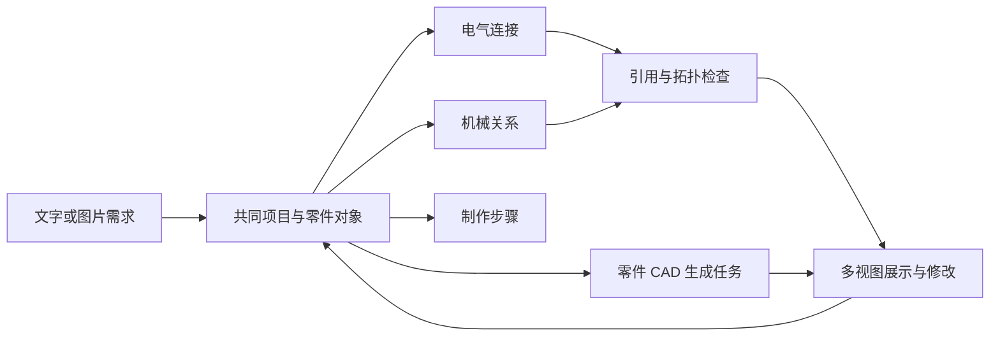

# Blueprint 公开逆向与双论文研究方向判断

日期：2026-10-24。状态：分析稿，待确认。

项目继续保持暂停。本次仅阅读公开产品、公开前端、厂家资料、研究文献和现有项目记录；没有向 S0/A/B 派发，没有启动科学实验、模型训练或产品生成，也没有修改研究源码、执行状态和自动化。

## 1. 先说判断

**Blueprint 对我们原来的宽泛叙事构成了真实威胁。**如果成果最终只是“用户描述需求，Agent 找零件、画连接、生成 CAD、反复修改”，它已经展示出更完整、更容易理解的产品形态。不能再把这些能力的集合当成论文的核心新颖性。

但“产品做得完整”和“某种设计算法已被证明更有效”是两回事。本次发现了 Blueprint 的实质工程能力，也发现公开方案中的具体规格冲突；没有找到足以判断其系统设计成功率、自动架构重构能力或方法自改进收益的受控证据。这支持一个有限判断：**它是需要认真学习和比较的设计产品，公开材料尚不足以证明它已经解决我们想研究的全部科学问题。**

同样，我们已有的门体、光供能方案成功，也不足以证明 BF Agent 更强。联合工程方案有实际价值，但重要设计选择仍由开发者提供；自动方法修改尚无可靠采用收益。我们不能用对方公开结果中的漏洞，替代自己的正面贡献。

我建议调整论文承诺：

- **第一篇保留，但核心必须从“生成整套设计”进一步落到“Agent 如何发现必须一起改变的部分，并生成跨硬件和程序的联合改造”。**下面给出具体搜索机制和否证方式。这是候选方法，不是已经确认的新算法。
- **第二篇保留研究问题，暂不承诺独立论文。**学习几个条件规则、修改 Update、保存成功代码都已有很强先例。只有学习确实改变了下一次联合设计的构造过程，而且胜过同历史的检索与通用代码改进，才值得独立成文。
- 不继续追求平台各部分完美。先证明一个足够重要的设计能力；漂亮前端、全工具覆盖、漏水材料模型和深层递归不应阻塞它。

## 2. 本次如何使用 rev-skills

用户指定仓库：[dslsdzc/rev-skills](https://github.com/dslsdzc/rev-skills/blob/main/README.md)。实际使用其 [re-analyze](https://github.com/dslsdzc/rev-skills/blob/main/.claude/skills/re-analyze/SKILL.md)、[re-managed](https://github.com/dslsdzc/rev-skills/blob/main/.claude/skills/re-managed/SKILL.md) 和 [re-script-deob](https://github.com/dslsdzc/rev-skills/blob/main/.claude/skills/re-script-deob/SKILL.md) 的相关流程：先确定证据属于哪个产品，再从公开页面追到数据结构、函数和调用位置，最后将代码结论与实际页面互相核对。

目标是 **www.blueprint.io 的 AI 硬件设计产品**。ForgeCAD 是其 CAD 合作方，单独归属；没有把其它同名项目混进来。

这次完成的是公开前端静态逆向与公开方案检查。未恢复服务器源码、系统提示词、模型训练方法或内部规划流程；没有调用从代码里发现的私有接口，没有注册、付费、复制项目或运行新生成任务。读取技能不等于安装、执行整套技能库。

结论分三层：

| 层级 | 本文含义 |
|---|---|
| 已核实 | 公开页面实际显示、公开代码实际实现，或厂家资料直接支持 |
| 有依据的推断 | 多项公开证据支持，但未见完整内部实现或运行记录 |
| 待验证假设 | 对其后端或我们未来方法的猜想，不能当现有能力或结果 |

## 3. Blueprint 实际做到了什么

### 3.1 它的价值并不只是一张漂亮效果图

官方产品和公开社区方案提供需求到零件、采购信息、接线、机械展示及制作步骤的连续入口；官方还公布了图片/草图输入、协作和 CAD 功能。对一个希望把想法做成东西的人，这种连贯性本身有价值。[官网](https://www.blueprint.io/)、[官方动态](https://ca.linkedin.com/company/blueprintio)

公开前端能够解释这种连贯性：它有共同的零件对象，以及电气连接、机械连接和步骤引用。因而用户改动的是一份有关联的项目，不只是几段彼此独立的说明文。代码中还存在变更合并、引用检查、连接修复和零件级 CAD 异步任务。[公开前端版本](https://www.blueprint.io/assets/index-Bce6DG7-.js)

根据这些证据，可以作如下架构推断。图中的后端生成细节仍未知，不能据此断言使用了某种特定多 Agent 算法：

**值得学的是它把一次设计变更落实成用户看得见、接得上的工程对象。**我们过去有时交付了很多运行记录，却没有让人迅速看懂：方案究竟改了哪几个部件、哪几段程序、服务为什么改善。这里是产品与研究沟通上的真实差距。

### 3.2 CAD 能力必须分清 Blueprint 与 ForgeCAD

Blueprint 官方发布说明其 CAD 生成由 ForgeCAD 支持，用户可以为零件生成、修改并导出 CAD。[Blueprint CAD 发布](https://www.linkedin.com/posts/blueprint-hardware_its-official-cad-generation-is-live-in-activity-7493373504600412160-2kfh)

ForgeCAD 本身公开展示可编辑的 `.forge.js` 参数模型、尺寸/间隙/干涉检查、关节与仿真元数据、下游格式导出。它明确把集成 Isaac Lab 仿真与结构分析后再改设计的完整循环标为未来方向；不能把路线图全写成已实现，也不能把合作方全部功能都算到 Blueprint 目前的集成中。[ForgeCAD 官网](https://forgecad.io/)

这也意味着，“我们有可执行检查，对方只有生成”这个对比站不住。对方生态已经在做检查与迭代。我们需要更具体的算法贡献。

### 3.3 目前不能从公开材料确认的部分

本次检查范围内，没有找到下列问题的完整公开答案：

- 在事前固定、完整服务要求下，有多少生成方案真实通过？失败分布是什么？
- 系统能否根据失败，自主改变功能由哪个组件承担，并同步生成配套程序？
- 软件、电源、机械设计之间的反馈，在多大程度上被联合执行验证？
- 设计方法是否从经历中自动修改，且在新任务中比同历史原方法更好？
- 有多少人工修订、外部编码和筛选成本参与成功作品？

这些是证据缺口，不是“它没有这些能力”的事实。公开社区作品也不是从统一初始条件、统一预算得到的基准样本。

## 4. 两个实际方案揭示了什么

### 4.1 灌溉控制器：同一项目的规格尚未完全对齐

实际阅读了 [Smart Irrigation Controller](https://www.blueprint.io/s/7rY0PpGYRBSCPhB5h-uWlLXPeF1tb-gWpI8uI3uswj4) 的零件、接线和制作步骤。

电气清单与接线使用两只 12 V、1/2 英寸电磁阀；机械清单又出现两只 12 V、3/4 英寸电磁阀。它构成公开展示中的规格冲突。尚未取得足够对象身份信息来判定究竟是重复零件、替代件未同步，还是用户编辑留下的版本差异；因此不把它写成已经发生的装配失败。

制作步骤覆盖装配和软件上传，但部分细节要求复制项目后才能查看。本次未复制或登录，不能据此声称产品不生成固件。

**意义：**把清单、接线、机械图放在一个项目里，解决了关联问题；不同视图对同一工程事实是否一致，仍需进一步保证。一个社区样本不能估算整个产品的错误率。

### 4.2 太阳能方案：存在可以直接核对的电压冲突

实际阅读了 [SolarBasePlant](https://www.blueprint.io/s/zmRLvDCrt9K6urYwIwpIXV090jkUhPC1tYPT1Gcbrf0)。公开接线中，电池管理模块向逆变器的连线标为 **24 V**，逆变器对象却写作 **Victron Phoenix 12/1200**。

厂家资料中，12 V 版本的输入范围约为 9.2–17 V；24 V 已超出该版本的输入规格。即使将其视为选型或标签错误，这份公开方案也需要先纠正才能作为可靠设计使用。[Victron 技术规格](https://www.victronenergy.com/media/pg/Inverter_VE.Direct_230V_-_HW15/en/technical-specifications.html)

这里核实的是**方案内部的器件—供电规格不一致**，不是实际上电损坏，也不是最新模型在受控测试中的失败率。社区作品的生成版本、用户修改过程和完整程度未知。

这个例子值得重视，却不足以成为我们论文的核心：查器件电压范围是基础设计检查，加入数据手册约束即可改善。我们不能把“它犯了基础错误，我们不犯”包装成系统级 Agent 创新。

### 4.3 逆向中最有启发的一处：修好了记录，不一定修好了设计

公开代码里的一个检查会拒绝不存在的零件引用，但对连接使用的未声明引脚，采取补入零件引脚表的处理；变更提交路径会使用修补后的对象。另一个供电检查根据连接分组和电源/接地标记判断孤立或无电源线索的子网。[公开前端版本](https://www.blueprint.io/assets/index-Bce6DG7-.js)

这种处理并非一定错误：可能只是把遗漏的元数据补齐。但它说明这些检查的直接保证是**数据关系和拓扑自洽**，并不自动保证芯片真有那个引脚，或在需要发送时电源足够。不能将该函数的局限扩大成整个后端没有物理检查。

这给我们的警示更重要：过去“字段齐了、H 加载了、绑定成功了、过程闭环了”，也可能只说明记录自洽。必须追问它是否改变了实际设计和最终服务。对自己与竞品应采用同一个标准。

## 5. 我对这个领域的判断

### 5.1 真实进展在哪里

第一类进展是降低设计表达和工具使用门槛。自然语言能进入器件对象、程序和 CAD，而不是停留在建议文字。Blueprint 与 ForgeCAD 的产品价值主要可在这里直接看到。

第二类进展是把多个设计环节接成实际可执行流程。它需要真实工程能力，不应因使用通用模型就被简单贬为“套壳”。HSCO-Bench 已研究 Agent 从软件计算到硬件加速器、SoC 集成与软件映射，并实际部署 FPGA 原型；CHIA 已将多种软硬件设计循环、工具和实验执行组织起来。[HSCO-Bench](https://arxiv.org/abs/2605.19399)、[CHIA](https://arxiv.org/abs/2606.27350)

第三类进展是从执行反馈改进程序与搜索。Trace、DreamCoder、Getafix、Hyperagents 分别提供了轨迹优化、抽象库学习、历史修复学习、任务与改进程序共同可编辑等不同路线。这些并非都只是文字反思。[Trace](https://arxiv.org/abs/2406.16218)、[DreamCoder](https://arxiv.org/abs/2006.08381)、[Getafix](https://arxiv.org/abs/1902.06111)、[Hyperagents](https://arxiv.org/abs/2603.19461)

这里包含预印本与既有发表工作，不能把“上了 arXiv”当成已经同行认可，也不能因为是预印本就忽略其对新颖性的影响。

### 5.2 哪些叙事最容易超过证据

| 经常出现的叙事跨越 | 实际尚需补上的证据 |
|---|---|
| 生成了整套文件，所以完成系统设计 | 文件对应同一方案；方案在完整服务下工作 |
| 各部件检查通过，所以系统通过 | 共享能量、时间、状态与通信过程共同运行 |
| 工具能检查，所以 Agent 会正确设计 | Agent 实际使用结果并改变了有用行动 |
| 找到一个更好的后代，所以学会改进 | 形成与筛选成本、独立任务效果、父方法与同历史对照 |
| 修改了改进器，所以实现递归自改进 | 新改进器在未参与形成的任务上，更有效地产生好方法 |
| 强通用模型比固定模板好，所以新机制有效 | 同样可自由生成和修改的强对照，以及机制移除实验 |

我的判断是：这个领域同时存在真实工具进步与过度能力叙事。最容易混淆的是，把“工程集成让基础模型终于能做事”写成“提出了新的学习机制”。判断不能靠论文是否使用 Agent、因果、递归等术语，而要看新增机制拿走以后，行动与结果究竟还剩多少差别。

**还有一个重要的不对称：产品可以通过显著降低人工工作量而成功，论文方法则需要解释新增机制带来了什么可重复的收益。**因此 Blueprint 即使仍需人工检查，也可以是好产品；我们即使审计非常完整，也可能还不是好方法论文。

## 6. 我们有什么资产，什么还不是贡献

现有暂停状态以 [review-state.json](review-state.json) 为准；当前研究主线见 [再推敲稿](双论文研究主线再推敲_Agent系统设计与方法自改进_待确认_20261024.md)。下面沿用已记录结果，没有重跑实验。

| 已有资产或结果 | 能支持的结论 | 尚不能支持的结论 |
|---|---|---|
| 源—储能—程序负载—记录—接收相互影响的仿真链 | 可研究完整行为及失败关系 | 自动优于已有设计 Agent |
| 门体联合方案在两个开发条件通过 | 联合工程设计可行 | Agent 自主发现该结构和策略 |
| 光供能三套整体配置在两个开发条件全服务通过 | 已有 LC 条件工程解 | 未见任务泛化或方法学习增益 |
| 实际生成、训练过 H 修改 | 学习流程已有真实执行 | 修改带来了值得采用的收益 |
| 空提案、拒绝、同动作、错误继续等轨迹 | 可定位形成和执行瓶颈 | 全部方法科学无效，或已完成有效比较 |

最值得保留的实验特性是：**电源什么时候可用，会改变信息是否取得、是否记住、时间是否仍有意义，以及通信能否完成；程序又反过来影响电源。**它能把一般设计流程里的隐含假设暴露出来。

但这是有价值的研究条件，不是算法创新的免检证。无电池场景本身也不会自动使一般优化或程序学习变成新方法。

## 7. 第一篇：需要超出已有工作的具体一步

### 7.1 先放弃三个弱定位

不以“端到端生成硬件”作为核心，不以“引入完整仿真”作为核心，也不以“发现失败后选择下一次实验”作为核心。前两者已有产品和学术竞争，第三者太接近一般反馈优化与主动学习。

值得检验的问题是：

> **当一项改动必须由别的部件和程序配套才能起作用时，Agent 能否自己构造这组共同改动，而不是等人先把正确组合列进候选库？**

这是系统级设计中的具体困难。某些改造中，单独换硬件无收益，单独改软件也无收益；只有功能分工与交接过程一起变化才有结果。要求每一步马上提高最终分数，会丢掉有用的中间设计；每次全系统重新生成，又浪费大量搜索。

### 7.2 用一个具体例子说明研究对象

假设一次门体事件结束时，MCU 尚未启动。这个例子是未来机制实验的设计说明，不是现有实验已证明的事实。

调重试参数不能找回从未捕获的事件。一个可能方向是让其它组件先保持事件状态，再由 MCU 接手。但“增加一个保持器件”还不是方案，它至少牵动：

1. 谁在事件发生时工作，怎样捕获，消耗多少能量。
2. 保存的是一次标记、次数、顺序还是时间；容量是否够原服务要求。
3. MCU 启动后如何读取，怎样区分已读、已提交和新事件。
4. 哪一步以后才能清除；中途复位会不会丢失或重复。
5. 新组件及交接操作是否破坏启动、空间、期限或其它原服务。

一位保持位不一定能满足多事件或时间戳需求，状态保持也不一定无能耗。研究应允许否定这种改造，不能把“加锁存器”提前写成正确答案。

这里 Agent 需要决定功能由谁承担，并同时生成结构与程序。它仍在设计实际系统；没有被缩成“为已定方案挑下一项测量”。

### 7.3 一个可实现的候选算法

暂不用夸张名称，直接称为**按尚未完成的配套关系扩展联合改造**。

搜索节点保存三样东西：已经提出的硬件/程序改动、这些改动尚缺的配套条件、允许一起重做的设计范围。

例如，“将事件捕获移到另一组件”会产生待解决问题：后续谁读取、身份如何保持、何时允许清除。系统保留这份未完成改造，再围绕这些问题生成连接或程序片段，而不是因它暂时没有最终服务收益就立即淘汰。

具体步骤：

1. 从真实失败轨迹定位未完成的服务及其发生时刻，保留竞争解释。
2. Agent 提出初始职责变更或局部改动，同时写出它需要其它部分提供的条件。
3. 用公共组件事实与程序读写关系检查这些条件：哪些已有满足，哪些缺配套，哪些与必要界冲突。工具返回事实，不直接返回设计答案。
4. 选择一个尚缺条件，生成可履行它的硬件连接或程序变更；新变更可能引入新的配套问题。
5. 形成可执行的整套候选后，用原完整消费者评价。必要条件已排除的分支停止；证据不够的分支标为待检验，不能伪装成功。
6. 如果失败来自原修改范围之外，再依据实际关系扩大范围；其它部分继续保留。

可用简化形式表示搜索状态：

`部分改造 = {硬件改动, 程序改动, 未满足的配套关系, 当前修改范围}`

关键新增对象不是一段“请考虑全局”的提示，而是**实际控制下一步生成的未满足关系集合及其扩展规则**。实验必须记录该集合如何产生、哪条关系触发了哪项真正修改。

### 7.4 为什么这还不能直接宣布创新

CEGIS 已通过反例改进候选；Sketch 已允许带空缺的部分程序；依赖切片已用于缩小修改范围；图语法设计与结构—控制联合搜索也早有研究。只要我们所做的事能够由“LLM 提补丁＋检查＋再提补丁”完整解释，就还没有建立新算法贡献。[Sketch/CEGIS 原始论述](https://people.csail.mit.edu/asolar/papers/thesis.pdf)

所以需要正面比较的差别很窄，也很具体：**在相同的设计自由与反馈下，按跨硬件—程序的配套关系扩展部分改造，是否比一般填空式合成和整套重新生成更有效？**

这不是声称数学上“超越优化”。足够一般的优化框架能容纳这些选择。论文能贡献的是一种明确的搜索状态与扩展算法，以及它为何适合这类相互依赖的设计变化。

### 7.5 能证明或推翻它的关键实验

首先做一个机制实验，随后再考虑扩大规模。它应同时包括：需要共同改造的条件、局部修复已足够的条件、现有组件能力不足的条件。不能只准备需要我们算法的有利题。

三项必要对照：

| 对照 | 必须保留的能力 |
|---|---|
| 强通用设计 Agent | 同模型、同组件、同硬件与代码编辑自由、同反馈、同预算 |
| 通用联合合成/部分程序搜索 | 可以保留未完成候选、联合编辑多个位置，不能刻意只准单变量搜索 |
| 候选方法 | 额外采用所声明的配套关系构造和扩展规则 |

最关键的机制移除：保留相同数据和编辑能力，把配套关系驱动的扩展换成普通扩展；另与每次全系统重生成比较。不能通过禁止基线改正确结构来制造优势。

看完整服务通过、首次可行方案总成本、不必要改动和局部任务上的额外开销。新完整执行、模型调用以及人工写入的组件语义都要交代；不追求所有辅助指标漂亮。

以下结果会推翻或明显削弱贡献：

- 强通用 Agent 或普通联合合成在同预算下同样好。
- 移除配套关系规则后，行动与结果基本不变。
- 正确的配套关系来自开发者按案例写好的答案。
- 优势完全由更多候选、更大模型或额外事实解释。
- 方法不能在实际执行中完成硬件与程序联动，只改变了计划文字。

**这组实验比再增加几十次电容、门限和重试参数扫描更接近原来的系统设计研究目标。**

## 8. 第二篇：怎样才算在改进设计方法

### 8.1 当前不足以成文的定位

“从经历写规则”“自动改 Update”“保存成功代码”“修改改进器本身”分别受到 Getafix、DreamCoder、Trace、Hyperagents 等工作的直接挑战。不能把 H 和 G 换成工程名词就算新颖。

尤其需要区分：学到了一个好设计，学到了检索该设计的条件，学到了构造新设计的程序。这三件事的证据要求不同；也不能把后者的执行接口换个名字就认为超出了库学习。

### 8.2 若继续，学习对象应更具体

候选对象是第一篇实际使用的联合改造过程，例如：如何从某类失效关系提出需要改变的功能分工，如何产生待完成的配套关系，以及怎样据此生成新的结构和程序。

输入应包括真实失败、成功和接近成功却失败的改造轨迹；输出是一个可执行生成过程，能在新的组件绑定与时序条件下生成新改造。它不能只输出“.85 秒重试”或“遇到失败就扩大范围”。

一个待研究的实现方向：将多次联合改造中的组件具体名称替换为读写、保持、供能和确认等语义角色，归纳“改动如何引出后续配套”的程序；对失败近邻保留反例，迫使程序区分何时不该使用同一改造。生成过程最后仍要绑定真实组件事实，产生完整可执行设计。

**但上述归纳仍可能只是 Getafix 式修复模式学习加 DreamCoder 式程序抽象。现在还没有足够理由宣称独立的新方法。**真正需要补出的，是明确不同的归纳或搜索机制，而不是又一份输入输出协议。

### 8.3 最有判别力的验证

若第一篇得到实际有效的构造算法，再比较：原算法加相同历史、成功方案/修改示例检索、通用代码改进、所提学习机制。共同历史、代码权限、基础模型、执行工具和总形成成本保持一致。

在新机制组合上测试时，分别替换：

- 保留旧成功设计，移除学习到的生成程序。
- 保留生成程序，移除对旧最终设计的直接检索。
- 用通用程序改进产生的版本替换所提版本。

若检索示例就足够，结果是经验复用；若通用代码优化同样好，专门学习机制没有额外收益；若生成程序确实改变了新任务中的设计构造且具有成本收益，才支持方法学习的较强结论。

这些替换要遵守同等历史权限：它们是明确的机制消融，不能偷偷把强对照的资料拿走。独立形成应重复，避免将单次幸运补丁写成稳定学习能力。

现阶段不启动更深 G 递归。第一篇尚未形成稳定、困难而有价值的设计过程时，继续递归只会把不清楚的目标搬到更高一层。

## 9. 借鉴什么，以及未来如何与 Blueprint 比较

### 值得借鉴

1. **共同设计对象。**借鉴已确认的零件—连接—步骤共同对象；在 BF 中进一步把程序纳入同一设计版本，复用已有实现，不再建设第二套平台。此次没有确认 Blueprint 固件对象的版本管理方式。
2. **整套设计变化可见。**每次展示“改了什么、为什么、后果如何”，少用日志数量表达进度。
3. **专业工具复用。**CAD 等能力可以接成熟工具；研究重点不必是从头造完整 CAD 编辑器。
4. **缩短行动到结果的距离。**已有完整仿真很快，就直接评价有实质差别的候选；不要继续扩展一个近似器去复制整套状态机。
5. **让人接得住结果。**可编辑工程和明确修改比只有评分的报告更有价值；这项工程改进可以服务论文，但不冒充算法创新。

### 不值得照搬或追逐

不与商业产品竞赛通用功能数量；不因其有漂亮 CAD 就再造大型前端；不把把关、来源、审计当研究主贡献；不通过挑出社区坏例子宣称我们优于产品。

产品比较与算法比较应分开：未来如果用户批准产品试用，可给 Blueprint 与 BF 同一完整需求、公开组件事实和正常修改机会，独立检查设计，记录人工补全和成本。闭源产品的基础模型与内部预算无法完全控制，这种比较衡量的是使用效果，不直接识别算法原因。不能因为它没有我们指定的接口，就把接口转换失败记成设计失败；转换者也不能偷偷替它修方案。

## 10. 恢复后建议的三项大工作，而非现在派发

| 顺序 | 总管 S0 | A：工程环境 | B：方法与论文 | 核心交付 |
|---|---|---|---|---|
| 1. 做成一个真正跨硬件与程序的机制案例 | 固定共同服务、动作与比较口径，协调一次完整实现 | 为必要组件与交接行为提供可执行语义，暴露事实与完整后果；不写案例答案 | 实现部分联合改造的生成与扩展规则，接入实际代码和结构变更 | Agent 自己产生的一套联合改造，或能定位在哪一步失败的实际结果 |
| 2. 判断机制是否值得写成第一篇 | 运行公平对照与必要机制移除，计入全部成本 | 独立核对完整服务及影响范围 | 比较通用 Agent、普通联合合成与候选机制，写成一条清晰论证 | 明确支持或推翻核心机制，不靠扩矩阵追正结果 |
| 3. 决定第二篇是否成立 | 根据前两项结果决定继续学习研究还是先交付第一篇 | 提供真正不同的机制组合，原服务保持 | 对照修复模式学习、程序抽象和通用代码改进，验证生成程序的增量 | 能独立说明新机制的第二篇，或明确不拆第二篇 |

一位执行者同一时间只承担一项活动实现。论文可并行整理既有材料，但不让长稿排版阻塞核心实验，也不等整个系统完善才写第一篇。

在这三项之前，只需要用户确认研究方向。本文不是恢复指令，当前暂停状态不变。

## 11. 结论的强弱

**强结论：**宽泛的 AI 硬件设计产品叙事已经不够；Blueprint 的工程整合值得学习；我们的现有结果尚未证明自主系统设计或自动方法学习优势。

**有依据的研究判断：**把功能分工、硬件连接和程序交接联合改变，比继续局部参数优化更接近本项目原始目标。可以围绕这一点构造具体算法和有杀伤力的实验。

**尚未建立：**该候选算法相对已有合成与修复方法的新颖性及收益；第二篇独立成立；递归自改进；Blueprint 在受控完整任务上的总体成败率。

我们真正应争取的是一个说得清、做得出、能被强对照推翻的核心能力，而不是把已有工作包装得比竞品更复杂。

## 附录 A：前端静态证据定位

公开资源：`https://www.blueprint.io/assets/index-Bce6DG7-.js`

本次读取大小：4,555,639 bytes。

SHA-256：`b68714c7fe6c4993aa7c54563f8dbc02de20ab00967042493b06b071e9302c91`

偏移为该快照的 **0-based Unicode 字符偏移**，不是字节地址；压缩符号名仅对该版本有效。没有保存整份 bundle 的冗余副本。

| 定位 | 字符偏移 | 核查用途 |
|---|---:|---|
| `yJn` | 2572567 | 变更计划与引用规范化 |
| `mLt` | 2575346 | 零件引用和缺失引脚处理 |
| `YWt` / `QWt` | 2579758 / 2580113 | 电源线索与连接分组检查 |
| `TXt` | 2815477 | 共同对象与步骤输入 |
| `Snr(ve.partIds,r.nodes)` | 2823707 | 步骤到零件卡片的引用 |
| `fQt` / `hQt` | 3904940 / 3905391 | CAD 任务读取与提交包装 |
| 变更提交调用 `mLt` | 4356634 | 检查结果确实进入提交路径 |

代码审阅与公开 UI 相互核对，并对关键函数做了独立复读。静态调用位置不等于已经验证所有产品执行路径；没有把前端模型标签当作后端实际模型身份。

## 附录 B：最接近工作的压力表

| 工作 | 已经覆盖的核心内容 | 对我们意味着什么 |
|---|---|---|
| [HSCO-Bench](https://arxiv.org/abs/2605.19399) | Agent 参与完整软硬件联合设计并产生 FPGA 原型 | 跨软硬件和实际执行本身不够新 |
| [CHIA](https://arxiv.org/abs/2606.27350) | 可组合的 Agent 设计循环与研究执行框架 | 受控可复现平台本身不是我们的独占贡献 |
| [Sketch/CEGIS](https://people.csail.mit.edu/asolar/papers/thesis.pdf) | 部分程序、待合成空缺、反例驱动合成 | “保留未完成设计再填补”不是新发现 |
| [Getafix](https://arxiv.org/abs/1902.06111) | 从历史修改归纳修复模式并按上下文选择 | 学习有适用条件的修复规则已有明确先例 |
| [DreamCoder](https://arxiv.org/abs/2006.08381) | 从解中学习可组合程序抽象并改进搜索 | 方法库和抽象扩展不能只靠改名宣称创新 |
| [Trace](https://arxiv.org/abs/2406.16218) | 用执行轨迹与反馈优化异质程序参数 | 自动联合改代码和提示的泛化叙事已拥挤 |
| [Hyperagents](https://arxiv.org/abs/2603.19461) | 任务程序与改进程序共同可编辑 | 修改 H/G 或形成后代不等于新的 RSI 方法 |

这张表用于界定研究问题，不把各论文摘要里的全部强主张无条件当作已经证明。我们未来的贡献必须落实到可比较的算法差别与结果，而不是仅寻找对方未使用的应用名词。
