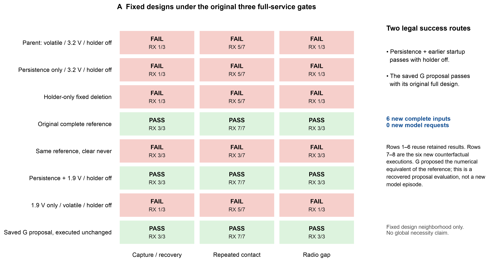
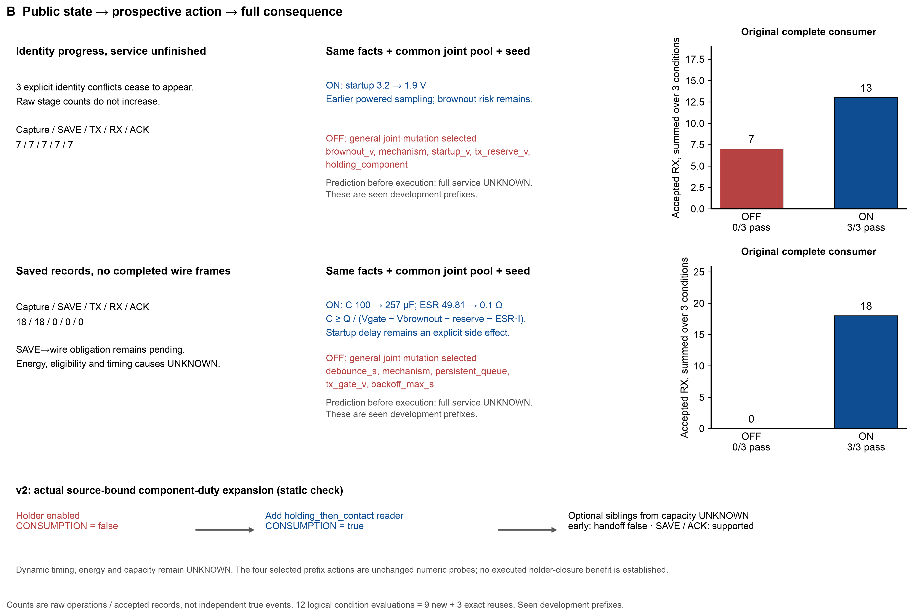
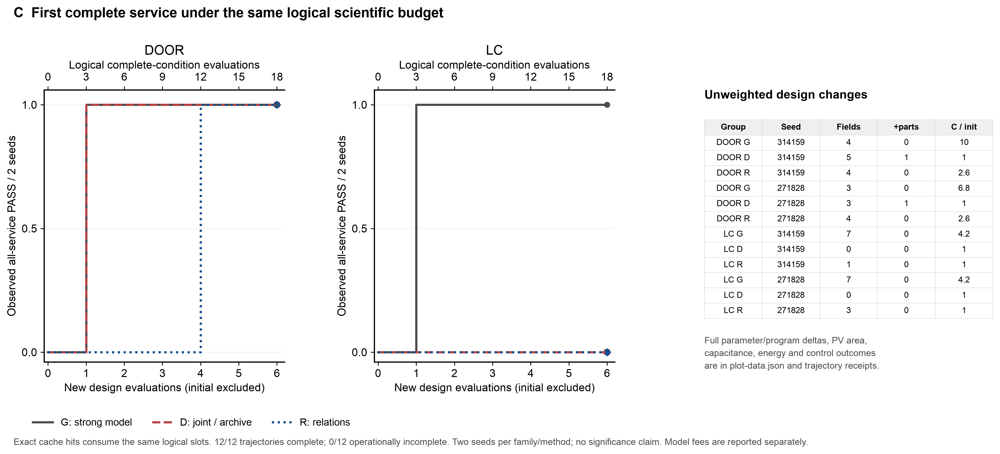

# 配套关系合成：三步有限包结果

工单：`BF-PQE-RELATION-SYNTHESIS-20261102-001`；feature：`BFA-100-pqe-relation-synthesis`。人类“完成这三步”的直接授权及固定预算保存在 [registration](../shared/registration.json)。本报告从原消费者结果、实际发出的模型载荷和已结算 usage 生成，原科学、服务门与合法设计域均未改变。

## 结论

两个既有失败前缀上，开启语义推导确实改变下一项设计，并由原完整消费者通过三工况；关闭时均三工况失败。新增的组件义务闭合能从实际源码事实推导读取配套，但本次被选中并执行的 R 干预中，新增组件义务的选择记录为 **0**。因此已经贯通的是“公开未完成服务→方向性的数值/程序修改→原完整后果”，不能把它写成已验证保持器配套链的动态收益。

三方比较按原冻结任务和两个 seed 完成 **12/12**，操作未完成 **0/12**。以下为每个候选都必须同时通过原三工况的结果；没有拼接不同设计的通过项。

| 场景 | 方法 | 完整通过 | 首次通过新设计数：314159 / 271828 | 首次通过逻辑单工况评价数 |
|---|---|---:|---|---|
| DOOR | G | 2/2 | 1 / 1 | 3 / 3 |
| DOOR | D | 2/2 | 1 / 1 | 3 / 3 |
| DOOR | R | 2/2 | 4 / 4 | 12 / 12 |
| LC | G | 2/2 | 1 / 1 | 3 / 3 |
| LC | D | 0/2 | 六设计内未通过 / 六设计内未通过 | — / — |
| LC | R | 0/2 | 六设计内未通过 / 六设计内未通过 | — / — |

G 是实际计费的强通用模型，沿用 `engineering-reasoning-active-context-v4`、API 标识 `deepseek/deepseek-flash`、thinking high；底层权重身份上游未披露。D 是开发者固定的联合搜索/多样性档案策略；R 是开发者固定的配套语义策略。三者共享任务、初态、合法动作和每轨迹六个新设计额度，但并非三个同模型 Agent，不能把差异归结为语义机制的单一因果效应。本有限样本没有建立 R 的稳定相对优势，也没有统计显著性、硬件验证、自动 H 学习或递归改进结论。

## 第一步：补齐反事实

在原 M2r 三工况中，关闭持久化、仅 startup=1.9V、其余与旧成功设计相同：**三工况有效 FAIL，RX=1/5/1，原目标=3/7/3**。这支持这个固定邻域里的持久化与启动门限配合，不能推出整个设计空间必须启用某个组件。已有“持久化+1.9V、holder off”三工况 PASS 是保留的合法简单路线。

原 G callback12 的 `payload.design` 原样执行：**三工况有效 PASS，RX=3/7/3**，没有重新提问模型或人工修案。该提案数值上等于原完整参考方案；这证明提案本身可行，不证明模型独立发现了一条新参考。旧工具上限及无最终提交的执行事实仍保留。

第一步共 **6 新完整单工况 / 6.740418 秒 / 0 模型请求**。完整八行固定设计矩阵见 [A 矩阵](../a/FIXED-NEIGHBORHOOD-MATRIX.json)，新六项及源绑定见 [A 结果](../a/STAGE1-RESULT.json)。



## 第二步：实际状态、义务与干预

两前缀使用同一公开事实、相同通用联合池和随机状态，仅切换语义生成/排序的消费；每格只执行一次预先冻结的候选，再由原三工况消费者评价。

| 既有失败前缀 | 正确公共解释 | 开启语义后的实际修改 | 完整后果 OFF / ON |
|---|---|---|---|
| identity-progress | 3 个显式身份冲突不再出现；原始 capture/SAVE/TX/RX/ACK 仍各 7，不能因计数未涨否认进展，也不能推出所有身份问题已解 | startup 3.2→1.9V；更早启动的条件探针，掉电风险仍在 | 0/3 / 3/3 PASS |
| saved-undelivered | 原始 capture/SAVE 各 18，TX/RX/ACK=0；SAVE→wire 仍未履行，能量、门限和时序原因保留 UNKNOWN | C 100→257.028µF，ESR 49.8063→0.1Ω，来自公开负载电荷与门限余量 | 0/3 / 3/3 PASS |

原始计数是三工况操作/接收记录总和，不是独立真实事件数。以上是已见开发前缀的诊断，不是未见迁移。**12 个逻辑单工况评价=9 新完整+3 精确输入复用**，新完整累计 10.841124 秒。结果见 [stage2-result](stage2-result.json)。

v1 数值生成完成后，新增 v2 从每个候选的 `facts.design_facts` 调用原 `semantic_checks`，而不是凭预写宏宣布闭合。实际链为 holder-on / reader 缺失→CONSUMPTION=false→补 `holding_then_contact`→CONSUMPTION=true。容量 UNKNOWN 的可选兄弟中，`early` 引出 RELIABLE_HANDOFF=false，`save` 与 `ack` 各有静态支持；未记录 `early→save/ack` 的跨边，不能补写这条路径。`never`、到期、时序、能量与动态容量没有被静态检验证实或完全排除。

v2 的四个已选前缀设计与 v1 相同，因此绑定既有精确输入结果而不重算；不能追认 v1 已执行了后来的组件推导。LC 的候选级事实适配器仍 **UNAVAILABLE**，其数值探针不能获得组件闭合信用。实现门禁与五节点源事实见 [core-closure-gate](core-closure-gate.json)。



## 第三步：固定比较与宿主接入

A 在方法成绩出现前冻结两场景各三个自然服务条件：门体局部修复/冷启动接触/链路恢复；冷链局部修复/先光后链路/先链路后光。六个共同初态只计算一次：门体 PASS/FAIL/FAIL，冷链 FAIL/FAIL/FAIL。保留门体初态通过的控制工况，不按方法结果换题。任务清单见 [MANIFEST](../a/stage3-host/MANIFEST.json)。

每轨迹六个**新**设计，不含共同初态；每设计原三个完整单工况都计逻辑预算，精确缓存命中也占相同三个槽。实际执行顺序固定，跨 seed 或方法复用只节省新计算，不改变公平比较横轴。

宿主在每个实际请求内重算 requests/reads/designs/condition inputs/tokens/USD/wall 的余额；读页额度 64 与设计提交额度 6 分开，所有已读页逐字节事实持续进入后续实际载荷。实际 provider 另有每 episode 12 请求上限，因此仍如实计入读页的请求、token 与费用成本。回读核对的是 `wire-public.json` 的真实消息，不仅是丰富的本地结果文件。

四条 G 原结果的嵌套 `final` 继承了模板值 `paid_model_requests=0`、`algorithm_identity=deterministic developer algorithm`；这两个嵌套标签错误，原文件保留。权威身份与调用数取外层 `method_identity`、真实 `model_ledger` 和 DB settled usage：四条分别 **7、9、7、8 请求，共 31**。汇总已作显式更正并绑定 [metadata-errata](metadata-errata.json)，不能把 G 报作零调用确定性方法。

首次启动服务因 root 绑定错误，在监听、owner 注册、provider 派发前停止；没有付费重试或六初态重跑。仅修正状态根绑定后沿新包继续，原故障 stderr 已按最初哈希恢复，当前服务日志另占其唯一原位。见 [绑定修正](local-runtime-binding-amendment.json) 与 [原故障回读](failure-log-readback.json)。



## 设计负担与过度设计边界

下表是最终已评价设计相对共同初态的未加权变化。字段包含真实程序/门限/机械参数；组件数量按显式新增 holder 计。C、PV 比值分别为电容与光伏面积相对初态。失败轨迹的最终设计仍是失败设计，不能因字段少而当成优胜。没有将这些量捏成一个“复杂度总分”。

| 轨迹 | 改变字段 | 新增组件 | C/初态 | PV/初态 |
|---|---:|---:|---:|---:|
| DOOR-G-314159 | 4 | 0 | 10 | — |
| DOOR-D-314159 | 5 | 1 | 1 | — |
| DOOR-R-314159 | 4 | 0 | 2.57 | — |
| DOOR-G-271828 | 3 | 0 | 6.8 | — |
| DOOR-D-271828 | 3 | 1 | 1 | — |
| DOOR-R-271828 | 4 | 0 | 2.57 | — |
| LC-G-314159 | 7 | 0 | 4.17 | 2 |
| LC-D-314159 | 0 | 0 | 1 | 1 |
| LC-R-314159 | 1 | 0 | 1 | 1 |
| LC-G-271828 | 7 | 0 | 4.17 | 2 |
| LC-D-271828 | 0 | 0 | 1 | 1 |
| LC-R-271828 | 3 | 0 | 1 | 1 |

完整参数差异、各工况能量账、控制动作计数、发送最低端电压和力负担均由原已存结果抽取到 [plot-data](../figures/plot-data.json)。本包没有执行等服务的最小化/Pareto 搜索，因此不声称已证明防过度设计能力。门体 D 的未读取 holder 与 G/R 的 holder-off 成功、冷链成功设计的储能/面积增加都原样报告。

## 实际资源与计费

- 新完整单工况 **105 / 240**：stage1=6，stage2=9，共同初态=6，正式比较=84；累计实际外层执行墙钟 **257.272837 / 3600 秒**。没有以压缩/复用抵消逻辑比较额度。
- 逻辑单工况总计 **138**，其中精确复用 **33**；新增 static geometry miss **26 / 96**，与命中/纯结构检查分列。
- 必要直接软件/出口检查 **23 / 24**；主核验计 22，最终文件完整性读回另计时见 resource-total。B 原首轮 7 PASS/3 FAIL 原样保留，未把失败覆盖为后来的全绿。
- 实际模型 episode **4 / 4**，请求 **31 / 48**，prompt **376312**，completion **109100**，total **485412** token；reasoning **101077** 已包含在 completion 中。
- cache hit / miss prompt token **0 / 376312**；已知 usage 的固定费率估算 **USD 0.2438136 / 20**，不是发票金额。所有新请求已 SETTLED，新 UNKNOWN/在途/未结预留均 0。

| 模型轨迹 | 请求 | 读操作 | 新设计 | 逻辑单工况 | 费率估算 USD |
|---|---:|---:|---:|---:|---:|
| DOOR-G-271828 | 9 | 25 | 1 | 3 | 0.0638739 |
| DOOR-G-314159 | 7 | 26 | 1 | 3 | 0.0528510 |
| LC-G-271828 | 8 | 20 | 1 | 3 | 0.0676284 |
| LC-G-314159 | 7 | 18 | 1 | 3 | 0.0594603 |

旧 **1995** 条 model_requests 完整哈希及两条例外授权行哈希一致；两条原 UNKNOWN 的 null usage、错误文本和完整预留合计 **USD 0.3686529** 不变，无重试/补 usage。四个新 owner 凭据与有效 grant 均关闭，study 过期，临时预算 scope 恢复；仅本包启动的有限服务已停止。见 [cost-closeout](cost-closeout.json) 与 [verification](verification.json)。

## 存储、验证与交接

采样于 2026-11-02T12:04:45.811135+00:00：本包逻辑产物 **85.29 MB**，分配上界 **90.75 / 150 MB**；文件系统可用 **22.764 GB**，高于 10GB+1GB 峰值要求。本研究包主动删除回收 **0 B**；后台空间变化不计作清理成果。原环境、单一源树，无新增备份/工作树/环境。

三图分别保留一份 PNG 300dpi、PDF、可编辑文字 SVG，配套唯一绘图脚本和来源数据；没有累计预览修订。冻结源、真实载荷、原账本、gzip 全量读回及新资源上限核验见 [verification](verification.json)。不运行全仓 init，不作全仓健康声明，没有 commit/push。当前仅本有限工单收口，整个研究项目及旧清理均未自动恢复。

只读复核入口：

```sh
rtk proxy env PYTHONDONTWRITEBYTECODE=1 /Users/depengsu/.local/share/bf-agent-runtime/product-cad/bin/python -B /Users/depengsu/Documents/Long-Horizon AI Agent/docs/research/pqe-two-paper-plan-20261022/relation-synthesis-20261102/s0/verify_saved.py
```

该入口只核对已存结果及源引用，不启动 runner。付费/科学 runner 为一次性入口，不能把复现实验命令当作重跑授权。阶段完成信号与最终唯一 BF_COMPLETE 分开；A/B 独立读回分别保存在 [A 服务核验](../a/FINAL-SERVICE-READBACK.json) 和 [B 方法费用核验](../b/FINAL-METHOD-COST-READBACK.json)，最终状态由 final-readback 与根 feature/progress/handoff 记录。
