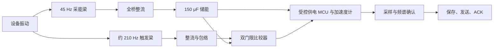
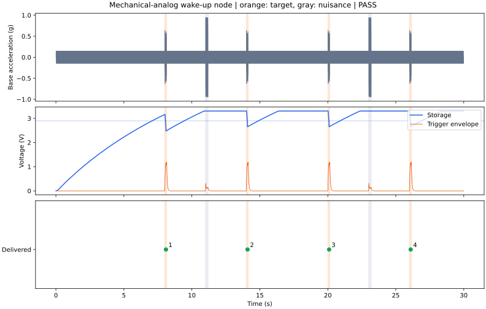

# 机电模拟唤醒节点：最小可运行设计

从空电容开始，背景振动负责充电，谐振梁与包络电路负责唤醒，MCU 只在触发后采样、判断和上报。当前设计在下面这段 30 秒任务中 **4 次异常全部按时交付，2 次干扰没有误报**。完整数值计算实际耗时 **5.20 秒**。

## 运行

```bash
python3 -m pip install numpy scipy matplotlib
PYTHONDONTWRITEBYTECODE=1 python3 -B wakeup/sim.py
```

本次使用 Python 3.14.4、NumPy 2.4.2、SciPy 1.17.1、Matplotlib 3.10.8。也可以传入另一份参数：`python3 -B wakeup/sim.py your-design.json`。

全部运行逻辑在 [sim.py](sim.py)，全部可编辑设计参数在 [design.json](design.json)。函数 `simulate(design)` 直接返回结果与波形；命令行运行会生成 [result.json](result.json)、[trace.csv](trace.csv) 和 [waveforms.svg](waveforms.svg)。运行不依赖本仓库的其他研究目录。

## 完整设计



两根梁安装在同一个振动底座上。采能梁的整流桥连接储能电容；触发梁的整流桥连接独立包络电容。比较器由储能供电，只有包络超过唤醒门限且储能电压足够时，才开启数字部分。一次处理完成后数字部分断电，包络降至低门限后重新允许触发。

### 机械部分

两根梁均为钢基底、上下对称 PZT 层、两层并联输出，PZT 覆盖全长。

| 参数 | 采能梁 | 触发梁 |
|---|---:|---:|
| 长 × 宽 | 30 × 10 mm | 18 × 6 mm |
| 钢基底厚度 | 0.15 mm | 0.10 mm |
| 每侧 PZT 厚度 | 0.12 mm | 0.08 mm |
| 端部配重 | 4.65 g | 0.14 g |
| 机械阻尼比 | 0.015 | 0.030 |
| 计算短路固有频率 | 44.11 Hz | 202.17 Hz |
| 计算开路固有频率 | 45.93 Hz | 210.52 Hz |

声明的材料参数：钢弹性模量 200 GPa、密度 7800 kg/m³；PZT 弹性模量 60 GPa、密度 7500 kg/m³、相对介电常数 1700、压电应力常数绝对值 11.4 C/m²。这些是本设计采用的代表性参数。

### 电路部分

| 路径 | 参数与连接 |
|---|---|
| 采能整流 | 全桥，每只导通二极管压降 0.15 V，桥路总串联电阻 5 kΩ |
| 储能 | 150 μF，等效漏电电阻 10 MΩ |
| 储能限压 | 3.3 V 开始分流，等效动态电阻 100 Ω |
| 触发包络 | 全桥，每只导通二极管压降 0.10 V；充电电阻 100 kΩ；包络电容 2 nF；放电电阻 20 MΩ；梁端输入电阻 100 MΩ |
| 唤醒与重置 | 包络高门限 0.55 V、低门限 0.18 V |
| 数字供电 | 储能至少 2.9 V 才启动；低于 1.8 V 中断工作；转换效率 85% |
| 静态耗电 | 比较器 75 nA，参考与供电控制 125 nA；比较器最低供电 0.9 V |

75 nA 比较器电流参考 [TI TLV3691](https://www.ti.com/product/TLV3691)。二极管、电阻、参考、转换效率等按上表的行为参数计算；这里交付的是可执行电路与功耗设计模型。

### 数字处理

```text
唤醒 → 启动 → 采样 → 频谱判断 → 保存 → 发送 → ACK → 断电
```

加速度计仅在采样时供电：一阶 800 Hz 带宽、±4 g 量程、12 位 ADC。以 2048 Hz 获取 128 个样本，去均值并加 Hann 窗后计算 FFT。只有 **195–225 Hz 频带能量占比至少 0.55，且采样 RMS 至少 0.12 g**，才保存并上报。序号由设备在保存完成后递增；未确认的频谱不产生记录。

| 阶段 | 时间 | 负载功率 |
|---|---:|---:|
| 启动 | 2 ms | 3 mW |
| 采样，包括传感器与 ADC | 62.5 ms | 3 mW |
| 判断 | 2 ms | 5 mW |
| 保存 | 0.5 ms | 2 mW |
| 发送 | 4 ms | 12 mW |
| ACK | 1 ms | 3 mW |

一次有效事件的数字部分运行 72 ms。本次 4 次事件合计运行 288 ms，占 30 秒的 **0.96%**。网络可用，发送及 ACK 完成即计为交付。

## 实际仿真结果

### 本次输入

初始电容电压、梁位移、梁速度和包络电压均为零。

| 输入 | 频率 | 峰值加速度 | 出现时刻与长度 |
|---|---:|---:|---|
| 持续背景振动 | 45 Hz | 0.15 g | 0–30 s |
| 目标异常 | 210 Hz | 0.50 g | 8、14、20、26 s 各持续 150 ms |
| 非目标干扰 | 250 Hz | 0.80 g | 11、23 s 各持续 200 ms |

瞬态边沿使用 5 ms 余弦渐变。每次异常须在发生后 250 ms 内交付；PZT 根部应力上限 40 MPa，梁尖位移上限 1.5 mm。异常时间仅用于生成输入和事后评价，检测器读取实际采样波形。

### 四次交付

| 序号 | 异常开始 / s | 实际唤醒 / s | ACK 完成 / s | 交付延迟 / ms |
|---|---:|---:|---:|---:|
| 1 | 8.000 | 8.023873 | 8.095873 | 95.873 |
| 2 | 14.000 | 14.023878 | 14.095878 | 95.878 |
| 3 | 20.000 | 20.023872 | 20.095872 | 95.872 |
| 4 | 26.000 | 26.023878 | 26.095878 | 95.878 |

| 结果 | 实际数值 |
|---|---:|
| 按时交付 | **4 / 4** |
| 误报 | **0** |
| 唤醒 / 掉电次数 | **4 / 0** |
| 空电容充至启动门限 | 7.086 s |
| 最长交付延迟 | 95.878 ms |
| 工作期间最低储能电压 | 2.476 V |
| 最大 PZT 根部应力 | 13.693 MPa |
| 最大梁尖位移 | 0.351 mm |
| 结束时储能电压 | 3.304 V |
| 完整仿真实际耗时 | 5.204 s |

3.3 V 分流模型具有有限动态电阻，因此结束电压略高于分流起点。



### 能量

30 秒内实际整流进入储能的能量为 **3.618 mJ**，平均 **120.6 μW**。数字部分从储能取得 **1.202 mJ**；参考、比较器与储能漏电合计 **0.04172 mJ**，平均 **1.39 μW**。这是一套低待机功耗设计，待机并非零功耗。

总机械输入 9.752 mJ；机械阻尼耗散 4.983 mJ，采能整流损耗 1.131 mJ，限压耗散 1.555 mJ，最终各储能项合计 0.8386 mJ。累计能量平衡残差为 −0.262 μJ，约占机械输入的 0.00269%。所有分项见 [result.json](result.json)。

## 实现过程

实际尝试了两套采能梁设计，其余任务、触发梁、电路与程序参数保持不变：

1. 初版钢基底 0.10 mm、每侧 PZT 0.08 mm、端部配重 1.30 g。触发包络已经产生，但充电不足，30 秒末储能仅 2.841 V，未达到 2.9 V 启动门限，交付 0/4。
2. 增厚采能梁并相应增大端部配重，保持其频率接近 45 Hz，得到当前设计，交付 4/4。

原始失败与首次通过结果保存在 [development.jsonl](development.jsonl)。最后将设备序号提交位置明确为 SAVE 完成后，又运行了一次当前源码，生成本目录最终结果。总共 3 次完整运行、2 套不同设计，没有外部模型 API 调用。

## 模型

每根梁采用一个三次 Rayleigh–Ritz 弯曲模态，形函数为 `φ(s) = (3s² − s³)/2`。几何与材料参数决定质量、刚度、机电耦合和电容；机械运动与压电端电压双向耦合，整流电流、包络负载、储能与实际程序阶段负载同时积分。基本形式参考 [Erturk 与 Inman 的双晶片耦合模型](https://www.ssdsl.gatech.edu/wp-content/uploads/2012/11/SMS_2009.pdf)。

使用 LSODA，`rtol=2e-6`，最大积分步长 0.25 ms；CSV 按 1 ms 及阶段端点导出，精确唤醒和程序事件另存于结果。数字确认实际处理传感器模型的样本；MCU、无线与保存采用上表的时间/功耗模型。这是声明材料、器件和任务条件下的降阶数值设计结果，尚不是实板测量或可直接生产的 PCB 工程。

独立的 [Agent 能力边界预实验](limits/README.md) 只增加一个 [agent_limits.py](agent_limits.py)：在谐波数学模型上标定十五题，并运行四组同模型探针。它不改动本页的完整瞬态设计与结果。
