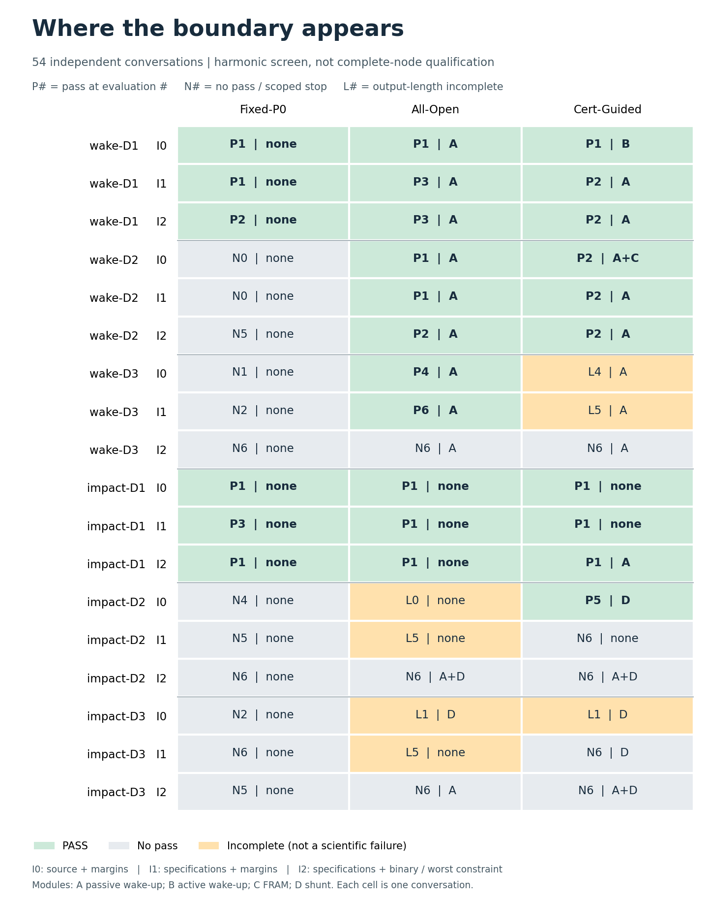

# Agent 边界实验：先让模块成为必要，再检查信息与执行

本轮重写 `../agent_limits.py`，仍是一个实验脚本加原来的 `../sim.py`，没有接回旧框架。上一轮十五题与六十条轨迹保留在 `../limits/`，对应源码是 Git 提交 `5f06f8a`，不能用本轮脚本冒充原实验的源码。

## 先看实际结论

**本轮完成 54 条有独立上下文的模型轨迹、163 次合法设计评价、8 次完整瞬态回灌。27 条通过谐波筛选，20 条正常结束但未通过，7 条因单次输出长度耗尽而未完成。没有新增用量缺失或在途请求。**

结论有三层，必须分开：

1. **唤醒中间档的模块必要性成立，但没有证书优势。** 全开放组在白盒、灰盒、黑盒下分别第 1、1、2 次评价通过；证书组分别第 2、2、2 次。两个白盒通过设计回到完整节点均交付 2/2，移除 A 均变成 0/2。旧实验的短采样捷径已消除，但强通用模型仍能直接找到模块和参数。
2. **更难的唤醒题开始显示数值与信息边界。** 全开放组白盒第 4 次、灰盒第 6 次通过，黑盒 6 次未通过；黑盒两个开放组都已安装正确的 A，剩余失败是充电 / 能量 / 参数搭配，不是没有想到安装模块。白盒成功设计的能量余量只有约 0.0284 μW，不能当稳健工程解。
3. **冲击题的数学边界不能替代完整节点边界。** 证书组一个设计在谐波模型通过，完整模型却交付 0/2；标定见证也只有 1/2。应力、位移与触发重新使能均暴露问题。不能把白盒证书组的数学 PASS 和全开放组的输出截断放在一起，声称证书战胜强基线。

本轮没有继续凑满 162 条，也没有挑分差追加种子。预先规则没有选中合格的唤醒比较格；冲击案例完整回灌未通过，停止对它追加方法比较。旧研究实验与自动化保持暂停。

### 54 格结果与首次通过次数

这是**谐波筛选器**的结果，不是完整器件通过率。`P1` 表示第一次合法设计评价通过；`N5` 表示评价五次后未通过并正常停止；`L4` 表示做了四次评价后模型输出截断，不能记为物理或方法失败。每格仅一个独立对话，没有显著性结论。

| 案例与难度 | 信息 | Fixed-P0 | All-Open | Cert-Guided |
|---|---|---:|---:|---:|
| wake-D1 | I0 | P1 | P1 | P1 |
| wake-D1 | I1 | P1 | P3 | P2 |
| wake-D1 | I2 | P2 | P3 | P2 |
| wake-D2 | I0 | N0 | P1 | P2 |
| wake-D2 | I1 | N0 | P1 | P2 |
| wake-D2 | I2 | N5 | P2 | P2 |
| wake-D3 | I0 | N1 | P4 | L4 |
| wake-D3 | I1 | N2 | P6 | L5 |
| wake-D3 | I2 | N6 | N6 | N6 |
| impact-D1 | I0 | P1 | P1 | P1 |
| impact-D1 | I1 | P3 | P1 | P1 |
| impact-D1 | I2 | P1 | P1 | P1 |
| impact-D2 | I0 | N4 | L0 | P5 |
| impact-D2 | I1 | N5 | L5 | N6 |
| impact-D2 | I2 | N6 | N6 | N6 |
| impact-D3 | I0 | N2 | L1 | L1 |
| impact-D3 | I1 | N6 | L5 | N6 |
| impact-D3 | I2 | N5 | N6 | N6 |



| 组别 | 谐波 PASS | 正常结束但未通过 | 输出截断未完成 | 合法设计评价 |
|---|---:|---:|---:|---:|
| Fixed-P0 | 6 | 12 | 0 | 51 |
| All-Open | 11 | 3 | 4 | 53 |
| Cert-Guided | 10 | 5 | 3 | 59 |

容易档两类共 18 格全部通过。Fixed-P0 的 6 个通过都来自容易档；其余 12 格未通过。这个结果支持声明范围内的局部困难，不支持外部证书独有的扩展能力。所有最终参数、模块、最紧约束、数值裕量和停止解释均在 `summary.json`，实际模型回包和全部中间设计在 `agents.jsonl`。

### 哪些地方真的卡住，哪些仍然不能回答

- 唤醒 D2：A 的选择在灰盒甚至黑盒下也不困难。证书告诉模型“必须找唤醒路径”，没有提供强模型尚不具备的决定性能力。
- 唤醒 D3：全开放组白盒 / 灰盒通过设计的最小归一化能量裕量约 `0.000284`；黑盒全开放组最后卡在充电，证书组卡在能量。不能把这两条轨迹解释成不会跨域思考。
- 冲击 D2：灰盒全开放组五次有效设计都没有安装 D，之后输出截断；证书组试过 D，最后又关掉 D，在六次评价后仍未通过。诊断文字被看到不等于诊断约束被持续用于选择。黑盒两组都曾装 A+D，却没把应力、采能和突发储能同时满足。
- 冲击 D3：所有模型没有取得通过，但额外的私有数值求解找到了谐波可行见证。因此它是本次接口与预算下的困难点，不是物理不可行题。该私有求解用了 13,602 次计算，不与六次评价的 Agent 做样本效率对比。
- 所有 7 条未完成都保留原输出、`finish_reason=length` 与费用。它们显示当前推理输出额度和数值求解接口的局限；不补跑，也不转成方法负结果。16 次非法 / 格式动作均返回修正反馈，不消耗设计评价配额，没有凭解析错误直接淘汰基线。

### 实际用量与时间

- 实际供应商请求 **187**，全部有 usage；UNKNOWN **0**。54 个上下文结束，0 在途。
- 输入 **1,389,885** token，输出 **651,833** token，其中推理 **625,672**；总计 **2,041,718**。缓存命中输入 **1,312,000**。
- 按已核官方高峰费率估算：计缓存 **USD 0.8134371**；输入全按未缓存计的保守估算 **USD 1.1991651**。均低于 USD 2 上限；不是账单。
- 三并发主体运行 **1932.699 s，约 32.2 分钟**；8 次新瞬态计算累计 **179.240 s**，另有一次原设计参考重算。标定和私有数值诊断另列，不混入 Agent 的六次评价。
- 临时扫参文件、原设计参考副本和绘图缓存已清理；保留一份模型原始记录与紧凑摘要，没有数据库、环境副本、独立模型服务或新实验框架。

### 下一步最值得做的事

**先不追加模型矩阵。** 唤醒题已说明“选择预先给定的正确模块”对强模型不难；继续削弱信息或收紧题目并不会自动产生论文创新。冲击题则应先让同一个分流定义、物理位移范围与可重复触发程序在完整模型里成立，当前不能拿它评判方法优劣。

若继续研究 Agent，最小且公平的下一步是让各组共享一个轻量数值求解工具，检查剩余差异究竟来自结构决策还是浮点调参；这个工具改进本身不当作新方法贡献。本轮没有实施或启动这项后续实验，也没有自动恢复旧计划。只有在完整服务和同工具条件下仍出现稳定的决策差距，才有理由围绕它提出新机制。

## 这次具体改了什么

1. 采样固定为现有流程的 **128 点 / 2048 Hz = 62.5 ms**。这约束的是当前分类程序，不声称所有异常检测都需要这么长的窗口。
2. 不再为了凑全空间 1.5% 可行体积而增加背景输入。先给出无目标模块的必要界，再保留有模块的实际可行见证。随机零命中与数学排除分开。
3. 两类机制各取容易、中间、稀少三个工作点，取代五份近似重复的题。轮询范围扩至 4 s，使长事件控制题在弱输入下也允许普通轮询；短事件仍受捕获期限约束。
4. 事件间隔统一为 **6 s**；旧筛选器是 60 s，完整节点原任务是 6 s。一次事件约需 300.6 μJ 储能侧能量，两者差了十倍的持续服务负担。
5. 三组均用同一模型、同一评价器。All-Open 表示变量可编辑，绝不表示所有模块必须安装。Cert 与 All-Open 的动作完全相同，Cert 只多得到有范围的解析诊断，不靠禁止基线行动制造差距。
6. 白盒、灰盒、黑盒分别运行。灰盒不发源码与机械方程系数；黑盒还去掉数值裕量。不发送档位定义、采样通过率和可行见证；任务 id 保留 D1/D2/D3 供定位。

## 六个工作点

共同条件：45 Hz 背景；空储能可充电 100 s；事件每 6 s 一次；面积不超过 95 mm²。坐标的线性 / 对数采样方式见 `calibration.json`。下列通过率是在**指定模块组合固定**时对连续参数采样，不是整个离散空间的统一体积。

| 工作点 | 背景 / g | 异常 | 应力上限 / MPa | 无模块通过率 | 对应模块通过率 |
|---|---:|---|---:|---:|---:|
| 唤醒 D1 | 0.30 | 210 Hz、0.5 g、3 s | 40 | 2.08% | A：1.56% |
| 唤醒 D2 | 0.16 | 210 Hz、0.5 g、150 ms | 40 | 0 | A：0.63% |
| 唤醒 D3 | 0.095 | 210 Hz、0.5 g、150 ms | 40 | 0 | A：0 / 10,000 |
| 冲击 D1 | 0.20 | 45 Hz、1.5 g、500 ms | 150 | 5.78% | D：3.49% |
| 冲击 D2 | 0.12 | 45 Hz、5 g、500 ms | 285 | 0 | D：0.20% |
| 冲击 D3 | 0.12 | 45 Hz、5 g、500 ms | 225 | 0 | D：0 / 10,000 |

冲击中间档低于原建议的 0.3% 下限，照实保留，没有为了数字好看继续调整。D3 的零命中不是全局无解；模型若找出有效解，正常计 PASS。探索性较大样本曾在唤醒 D3 找到极少可行点。

事后独立数值检查也为冲击 D3 找到数学可行解，最小归一化裕量约 0.00724，证明该点不是全局无解。它花了 1.96 s、13,602 次谐波计算，明确**不是与 Agent 六次预算相同的对照**；未将设计或结果送入任何模型对话，没有改变原任务。具体设计见 `calibration.json` 的 `post_run_private_reference`。

冲击的 150–285 MPa 是这个数学实验的任务参数，**没有被认定为真实 PZT 的可用强度**。这组题还需要完整模型中的位移与执行检查，不能直接写成可制造的冲击自保护器。

## 模块必要性到底凭什么

### 唤醒中间档

对被动单模态采能器，最大可用功率满足

`P_useful ≤ η F² / (8 c)`。

在本次允许的厚度与质量范围内，`F²/c` 随端部质量增加、随厚度增加而下降，因此可用端点给出整个矩形域的保守上界。0.16 g 时约为 **210.82 μW**。

不开 A/B 要保证任意相位的 150 ms 事件被完整采到，必须 `poll + 62.5 ≤ 150 ms`，因此仅轮询和基础待机就至少需要 **2144.26 μW**。改电容不能消除持续功率赤字。

有源唤醒 B 加上每 6 s 的数字工作，至少需要 **231.50 μW**，仍超过上界。被动 A 的对应最低负担约 **52.00 μW**，实际可行见证也存在。所以在**这个谐波模型、固定采集流程与声明范围**内，A 的必要性不依赖随机零命中。

### 冲击中间档

背景和冲击频率相同、没有 D 时，线性系统具有

`q_event / q_background = a_event / a_background`。

应力限制约束了振幅，从而约束背景采能。用

`max_R R / (1 + (ω Cp R)²) = 1 / (2 ω Cp)`

可得到覆盖允许厚度、质量和电阻的功率上界。中间档约为 **51.15 μW**，低于完整服务至少需要的 **51.50 μW**；因此不装 D 的几何或电阻调整不能满足这组谐波约束。D 通过电压触发改变电学边界，背景和冲击不再共用同一等效阻抗，允许打破这个比例；装 D 的见证实际通过。

以上是模型内必要条件，既不是器件认证，也不是瞬态碰撞、材料断裂或完整分类服务的证明。两次局部探测的梯度反向没有被当成不可行证书。

## 公平对照与执行方式

| 组别 | 可以修改 | 新增信息 |
|---|---|---|
| Fixed-P0 | 唤醒只改 C、轮询；冲击只改 C、输入负载 R | 无 |
| All-Open | 所有连续变量、A/B/C/D 安装状态 | 无 |
| Cert-Guided | 与 All-Open 完全相同 | 上面有适用范围的必要界 |

| 信息档 | 模型得到什么 |
|---|---|
| I0 白盒 | 工程规格、完整谐波源码、连续裕量和能量 / 应力分项 |
| I1 灰盒 | 工程规格、定性关系；连续裕量和分项；没有源码和方程系数 |
| I2 黑盒 | 与灰盒相同的规格；评价只返回 PASS/FAIL 与最差约束名 |

证书组在 I1/I2 得到额外定量信息，这是**诊断信息的增量比较**，不能包装为同信息条件下一个搜索策略的纯消融。白盒公开公式是合法条件，不称“作弊”。

本次模型只有设计评价和停止两个工具，没有可执行任意 Python 的数值求解器。因此结果界定的是这个六次评价接口下的能力，不能写成拥有完整编程工具的通用 Agent 的能力上限。

第一轮为 `2 类 × 3 档难度 × 3 档信息 × 3 组 = 54 条轨迹`。每条最多 6 次合法设计评价。格式错误得到纠正机会，不消耗物理评价次数；调用和思考成本照记。允许有依据地提前停止。

补重复的规则在第一条模型结果前固定：只看中间档，若 All-Open 与 Cert 通过状态不同，或同通过但首过相差至少两次，选至多两个“案例 × 信息”格，各补两个成对重复；选择顺序 I1、I2、I0，与哪组领先无关。若 I1 中间档两组均完整失败，至多做一组成对的 12 次评价。它们用于探索边界，不当作事后筛选后的显著性证明。全部共用 USD 2 上限，不自动跑完整 162 条矩阵。

**执行中的停止调整：** 完整回灌暴露冲击中间档的应力、位移和交付失败后，追加重复还要求该案例已有“安装模块完整 PASS、移除后 FAIL”的真实见证。冲击题未满足，因此不因它出现方法分差或双方失败而继续补种子 / 12 步。这个调整只减少后续实验，不改原 54 条的任务、评价器或结果。

## 完整瞬态回灌的含义

取 I0 中间档开放组的通过设计，再做只移除 A 或 D 的配对反事实；All-Open 没有提交冲击通过设计，所以另用标定见证检查物理前提，明确标为 `calibration/impact-D2`，不算 Agent 结果。原节点的双向压电耦合、空储能、模拟包络、128 点实际波形分类、程序阶段负载、发送和 ACK 都参与计算。不会拿谐波 PASS 替代完整服务 PASS。

必须说明两套模型的接口差别：谐波 `R` 是等效输入负载，而原整流桥的串联电阻不是同一个量。新回灌显式使用一个效率 0.65 的**受控输入阻抗转换器行为模型**；原节点仍默认原来的二极管桥。D 在瞬态里是有真实耗散的电压分流电路，没有直接给应力乘一个减半系数。谐波的峰值触发等效负载和真实时变电压分流并不等价，差异会作为结果报告。

谐波筛选没有完整节点的 1.5 mm 位移限制、实际分类 / 误报、250 ms 首次交付要求与触发后重新允许唤醒的状态机。因此本轮发现的是两套模型的真实差距，不能把它称为完全相同消费者的复现，也不能把谐波 D1 称为完整节点已认证的简单控制题。

原节点默认设计重新运行仍为 4/4 按时交付、零误报、零掉电；原设计、原结果与波形保留。

## 复跑

```bash
PYTHONDONTWRITEBYTECODE=1 python3 -B wakeup/agent_limits.py --calibrate
PYTHONDONTWRITEBYTECODE=1 python3 -B wakeup/agent_limits.py --agents
PYTHONDONTWRITEBYTECODE=1 python3 -B wakeup/agent_limits.py --followup
PYTHONDONTWRITEBYTECODE=1 python3 -B wakeup/agent_limits.py --report --transient
```

模型用 `DEEPSEEK_API_KEY`，或沿用本机既有密钥文件；没有新环境、服务、数据库或模型框架。已有终态不重跑，未结算请求不自动重试。首过设计、最终模块、最紧裕量、原始回包和用量分别保存在 `agents.jsonl`、`summary.json`；瞬态输出在 `transient.json`。

价格使用 [DeepSeek 官方价格表](https://api-docs.deepseek.com/quick_start/pricing/) 的高峰费率估算，缓存与不计缓存的上界分列，不称为实际账单。

## 完整节点实际结果

| 设计来源 | 操作 | 谐波判定 | 按时交付 | 应力 / MPa | 位移 / mm | 完整判定 |
|---|---|---|---:|---:|---:|---|
| 唤醒 All-Open | 原设计 | PASS | 2/2 | 11.37 | 0.292 | PASS |
| 唤醒 All-Open | 仅移除目标模块 | FAIL | 0/2 | 11.37 | 0.292 | FAIL |
| 唤醒 Cert | 原设计 | PASS | 2/2 | 11.37 | 0.292 | PASS |
| 唤醒 Cert | 仅移除目标模块 | FAIL | 0/2 | 11.37 | 0.292 | FAIL |
| 冲击标定见证（非 Agent） | 原设计 | PASS | 1/2 | 301.56 | 8.002 | FAIL |
| 冲击标定见证（非 Agent） | 仅移除目标模块 | FAIL | 1/2 | 428.93 | 11.382 | FAIL |
| 冲击 Cert | 原设计 | PASS | 0/2 | 338.12 | 9.126 | FAIL |
| 冲击 Cert | 仅移除目标模块 | FAIL | 0/2 | 356.58 | 9.624 | FAIL |

唤醒的两套 Agent 设计均在实际频谱确认后交付 2/2，零误报、零掉电；移除 A 后均交付 0/2。支持 A 在这些固定设计中的工程作用，不是 Cert 独有能力，也不等于所有任务的全局最优。

冲击标定见证的 D 将应力由 428.93 降至 301.56 MPa，约降低 29.7%，但仍超过 285 MPa，位移达 8.00 mm。Cert 的数学通过设计进入完整程序后交付 0/2，位移达 9.13 mm。实际事件还显示只有一次唤醒，前端信号与重新使能逻辑不能由一个稳态捕获电压代替。

因此应保留“D 有实际阻尼作用”和“整套冲击节点未通过”这两个不同判断。没有证据称这种分流完全无用，也没有证据称冲击中间档已是合格的 Agent 工程任务。下一步先统一这个案例的工作域、触发 / 复位语义和完整服务，而非继续比较哪个模型在不完整筛选器中得分更高。

本轮 8 次新瞬态计算合计 179.240 s；另一次原设计参考重算为 PASS。原输出没有被覆盖。
