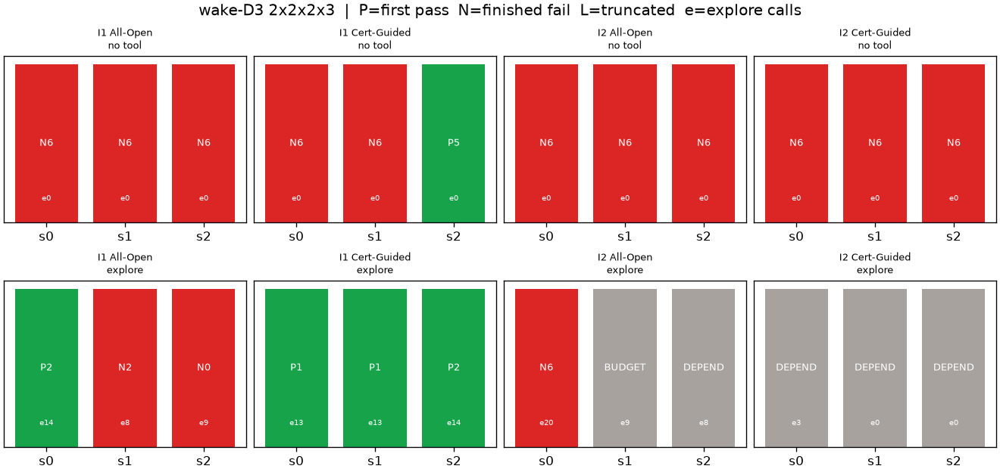

# wake-D3 工具 × 反馈预实验

本目录是新一轮独立结果，不覆盖 `../boundary/`。脚本仍是上一级一个 [`agent_limits.py`](../agent_limits.py)；用 `--d3` 写入这里。标定复用已有的 [`../boundary/calibration.json`](../boundary/calibration.json)，没有重标、没有新框架或数据库。

```bash
export DEEPSEEK_API_KEY=...   # 只走环境变量，不写入仓库
PYTHONDONTWRITEBYTECODE=1 python3 -B wakeup/agent_limits.py --d3
```

`--tool` 可只跑带 `explore` 的一半；完整 24 条只需 `--d3`。已有终态不重跑，未结算请求不自动重试。

## 先行核查（不另花模型费用）

对象是上一轮 `../boundary/agents.jsonl` 中 7 条 `finish_reason=length` 的轨迹，以及 wake-D3 的私有可行性。

1. **截断全部顶满 16,384 输出额度，且几乎全是思考 token。** 7 次请求的 `completion_tokens = reasoning_tokens = 16384`，可见输出为 0，来不及发出工具调用。它们不能记成物理或方法失败。上一轮上限 16,384 是混淆因素。
2. **Cert-Guided 首轮提示略长，但不是截断的主因。** 首请求输入 token：I1 上 Cert 中位 2,365，All-Open 2,209，Fixed-P0 1,894，差额主要来自用户消息里的解析必要界。全体响应的平均思考 token：All-Open 4,315，Cert 4,194，并不系统更长。7 条截断里 Cert 3 条、All-Open 4 条。
3. **16 次格式错误不集中在某一组。** All-Open 6、Fixed-P0 6、Cert 4；I2 7、I1 6、I0 3；wake-D3 最多（5 次）。10 次是工具参数 JSON 解析失败，6 次越出声明域。上一轮已不把它们计为物理失败。
4. **wake-D3 装 A 确实可行，但能量脊极窄。** 标定 10,000 次 A 固定样本为 0 命中，`calibration.json` 也没有保存见证。上一轮 All-Open I0/I1 找到的设计，以及本轮独立 20,000 次抽样中的 1 个命中，能量归一化裕量都只有约 `0.00024–0.00028`（约 0.024–0.028 μW）：采能约 52.02 μW，需求 51.998 μW。常见几何（`h=1`、`mass_g=4.65`）只能采到约 42.3 μW，看起来像“结构无解”；真正的可行点在 `h≈1.06`、端部质量接近 5.8 g 的窄带。去掉 A 后能量和捕获同时失败。

因此本轮把单次 `max_tokens` 提到 **65,536**（官方思考模式默认值，为上次截断上限的 4 倍）。模型名义最大输出是 384K，但按峰值费率预留会达到约 USD 0.47/请求，三并发就可能在实际花费很低时误触 USD 2 上限，所以没有用满名义最大值。

## 实验设计

只做 **wake-D3**，`2×2×2×3 = 24` 条独立对话。模型仍是 `deepseek-flash`，`thinking=high`。每条最多 6 次合法设计评价。

| 因子 | 水平 |
|---|---|
| 反馈 | I1 灰盒：连续裕量 + 能量/应力分项，无源码。I2 黑盒：只返回 PASS/FAIL 与最差约束名。提示构造与上一轮 `feedback()` / `public_spec()` 完全相同。 |
| 工具 | 仅 `evaluate`+`finish`，或再加共享的 `explore`。 |
| 方法 | All-Open 与 Cert-Guided，动作空间相同；Cert 额外获得解析必要界。 |
| 种子 | 每格 3 个独立 API 对话（r0/r1/r2），不声称供应商侧确定性种子。 |

**`explore` 的公平约定：** 在当前设计（可加未提交的 `hold` 补丁）上，对 1–2 个允许变量做至多 11 个点的局部扫描。它**不提交**官方设计，也**不消耗** 6 次评价。I1 返回与 `evaluate` 相同的连续裕量和分项；I2 只返回 PASS/FAIL 与最差约束名，不泄漏连续裕量。每条轨迹最多 20 次 `explore`，次数单独记账。这是各组共享的数值接口，不把它当成一种新方法贡献。

## 24 格结果（谐波筛选器）

`P2` 表示第 2 次合法设计评价通过；`N6` 表示 6 次评价后未通过并正常结束；`N0`/`N2` 表示模型在用尽评价前调用 `finish` 自行停止；灰格是达到 USD 2 保守上限后的 `BUDGET_STOP` / `DEPENDENCY_STOP`，**不能记成方法失败**。本轮 **0 次输出截断**。

| 反馈 | 工具 | All-Open s0 / s1 / s2 | Cert-Guided s0 / s1 / s2 | 完整通过 |
|---|---|---|---|---:|
| I1 灰盒 | 无 | N6, N6, N6 | N6, N6, P5 | 1/6 |
| I1 灰盒 | explore | P2（14 次扫描）, N2（8 次后自行停止）, N0（9 次后自行停止） | P1（13）, P1（13）, P2（14） | 4/6 |
| I2 黑盒 | 无 | N6, N6, N6 | N6, N6, N6 | 0/6 |
| I2 黑盒 | explore | N6（20 次扫描仍未过）, 预算中止, 依赖中止 | 三条均在并发中被依赖中止 | 完整收口仅 0/1 |



通过设计的最紧约束都是能量。I1+explore 的 Cert 三次通过中，有两次把归一化能量裕量做到 0.0147 和 0.0193（采能约 53.5–53.9 μW）；其余通过解仍贴在约 0.00028–0.00032 的刀刃上。无工具的唯一通过也是这道刀刃。

无工具失败的轨迹几乎都安装了 A，剩余失败是充电、整流电压、捕获或能量搭配，不是没想到装模块。I1+explore 中 All-Open 的两次自行停止很说明问题：扫描后模型把默认几何附近约 42.3 μW 的采能上界当成全域上界，写成“结构无解”并调用 `finish`，没有走到 `h≈1.06`、`mass_g=5.8` 那条窄脊。证书组在同一工具下三次都找到了这条脊，且前两次只需 1 次正式评价。

I2 无工具 6/6 正常失败。I2+explore 唯一完整跑完的一条用满 20 次扫描、共 168 个点，**0 个点通过**，随后 6 次评价仍失败。其余 5 条因费用上限中止，不能用来下否定结论。

## 完整节点回灌

对三个互不相同的通过设计做了瞬态回灌，并对其中第一个做仅移除 A 的反事实。合计约 2 分钟，低于 5 分钟上限。`simulate` 已去掉原始轨迹，只保留判定和指标。

| 来源 | 操作 | 谐波 | 按时交付 | 应力 / MPa | 位移 / mm | 完整判定 |
|---|---|---|---:|---:|---:|---|
| I1 Cert r0 + explore | 原设计 | PASS | 2/2 | 7.27 | 0.173 | PASS |
| 同上 | 仅移除 A | FAIL | 0/2 | 7.27 | 0.173 | FAIL（17 次轮询式唤醒，未按时交付） |
| I1 Cert r1 + explore | 原设计 | PASS | 2/2 | 9.26 | 0.223 | PASS |
| I1 All-Open r0 + explore | 原设计 | PASS | 2/2 | 7.28 | 0.174 | PASS |

三个通过设计在完整分类与 250 ms 交付下均为 2/2、零误报、零掉电。去掉 A 后交付 0/2，支持这些固定设计里 A 的工程作用，不是某一种方法的独有能力。谐波能量刀刃在完整节点里仍然工作，但不能把约 0.0003 的谐波裕量当成稳健工程余量。

## 用量

- 24 条轨迹都写了终态；169 次请求全部有 usage，UNKNOWN 0。
- 合法设计评价 88 次，`explore` 111 次；格式错误 7 次（5 次 JSON、2 次越域），不消耗评价配额。
- 输出截断 0。本轮观察到的单次最大输出为 27,677 token（思考 27,255），低于 65,536，也高于旧上限 16,384。
- 输入 3,075,491，输出 676,453（其中思考 633,591），合计 3,751,944；缓存命中 2,879,616。
- 按已核官方高峰费率：不计缓存的保守估算 **USD 1.734391**；计缓存 **USD 0.887784**。均不是账单。
- 主体 API 运行 1,801 s（约 30.0 分钟）。接近上限时停止了 5 条尚未完成的 I2+explore 轨迹：保守账面已约 USD 1.73，再预留一次 65,536 输出就可能超过 USD 2。计缓存的实际估算仍明显低于 2 美元，但这是事后数字，运行中按保守账面停机。

## 对照原先的两个预测

1. **若工具弥合差距，边界主要在数值接口。** I1 上有部分支持：无工具 1/6，有工具 4/6，证书组从 1/3 变成 3/3，且首次通过从第 5 步降到第 1–2 步。工具把“沿能量脊搜参数”从六次盲评里解放出来。但它不是充分条件：All-Open 在同一工具下仍有 2/3 把扫描范围看窄了，自行宣判无解。
2. **若工具在 I2 无助、而 I1 能过，边界主要在反馈信息。** 现有完整数据偏向这个判断，但 I2+explore 没有跑完，不能当成已经证实。无连续裕量时，I2 无工具 0/6；唯一跑完的 I2+explore 用满 20 次扫描仍是 0 命中。同一 `explore` 在 I1 能走到 52–54 μW 的窄脊，在 I2 只看见最差约束名，不足以定位。要确认这条解释，需要在不扩大题目、不改评价器的前提下，单独补齐 I2+explore 的 3+3 个种子。

两句话并存比只选一句更准确：**在灰盒连续反馈下，共享数值工具能明显提高找到窄脊的机会；没有连续反馈时，现有证据显示同一工具帮不上忙，但样本被费用上限截断。** 证书在本轮像是帮模型把搜索对准“必须过能量、并调整梁参数”，不是单独的新算法。三次种子谈不上显著性。

上一轮单次 I1 All-Open 第 6 步通过，本轮同条件 3 个种子全部失败。那一格本来就不宜写成稳定能力。

## 局限

- 只有 wake-D3 一个工作点、一种模型、三个种子。
- I2+explore 五条中止，不能解释成黑盒加工具一定失败。
- 不少通过解的谐波能量裕量只有万分之三量级；完整节点碰巧通过，不代表可制造裕量。
- `explore` 的扫描网格很粗，不保证覆盖那条脊；模型如果只扫默认几何，会得到假的“结构无解”。
- 谐波筛选器仍不是完整分类定理；回灌只覆盖了三个通过设计。
- 费用按公开高峰费率估算，不是账单；运行中的停机阈值按不计缓存的保守账面执行。

原始紧凑日志在 `agents.jsonl`（不含思考正文），摘要在 `summary.json`，协议在 `protocol.json`，回灌在 `transient.json`。
